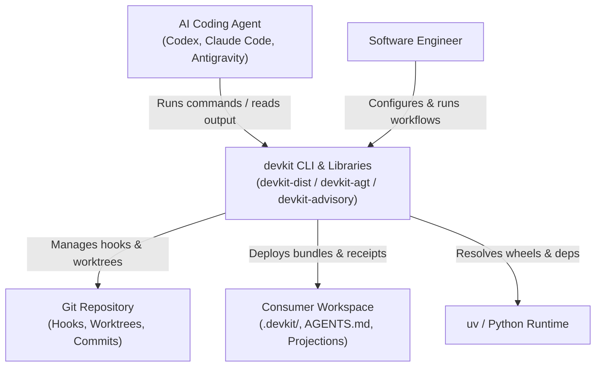

# [ARCH-03-context] System Scope and Context

- **arc42**: §3 System Scope and Context
- System mission: `ARCH-01-introduction-and-goals`. Containers: `ARCH-05-1-containers`.

---

## 1. Business & Technical Context

### 1.1 External Actors and Interfaces

| Actor / System | Interface Type | Interaction Summary |
| :--- | :--- | :--- |
| **AI Coding Agents** | CLI (stdout/stderr), Tool Calls | Run verification (`rules check`), execution (`run`), workflows (`workflow`), and read projected skills. |
| **Software Engineers** | CLI, Git commits, PRs | Configure project policy in `.devkit/config.toml`, make gate decisions, approve integrations. |
| **Git Engine** | Local binary (`git`) | Worktree allocation, hook execution (`pre-commit`), snapshot tree inspections (`--staged`, `--ci`). |
| **Package Manager (`uv`)** | Shell execution, wheel build | Installs package wheels, manages Python virtualenvs, resolves workspace dependencies. |

---

## 2. System Boundaries

- **In-Scope**:
  - Asset distribution (`.devkit/managed/`, `.devkit/installation.json`, native skill/subagent projections).
  - Rule evaluation and deterministic code repair.
  - Multi-stage delivery workflows and envelopes.
  - Commit gate wrappers and policy checks.
  - Agent Advisory Protocol definitions and formatting.
  - Compact execution runner and log capturing.
  - Task worktree isolation and lifecycle.

- **Out-of-Scope**:
  - Remote CI/CD hosting (GitHub Actions runs devkit CLI locally).
  - Code generation or LLM API calls directly inside core devkit commands.
  - Windows-specific shell wrappers (devkit strictly targets POSIX: macOS and Linux).
