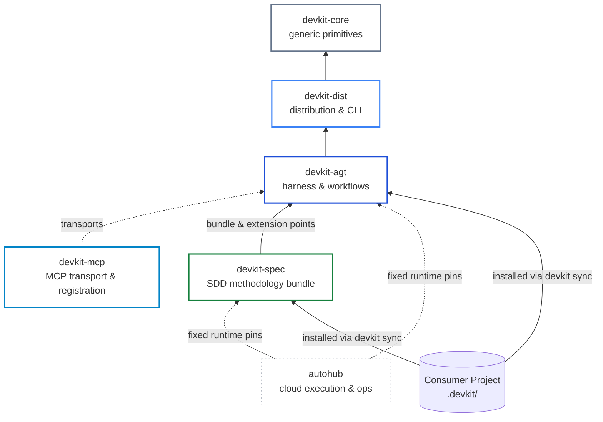

# [ARCH-04-1-ecosystem-boundaries] Ecosystem Boundaries & Responsibilities

- **arc42**: §4 Solution Strategy (Sub-topic 1: Boundaries & Responsibilities)
- Master Strategy: `ARCH-04-delivery-strategy`. Containers: `ARCH-05-1-containers`.
- Living Spec: `CAP-DLV-delivery-workflows`, `CAP-HARN-agent-guidance`.

---

## 1. Package Dependency Architecture

The delivery ecosystem maintains strict unidirectional dependencies across foundation, harness, methodology, and cloud execution layers:

1. **Unidirectional flow**: Lower packages never import higher orchestrators. `devkit-core` has zero harness dependencies; `devkit-dist` exposes the `devkit` executable without importing `devkit-agt`; `devkit-agt` mounts the developer harness; `devkit-mcp` exposes services over MCP; `devkit-spec` packages SDD assets and hooks.
2. **Runtime pinning**: Cloud platforms (`autohub`) consume fixed distribution wheel pins, verifying contract receipts rather than running ad-hoc repository checkouts.

---

## 2. Package Responsibilities

| Package | Core Responsibilities | Explicit Non-Goals |
| :--- | :--- | :--- |
| **`devkit-core`** | Filesystem/Git primitives, plugin dispatch, shared errors. | Application CLI commands, workflow logic, MCP transports. |
| **`devkit-dist`** | Distribution engine (`devkit sync`), projection management, bundle packaging, `devkit` CLI executable. | SDD concepts, delivery stages, commit gate evaluation. |
| **`devkit-agt`** | Workflow engine (`devkit workflow`), worktree lifecycle, commit gates, rules engine, integration services (`CAP-INT-mcp-services`). | Methodology semantics (spec vs proposal, task classification, roadmap authoring). |
| **`devkit-mcp`** | Optional MCP transport, retained-runtime registration provider, host tool endpoint exposition. | Domain business logic, repository state mutations, direct CLI handlers. |
| **`devkit-spec`** | SDD workflows (`sdd-*`), planning and development skills, subagent roles, proposal incubation, roadmap & backlog procedures, extension hooks (`attach_check`, `hygiene`). | Agent host execution, slot management, remote runner dispatch. |
| **`autohub`** | Cloud PR runner dispatch, conversational UI for questions and approvals, quota and admission control, PR merging. | File modifications requiring subjective judgement, workflow stage re-derivation. |

---

## 3. Shared Data Contracts

| Contract | Owner | devkit-spec Role | autohub Role |
| :--- | :--- | :--- | :--- |
| **Envelopes** (core: `worker`, `answer`, `resolution`, `review`, `reverify`; domain: `reconcile-check`, `challenger`, `scout`, `feedback`, `red`, `green`) | `devkit-agt` (engine & core kinds); `devkit-spec` (domain kinds) | Defines review criteria, role contracts, and evidence schemas. | Parses PR head envelopes to render question and approval cards. |
| **Human Interaction Requests** (`gate:*`, `choose`) | `devkit-agt` | Declares gate locations and question formats. | Renders interactive decision cards on PR dashboards. |
| **Branch Naming** (`plan-<slug>`, `dev-<slug>`) | `devkit-agt` | Enforces naming per activity; checks local/remote duplicates. | Reuses naming for runner checkouts and PRs; rejects duplicates. |
| **Problem & Resolution** | `devkit-agt` | Records structured problems; halts execution on unresolvable blockers. | Blocks merging when unresolvable problem envelopes exist. |
| **Extension Hooks** (`attach_check`, `hygiene`, `post_finish`) | `devkit-agt` (contracts); `devkit-spec` (providers) | Validates Unit-to-branch binding; flags stale rejected proposals. | Not invoked in cloud runner directly. |

---

## 4. Actors and Execution Roles

| Actor | Description | Allowed Actions | Restricted Actions |
| :--- | :--- | :--- | :--- |
| **Human** | Developer, project owner | Confirms intent, answers questions, approves gates. | Internal stage mechanics. |
| **Host** | Main agent in local session | Drives Backlog, inline Planning, worktree prep, worker delegation, local integration. | Inferring approvals, forging worker envelopes. |
| **Planning Worker** | One-shot proposal planner | Drafts proposals, PADRs, records worker questions and answer envelopes. | Modifying files outside the proposal Unit, pushing/merging. |
| **Development Worker**| One-shot unit developer | Authors specs, implements code, updates Living Spec and reconcile, runs review subagents. | Broadening scope outside the Unit, weakening tests. |
| **Subagent Roles** | `scout`, `challenger`, `code-reviewer`, `reconcile-reviewer`, `triage`, `decomposer` | Read-only inspection, criticism, code and document verification, Backlog feedback grouping and draft split proposals; returns structured messages. | Writing envelope files to disk, modifying production code. |
| **Cloud Agent** | Remote runner agent | Mirrors worker execution inside cloud PR runs. | Handling local conversation prompts. |

### Role-to-Execution Actor Mapping

| Role | `direct` Mode | `local-orchestrated` Mode | `cloud-pr` Mode |
| :--- | :--- | :--- | :--- |
| **Backlog & Inline Planning** | Host | Host | — |
| **Proposal Planning** | Host | Planning Worker | Cloud Agent |
| **Development** | Host | Development Worker | Cloud Agent |
| **Delegated Roles** (`code-reviewer`, etc.) | Host (as subagent) | Worker (as nested subagent) | Cloud Agent (as nested subagent) |
| **Verification & Integration** | Host | Host | autohub + Human / Local Host via the `devkit integration` CLI |

---

## 5. Responsibility Matrix

| Area | `devkit-agt` | `devkit-spec` | `autohub` |
| :--- | :--- | :--- | :--- |
| **Flow Evaluation** | Stage exit checks and gate transitions | Methodology definitions, stage ordering, effort presets | Cloud run lifecycle tracking |
| **Workspace Isolation** | Worktree creation, cleanup, stale branch checks | Unit binding, scope registration, attach verification | Ephemeral cloud runner checkouts |
| **Delegation** | Envelope contracts and request parsing | Subagent role system prompts and handoff inputs | Remote agent dispatch and admission |
| **Decision Handling** | Question and answer serialization | Question consolidation and rewrite procedures | Web UI cards and approval webhooks |
| **Integration** | Fast-forward merge, base push, MCP integration | Readiness provider, Living Spec sync, cleanup hooks | CI observation and PR merge |

---

## 6. Terminology Disambiguation

| Term | Exact Delivery Meaning | Distinguish From |
| :--- | :--- | :--- |
| **Workflow handoff** | Rebinding an existing Unit to the next workflow in `devkit workflow`. | Proposal handoff, worker handoff. |
| **Proposal handoff** | Replacing a proposal bundle with a spec bundle and promoting PADRs to ADRs. | Cloud runner dispatch. |
| **Worker handoff** | Providing initial task payload and context to a delegated worker instance. | CLI handoff commands. |
| **Stage isolation** | Instruction to run a specific role in a fresh conversation context. | Git worktree directory isolation. |
| **Envelope** | Structured YAML file capturing findings, questions, or verification results. | Agent memory or session transcript. |

