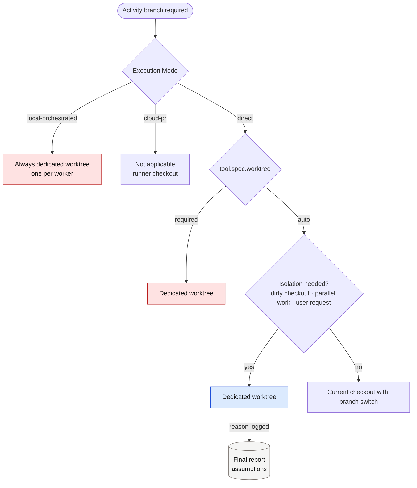
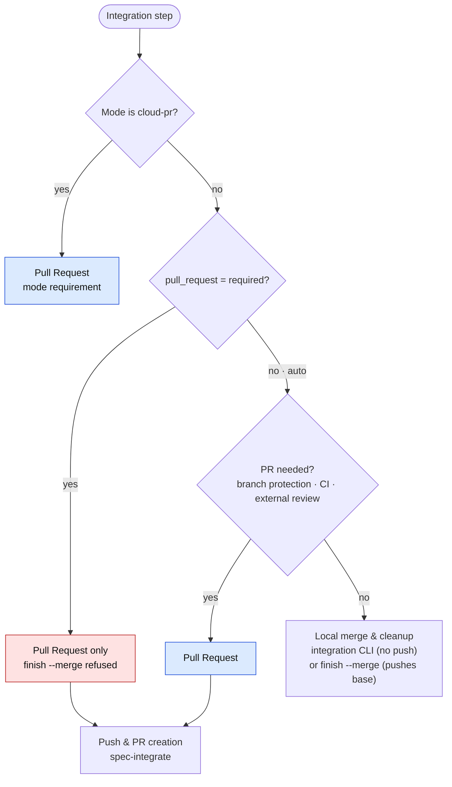

# [ARCH-04-2-delivery-policy] Delivery Policy

- **arc42**: §4 Solution Strategy (Sub-topic 2: Policy & Governance Invariants)
- Master Strategy: `ARCH-04-delivery-strategy`. Boundaries: `ARCH-04-1-ecosystem-boundaries`.
- Living Spec: `CAP-DLV-project-policy`, `CAP-WT-task-worktrees`, `CAP-INT-mcp-services`.

---

## 1. Policy Principles

1. **Minimize unnecessary interruptions**: Agents resolve ambiguities using recommended options within agreed scope. Non-blocking improvements become feedback records; execution halts only when agreed constraints cannot be met (`problem` envelope).
2. **Configuration models governance only**: Operational modes (`direct`, `local-orchestrated`, `cloud-pr`) are transient session choices and never stored in `.devkit/config.toml`.
3. **Modes and effort levels do not lower policy**: High effort does not add human approvals to delegated workflows; low effort does not waive exit checks or reconcile verification.
4. **`session` depth creates no durable artifacts**: Verification relies on test execution and conversational reporting; no envelope or reconcile files are generated regardless of effort.
5. **Isolation policy values are `auto` or `required`**: Switches governing worktrees and pull requests (`[tool.spec] worktree` and `[worktree] pull_request`) use `auto` or `required` levels; booleans are rejected (`SPEC_CONFIG_INVALID`, `WORKTREE_CONFIG_INVALID`). Approval gates use `ask` or `auto` (`[workflow.approvals]`), stage toggles use `on` or `off` (`[workflow.stages]`), and boolean flags are explicit (e.g. `[worktree] delete_branch = true`).

---

## 2. Configuration Keys

Policies are configured under `.devkit/config.toml` (`CAP-DLV-project-policy`):

| Key | Owning Package | Allowed Values (Default) | Governed Behavior |
| :--- | :--- | :--- | :--- |
| `[workflow.approvals] plan-intent` | `devkit-spec` | `ask`, `auto` (`ask`) | Human confirmation vs explicit task prompt satisfying intent. |
| `[workflow.approvals] plan-accept` | `devkit-spec` | `ask`, `auto` (`ask`) | Human acceptance vs policy-delegated direction acceptance. |
| `[workflow.approvals] proposal-handoff` | `devkit-spec` | `ask`, `auto` (`ask`) | Human confirmation vs automated Development kickoff. |
| `[workflow.approvals] dev-integration` | `devkit-agt` | `ask`, `auto` (`ask`) | Human confirmation vs automated integration delegation. |
| `[workflow.stages]` | `devkit-agt` | stage: `"on"`, `"off"` | Disabling optional stages (e.g. `collect-feedback = "off"`). |
| `[worktree] pull_request` | `devkit-agt` | `auto`, `required` (`auto`) | Forcing integration exclusively through remote pull requests. |
| `[worktree] stale_after` | `devkit-agt` | `<N>d`, `<N>w` (`14d`) | Inactivity threshold for flagging abandoned activity branches. |
| `[tool.spec] worktree` | `devkit-spec` | `auto`, `required` (`auto`) | Forcing separate worktrees in `direct` mode. |
| `[tool.spec] depth_escalation` | `devkit-spec` | `auto`, `ask` (`auto`) | Autonomous vs human-prompted `planning-depth` escalation. |
| `[tool.spec.feedback]` | `devkit-spec` | Table (`capture`, `coverage`, etc.) | Autonomous feedback capture scope and reminder behavior. |

---

## 3. Branch and Worktree Allocation

Branches are structural workflow requirements; whether a branch executes in a dedicated worktree directory depends on mode and configuration:

- **Branch naming**: Always `plan-<slug>` for proposal incubation and `dev-<slug>` for development. Reusing existing branches without explicit `--existing-branch` is rejected.
- **Dedicated worktrees**: Managed exclusively via `devkit worktree start <branch>` to ensure synchronized hook environments and unified tracking.

---

## 4. Pull Request Integration

The choice between local merge and remote pull request depends on deployment policy and environmental constraints:

- When `pull_request = "required"`, local integration commands (`finish --merge`, `devkit integration integrate --route local`) fail closed with `WORKTREE_PR_POLICY`.
- The `devkit integration integrate` CLI rebuilds readiness and policy from the retained base after Host conversational approval; automatic authority comes only from that base's policy. Its `local` route excludes fetch and push and triggers scoped cleanup (`CAP-INT-mcp-services`). The separate `devkit worktree finish --merge` command pushes base upstream.

---

## 5. Approval Delegation Matrix

| Gate | `ask` Policy | `auto` Policy | Hard Invariants |
| :--- | :--- | :--- | :--- |
| `plan-intent` | Explicit instruction or confirmation | Explicit task prompt satisfies intent | Task cannot start without instruction. |
| `plan-accept` | Explicit human acceptance | Direction accepted via policy delegation | Merge is an acceptance effect, not Development approval. |
| `proposal-handoff`| Human confirms starting Development | Autonomous handoff and Unit creation | Requires accepted proposal anchor. |
| `dev-integration`| Explicit user confirmation prompt | Autonomous integration upon passing checks | Review, verification, and reconcile must pass. |

The four decision gates correspond to `[workflow.approvals]` configuration. Unrecoverable failures enter the `exception` workflow stage (`exception: true`), which always requires explicit human recovery and cannot be delegated or configured in approvals.

Policy delegation is reported as `policy`, never as fabricated human consent. Revocation of auto authority immediately halts pending effects.

---

## 6. Stale Activity Branches

Abandoned task branches are detected during project hygiene sweeps (`devkit rules check -p hygiene`):
- **Eligibility**: Activity branches matching `plan-*` or `dev-*`.
- **Precondition**: `gh auth status` succeeds (skipped gracefully if unauthenticated).
- **Evaluation**: Emits a warning when the latest commit and the linked PR activity are both older than `[worktree] stale_after`.
- **Remediation**: Output presents actionable resume or discard commands (`devkit worktree finish <branch> --discard`). Automated deletion is never performed.

---

## 7. Audit and Evidence Locations

| Question | Authoritative Record Location |
| :--- | :--- |
| **Is work active?** | Presence of active `plan-<slug>` or `dev-<slug>` Git branches. |
| **Who executed the turn?** | The worker envelope (`envelopes/worker-NN.yaml`) authored by the acting agent. |
| **Is work blocked?** | Unresolved `problem` field in any worker envelope of the unit without a matching `resolution`. |
| **Why was worktree or PR used under `auto`?** | Assumptions section of the final change report. |
| **What `activity-effort` was applied?** | Recorded in the worker envelope `activity_effort` field (authoritative runtime evidence). |
