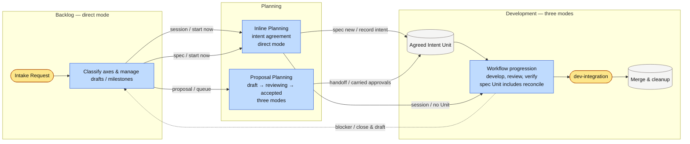
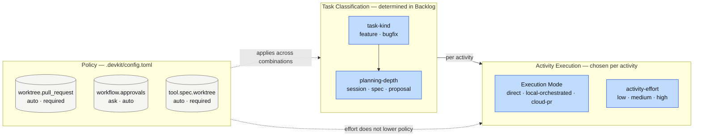
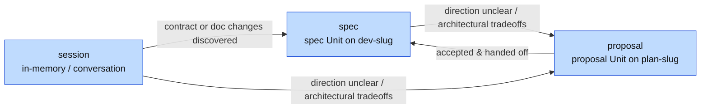
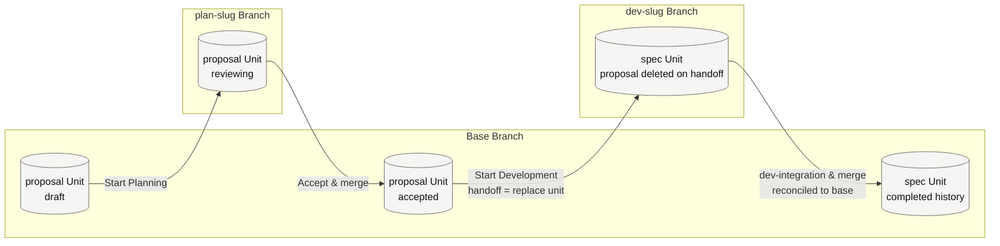

# [ARCH-04-delivery-strategy] Delivery Strategy

- **arc42**: §4 Solution Strategy
- Boundaries: `ARCH-04-1-ecosystem-boundaries`. Policy: `ARCH-04-2-delivery-policy`.
- Living Spec: `CAP-DLV-delivery-workflows`, `CAP-DLV-project-policy`. Stories: `US-route-development-intent`, `US-drive-development-to-integration`.

---

## 1. Delivery Lifecycle

Every software change in `devkit` traverses three high-level activities: **Backlog → Planning → Development**.

| Activity | Input | Output | Applicable Modes | Key Decisions |
| :--- | :--- | :--- | :--- | :--- |
| **Backlog** | User requests, open feedback | Tentative classification, draft proposals, milestone anchors | `direct` | Classification confirmation, draft intake |
| **Planning** | Classified request | Agreed intent in conversation (`session`), spec Unit (`spec`), or accepted proposal (`proposal`) | Inline: `direct` Proposal: `direct`, `local-orchestrated`, `cloud-pr` | `plan-intent`, `plan-accept` (proposal) |
| **Development** | Agreed intent (Unit or session agreement) | Verified changes, reports, Living Spec & reconcile updates | `direct`, `local-orchestrated`, `cloud-pr` | `proposal-handoff`, `dev-integration` |

Development always starts from agreed intent. Unit-bearing paths evaluate stage exit conditions with `devkit workflow next`, while `session` tasks complete within conversation context without durable envelopes or reconcile files.

---

## 2. Classification Axes

Tasks are classified across three orthogonal axes:

### 2.1 `task-kind`
- `feature` (default): New behavior or intentional modifications to existing capabilities.
- `bugfix`: Defect violating an agreed contract. Requires characterization (current, expected, preserved behavior) and reproduction evidence (Red → Green).

### 2.2 `planning-depth`
- `session`: No contract or Living Spec changes required; fully verifiable within one session without durable artifacts.
- `spec`: Contract changes with an already clear direction; bound to a spec Unit via inline Planning.
- `proposal`: Uncertain direction requiring multi-option exploration, spikes, or architectural PADRs.

| Depth × Kind | `feature` | `bugfix` |
| :--- | :--- | :--- |
| **`session`** | `sdd-session-feature` | `sdd-session-bugfix` |
| **`spec`** | `sdd-spec-feature` | `sdd-spec-bugfix` |
| **`proposal`** | `sdd-proposal` → `sdd-spec-feature` | `sdd-proposal` → `sdd-spec-bugfix` |

Depth may escalate during Development (`session → spec`) when contract or documentation changes are discovered. Lowering depth is prohibited, with the sole exception of session reclassification of unreviewed draft proposals at pickup (`ADR-session-reclassification-of-a-queued-draft`).

### 2.3 `activity-effort`
Determines the thoroughness of inspection and review per activity (`low`, `medium`, `high`, default `medium`):
- `low`: Self-review and self-verification by the working actor.
- `medium`: Mandatory initial `code-reviewer` subagent execution. Conditional self-verification for `reconcile-reviewer` only when contracts and diff coverage are provably unambiguous.
- `high`: Bounded re-review loop (`ADR-bounded-high-effort-review-loop`) reviewing whole batches, stopping when rounds find no issues or only minor fixes. Mandatory independent `reconcile-reviewer`.

---

## 3. Unit Model and Boundaries

A **Unit** is an isolated directory containing an anchor file bound to a delivery workflow:
- **Proposal Unit**: `docs/proposals/PROP-<slug>/` anchored by `proposal.md` bound to `sdd-proposal`.
- **Spec Unit**: `specs/<YYYY-MM>/<YYYYMMDD>-<slug>/` anchored by `spec.md` bound to `sdd-spec-<task-kind>`.

A slug identifies the line of work across activities, while each activity runs in its respective Unit and branch. Units never nest, and `session` tasks operate without a Unit.

---

## 4. Decision Boundaries and Gates

The four decision gates represent explicit authorization boundaries in `[workflow.approvals]`:

| Gate | Scope | Authority & Delegation |
| :--- | :--- | :--- |
| `plan-intent` | Authorizes initial scope, goal, and classification | Explicit instruction satisfies `plan-intent` without duplicate prompting; supports `ask` or `auto`. |
| `plan-accept` | Accepts proposal direction and merges Planning branch | Defaults to `ask`; supports policy delegation (`auto`). Supports direct acceptance in Backlog. |
| `proposal-handoff`| Authorizes starting Development and Unit transition | Defaults to `ask`; supports policy delegation (`auto`). Schedulable independently of `plan-accept`. |
| `dev-integration` | Authorizes merging verified Development changes | Evaluated by `approvals.dev-integration` (`ask` or `auto`). Requires passing verification and reconcile. |

Unrecoverable failures (retry caps, tool crashes, semantic conflicts) transition to the `exception` workflow stage (`exception: true`). Unlike decision gates, `exception` is a workflow stage requiring explicit human handling and cannot be delegated or configured in `[workflow.approvals]`.

---

## 5. Core Architectural Principles

1. **State lives in branches**: Workers are one-shot entities; incoming workers resume execution purely from committed branch state, Unit files, and envelopes.
2. **The working actor records its own evidence**: Subagents are read-only; the invoking actor records envelope findings and decision records.
3. **Autonomous progression within agreed boundaries**: Actors proceed on recommended choices within agreed intent; non-blocking improvements become feedback, while agreement breaches halt as structured problems.
4. **Nested execution**: Host delegates to workers, and workers nest delegated review subagents (depth 2). Environments incapable of nesting use `direct` mode.

