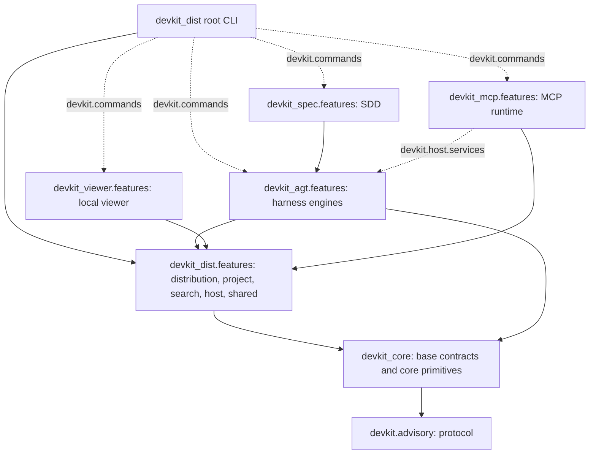

# [ARCH-05-2-components] Building Block View: Components

- **arc42**: §5 Building Block View - Level 2 (Components)
- Containers: `ARCH-05-1-containers`. Runtime: `ARCH-06-runtime-view`.

---

## 1. Subsystem Decomposition & Layering

Each application wheel owns a regular Python package (`ARCH-05-1-containers`): `devkit_dist`
holds distribution behavior and the root command line; `devkit_agt` holds the harness engines;
`devkit_spec`, `devkit_mcp` and `devkit_viewer` own their extensions. The public advisory API remains
`devkit.advisory`. `ADR-independent-package-namespaces-and-feature-layout` records the ownership and layout decision.



### 1.1 Package Layout

Application behavior lives under `features/<feature>/`. A feature adds only the layers it needs:

```text
<package>/
├── base/                     # optional contracts shared by features
├── utils/                    # optional technical helpers
├── bundles/<name>/bundle/    # application-owned content, when present
└── features/<feature>/
    ├── cli/                  # command adapters
    ├── mcp/                  # SDK-free tool adapters
    ├── usecases/             # operations exposed by adapters
    ├── services/             # domain policy and reusable operations
    ├── repositories/         # filesystem, Git and other external IO
    └── models/               # feature-owned values and contracts
```

A small layer may be a single module instead of a directory. Do not create empty layers,
package-level `core/`, or a layer solely to forward a call. `base/` and
`utils/` are optional. The foundation package is the explicit exception: `devkit_core.base` holds
shared errors and SDK-free MCP contracts, and `devkit_core.core` holds generic implementations.
A package may explicitly declare shared transport adapters: dist owns `adapters/cli.py` for
its common CLI boundary. These adapters remain above application layers. Application-owned bundles live under
`bundles/<name>/bundle/`, including a package with only one bundle. Content-only packages
may retain their existing bundle-only layouts. `tools/devkit-dev` owns the repository's
structure and layering rules in a development bundle; its initial layout is bundle-only.

Package initializers own package management: explicit exports, import control, lazy loading and
dynamic discovery are allowed in `__init__.py`. Business operations, domain validation and command
handlers belong in named modules. A CLI directory can split related command groups into separate
modules and assemble its Click group in `app.py`; there is no one-command-per-file requirement.

Use cases may be typed functions or classes when they own state. A feature introduces repository
`Protocol` contracts when implementations need substitution, and a shared base class only when it
provides actual common behavior. There is no required `BaseUseCase`, `BaseRepository`, Command
registry or Unit of Work. CLI commands are transport adapters, not an additional mandatory domain
Command layer.

### 1.2 Layering Rules

- CLI and MCP adapters invoke use cases. They own transport parsing and output shaping.
- Use cases coordinate feature operations through services, repositories and models.
- Services and repositories may use models, base contracts and technical helpers; they never import
  use cases or transport adapters. Models do not import services, repositories or higher layers.
- Package `base` contracts do not import feature implementations or `utils`; technical helpers do not
  import features. `devkit_core.base` never imports `devkit_core.core` or an application package.
- Feature dependencies follow the package's declared acyclic graph. Shared project configuration,
  receipts and execution binding behavior belong to the distribution's project feature. Its models
  hold receipt, template and presentation contracts; repositories read configuration, receipts and live
  invocation state; services resolve configured presentation; use cases coordinate CLI/MCP invocation. Cross-package imports target the owner's independent namespace.
- `devkit_dist` never imports `devkit_agt`, `devkit_mcp` or the MCP SDK, including dynamic module paths
  and entry-point targets. Its tests run with `devkit-agt` absent (`just test-dist`).
- Entry-point groups preserve dependency inversion: `devkit.commands`, `devkit.post_sync`,
  `devkit.config_tables`, `devkit.host.services`, `devkit.mcp.registrations`, `devkit.hygiene` and
  `devkit.finish_guard` retain their public names. Their targets use the owning package namespace.
- Domain MCP adapters consume `devkit_core.base.mcp` contracts. The optional MCP runtime adapts them
  to the SDK; dist discovers only the narrow registration launch provider.
- Bundle rule code is content loaded by the rule engine. It uses public foundation and rule APIs;
  bundle modules do not become a shortcut around application layer boundaries.

Repository structure rules check folder conventions and layer direction. Package tests additionally
check feature dependencies and package ownership; independent-wheel tests cover import isolation.

### 1.3 Test Layout

Each package uses only the test tiers it needs, with source ownership mirrored below the tier:

```text
tests/
├── unit/
│   ├── base/
│   └── features/<feature>/
├── integration/
│   ├── features/<feature>/
│   └── bundles/
├── e2e/
├── support/
└── conftest.py
```

Unit tests isolate a behavior or contract; CLI parsing and output with a substituted use case can
be unit tests. Integration tests connect real components or exercise filesystem, Git, provider
discovery and other external boundaries. E2e tests exercise the installed product through public
CLI/MCP entry points. These distinctions depend on the exercised boundary, not whether the
package is an application or a library. Foundation tests mirror `base/` and `core/` instead of
features. Content-package tests use the same tiers around bundle loading and validation.

Rule tests remain in `<rule>/tests/` so they deploy and run with the rule. Shared helpers belong
in `tests/support/`; keep fixtures at the narrowest useful `conftest.py` scope. Repository-owned
consumer smoke scripts build and install wheels in fresh environments and cover cross-package
e2e combinations; individual packages need no duplicate installation suites.

---

## 2. Core Modules Summary

| Module | Core Purpose | Exported Commands / APIs |
| :--- | :--- | :--- |
| **`devkit_core.base` / `devkit_core.core`** | Shared contracts and generic filesystem, Git, parsing and plugin primitives. | Internal library |
| **`devkit_dist.features.project`** | Project configuration, receipts and execution binding behavior. | Internal library |
| **`devkit.advisory`** | Standard library advisory protocol and error base classes. | `AdvisoryError`, `ExitCode` |
| **`devkit_dist.features.distribution`** (dist) | Bundle manifest validation, transaction engine, skill/subagent projection, the configuration schema and the receipt writer. | `sync`, `add`, `remove`, `list`, `status` |
| **`devkit_agt.features.rules`** (agt) | Deterministic static invariant checking, autofix, and convergence recheck. | `rules check`, `rules fix`, `rules phases` |
| **`devkit_agt.features.workflow`** (agt) | Multi-stage delivery procedures, stage evaluation, decision envelopes. | `workflow next`, `workflow envelope` |
| **`devkit_agt.features.worktree`** (agt) | Activity branch management and task worktree lifecycle. | `worktree start`, `worktree finish` |
| **`devkit_agt.features.gate`** (agt) | Git hook wrappers enforcing commit policies. | `gate install`, `gate run` |
| **`devkit_agt.features.compact`** (agt) | Bounded command execution with persistent log capture. | `devkit run` |
| **`devkit_dist.features.search`** (dist) | Lexical (BM25), dense (embeddings), and hybrid document retrieval. | Library API |
| **`devkit_dist.features.host`** (dist) | Host environment discovery, lifecycle event hook dispatch, exact project MCP registrations. | `host status` |
| **`devkit_agt.features.integration`** (agt) | Approval-bound integration and the MCP service tools it registers with the host. | `integration` |
| **`devkit_agt.features.generated`** (agt) | Tracking and deterministic regeneration of machine-generated files. | `generated check`, `generated regen` |

The optional `devkit_mcp` component mounts `mcp`, loads `devkit.host.services` and adapts native forms.
`devkit_core.base.mcp` owns SDK-free service contracts and explicit execution classification; the core execution binding
keeps owning configuration workspace, retained executor and same-clone identity distinct. Domain mutation guards
consume the process-local binding without importing the transport. Dist discovers only the narrow
`devkit.mcp.registrations` launch provider; removing that package leaves dist able to retire exact owned entries.
