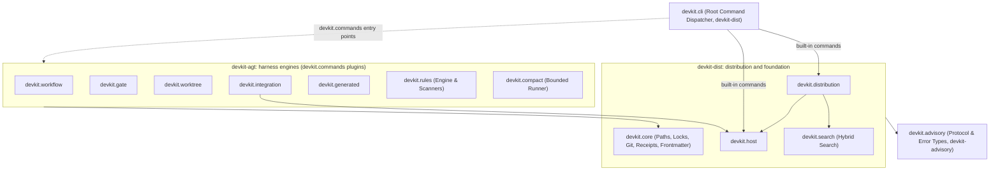

# [ARCH-05-2-components] Building Block View: Components

- **arc42**: §5 Building Block View - Level 2 (Components)
- Containers: `ARCH-05-1-containers`. Runtime: `ARCH-06-runtime-view`.

---

## 1. Subsystem Decomposition & Layering

The `devkit` modules ship in two wheels that share the `devkit` namespace (`ARCH-05-1-containers`,
`ADR-dist-module-split`): `devkit-dist` (`packages/devkit-dist`) holds the foundation, distribution, host hooks,
search and the root command line; `devkit-agt` (`packages/devkit`) holds the harness engines. Each wheel enforces its
own layering with a unit test (`packages/devkit-dist/tests/test_layering.py`, `packages/devkit/tests/test_layering.py`):

### 1.1 Layering Rules

1. `advisory` imports no other module.
2. `core` imports only `advisory`.
3. `search` and `host` import only `core` and `advisory`.
4. `distribution` imports `core`, `advisory`, `search`, and `host`.
5. No `devkit-dist` module (`devkit.cli` and `devkit.__main__` included) references a `devkit-agt` area: not by
   import, importing call, dotted module string or `module:attribute` string, and no `devkit-dist` entry point
   targets one. Rule code under a data area's `bundle/` (the `advisory` bundle's rule) is bundle content run by the
   rule engine and may use its public API.
6. `rules` imports `core`, `advisory`, and `compact` (`devkit rules test` runs rule tests through `compact`).
7. `workflow` imports `core`, `advisory`, and `rules`.
8. `gate` imports `core`, `advisory`, `rules`, and `compact`.
9. `compact` and `worktree` import only `core` and `advisory`.
10. `integration` imports `core`, `advisory`, `host`, and `worktree`.
11. The data-only bundle areas (`advisory_guide`, `commits_guide` in `devkit-dist`; `authoring_guide`,
    `harness_guide` in `devkit-agt`) import nothing from their package modules.
12. `devkit.cli` maps its built-in commands to `devkit-dist` module references and lazy-loads them only when the
    command executes; `devkit-agt` commands come from `devkit.commands` entry points (`ARCH-05-3-command-plugins`).
13. An area that loads an entry point group may load a target of a higher area only through a declared dependency
    inversion: `devkit.post_sync` (gate), `devkit.config_tables` (workflow, worktree), `devkit.host.services`
    (integration), `devkit.hygiene` (worktree) and `devkit.finish_guard` (workflow).

---

## 2. Core Modules Summary

| Module | Core Purpose | Exported Commands / APIs |
| :--- | :--- | :--- |
| **`devkit.core`** (dist) | Shared SDD-agnostic primitives (atomic writes, git runner, receipts, locks, frontmatter). | Internal library |
| **`devkit.advisory`** | Standard library advisory protocol and error base classes. | `AdvisoryError`, `ExitCode` |
| **`devkit.distribution`** (dist) | Bundle manifest validation, transaction engine, skill/subagent projection, the configuration schema and the receipt writer. | `sync`, `add`, `remove`, `list`, `status` |
| **`devkit.rules`** (agt) | Deterministic static invariant checking, autofix, and convergence recheck. | `rules check`, `rules fix`, `rules phases` |
| **`devkit.workflow`** (agt) | Multi-stage delivery procedures, stage evaluation, decision envelopes. | `workflow next`, `workflow envelope` |
| **`devkit.worktree`** (agt) | Activity branch management and task worktree lifecycle. | `worktree start`, `worktree finish` |
| **`devkit.gate`** (agt) | Git hook wrappers enforcing commit policies. | `gate install`, `gate run` |
| **`devkit.compact`** (agt) | Bounded command execution with persistent log capture. | `devkit run` |
| **`devkit.search`** (dist) | Lexical (BM25), dense (embeddings), and hybrid document retrieval. | Library API |
| **`devkit.host`** (dist) | Host environment discovery, lifecycle event hook dispatch, the MCP server. | `host status`, `host mcp` |
| **`devkit.integration`** (agt) | Approval-bound integration and the MCP service tools it registers with the host. | `integration` |
| **`devkit.generated`** (agt) | Tracking and deterministic regeneration of machine-generated files. | `generated check`, `generated regen` |
