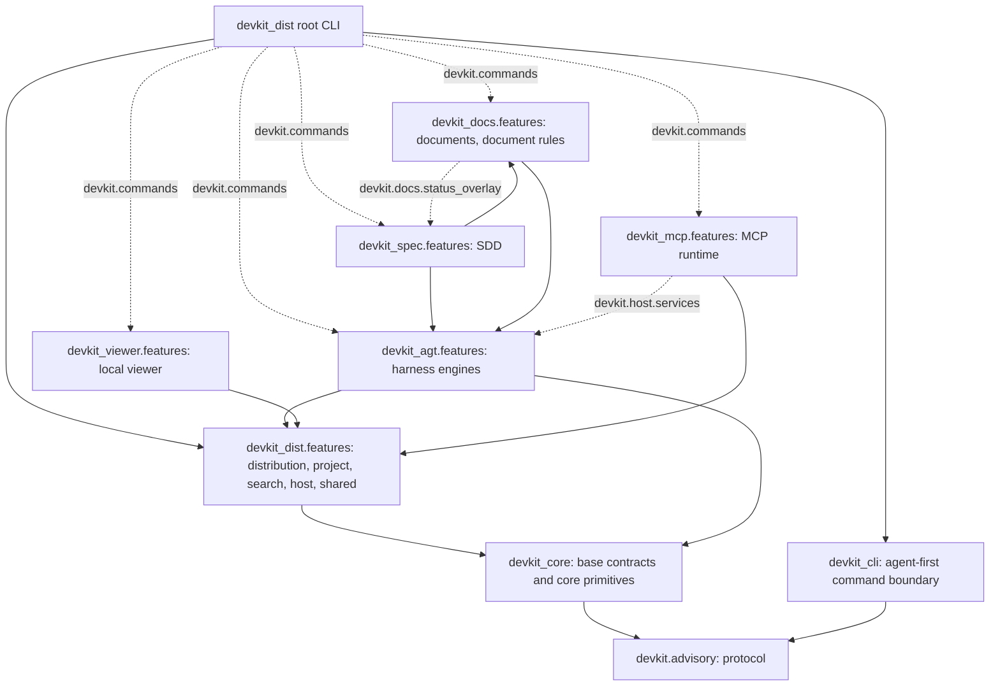

# [ARCH-05-2-components] Building Block View: Components

- **arc42**: §5 Building Block View - Level 2 (Components)
- Containers: `ARCH-05-1-containers`. Runtime: `ARCH-06-runtime-view`.

---

## 1. Subsystem Decomposition & Layering

Each application wheel owns a regular Python package (`ARCH-05-1-containers`): `devkit_dist`
holds distribution behavior and the root command line; `devkit_agt` holds the harness engines;
`devkit_docs` holds the document system; `devkit_spec`, `devkit_adaptive`, `devkit_mcp` and `devkit_viewer` own their extensions.
The public advisory API remains `devkit.advisory`. `ADR-package-ownership-and-release-version` records the ownership and
layout decision; `ADR-document-system` places the document layer in `devkit_docs` below `devkit_spec`.



### 1.1 Package Layout

Application behavior lives under `features/<feature>/`. A feature adds only the layers it needs:

```text
<package>/
├── base/                     # optional contracts shared by features
├── utils/                    # optional technical helpers
├── bundles/<name>/bundle/    # application-owned content, when present
└── features/<feature>/
    ├── cli/                  # command adapters
    ├── mcp/                  # SDK-free tool adapters
    ├── usecases/             # operations exposed by adapters
    ├── services/             # domain policy and reusable operations
    ├── repositories/         # filesystem, Git and other external IO
    └── models/               # feature-owned values and contracts
```

A small layer may be a single module instead of a directory. Do not create empty layers,
package-level `core/`, or a layer solely to forward a call. `base/` and
`utils/` are optional. The foundation package is the explicit exception: `devkit_core.base` holds
shared errors and SDK-free MCP contracts, and `devkit_core.core` holds generic implementations.
A package may explicitly declare shared transport adapters: dist owns `adapters/cli.py` for
its common CLI boundary, and docs and spec each own `adapters/cli.py` for the sentinel output their commands share. These adapters remain above application layers. Application-owned bundles live under
`bundles/<name>/bundle/`, including a package with only one bundle. Content-only packages
may retain their existing bundle-only layouts. The content-only catalog owns the opt-in `deep-research` bundle under
`devkit_catalog/deep_research/bundle/` and the `app-uiux-improve` and `design-explore` bundles below.
`devkit_adaptive` owns the opt-in `adaptive-dev` bundle under `devkit_adaptive/bundles/adaptive_dev/bundle/`,
with the `assignment` feature and an exact-pinned requirement on `devkit-docs`. Its two feature edges are `devkit_dist.features.project` and `devkit_docs.features.documents`; the public read use case is `devkit_adaptive.features.assignment.usecases.listing`. Both devkit-spec and devkit-adaptive sit above devkit-docs and neither imports the other. Its entry, optional role contracts and context
template remain independent of `deep-research`; neither bundle shares an asset with the other. Adaptive-dev also owns reusable `swarm-planner`, `swarm-worker` and `swarm-verifier` contracts,
skill-local task overlays and orchestration references, and the user-invoked `adaptive-import` skill with its
`agent-asset-conversion` playbook, which write converted assets into the consuming project's own bundle. Compatible external callers may reuse installed public
contracts under their own workflow; private sibling assets and mandatory bundle dependencies are not introduced. The opt-in `app-uiux-improve` content bundle lives under
`devkit_catalog/app_uiux_improve/bundle/`; its user-invoked entry and local design roles add no runtime dependency or
shared orchestration module, Impeccable stays an optional external skill the user installs or asks the coordinator to
install, and the bundle directory also holds a human usage guide that sync does not deploy
(`CAP-DLV-uiux-improvement`). The opt-in `design-explore` bundle lives under
`devkit_catalog/design_explore/bundle/`; its user-invoked skill, local solution-explorer/researcher/critic roles
and references are content only, with no runtime dependency, shared orchestration module or companion asset import
(`CAP-DLV-design-exploration`). `CAP-DLV-adaptive-development` and `CAP-DLV-deep-research` own the agent behavior. `tools/devkit-dev` owns the repository's
structure and layering rules and the release handbook playbook (`CAP-DLV-release-handbook`) in a development bundle;
its initial layout is bundle-only.

Package initializers own package management: explicit exports, import control, lazy loading and
dynamic discovery are allowed in `__init__.py`. Business operations, domain validation and command
handlers belong in named modules. A CLI directory can split related command groups into separate
modules and assemble its Click group in `app.py`; there is no one-command-per-file requirement.

CLI/MCP/HTTP-exposed application operations implement `devkit_core.base.usecase.BaseUseCase` with a
fully typed `execute` method. Each operation keeps its existing arguments and result type; a request DTO
is not mandatory. Constructors receive dependencies and retain shared engines without executing domain
operations. Internal composition and helper functions remain functions. Synchronous and asynchronous
implementations use the same identification contract. The base does not add authorization, transactions,
retries or logging, and cannot replace runtime policy checks.

`RULE-usecase-boundaries` checks these exposed boundaries without importing application code. It complements
import-direction checks: a directory name alone does not identify an executable operation. Explicit
transport bootstrap and infrastructure helpers are declared narrowly rather than exempting feature modules.
A feature introduces repository `Protocol` contracts when implementations need substitution; there is no
required `BaseRepository`, Command registry or Unit of Work. CLI commands remain transport adapters.

### 1.2 Layering Rules

- CLI, MCP and HTTP adapters invoke use cases. They own transport parsing and output shaping.
- Use cases coordinate feature operations through services, repositories and models.
- Services and repositories may use models, base contracts and technical helpers; they never import
  use cases or transport adapters. Models do not import services, repositories or higher layers and do not read files,
  discover directories or launch Git. Repositories own these external operations.
- Package `base` contracts do not import feature implementations or `utils`; technical helpers do not
  import features. `devkit_core.base` never imports `devkit_core.core` or an application package.
- Feature dependencies follow the package's declared acyclic graph. Shared project configuration,
  receipts and execution binding behavior belong to the distribution's project feature. Its models
  hold receipt, template and presentation contracts; repositories read configuration, receipts and live
  invocation state; services resolve configured presentation; use cases coordinate CLI/MCP invocation. Cross-package imports target the owner's independent namespace.
- `devkit_dist` never imports `devkit_agt`, `devkit_mcp` or the MCP SDK, including dynamic module paths
  and entry-point targets. Its tests run with `devkit-agt` absent (`just test-dist`).
- Entry-point groups preserve dependency inversion: `devkit.commands`, `devkit.post_sync`, `devkit.post_sync_preview`,
  `devkit.config_tables`, `devkit.config_template`, `devkit.context_documents`, `devkit.host.services`,
  `devkit.mcp.registrations`, `devkit.hygiene`, `devkit.finish_guard` and `devkit.docs.status_overlay` retain their
  public names. Their targets use the owning package namespace.
- Domain MCP adapters consume `devkit_core.base.mcp` contracts. The optional MCP runtime adapts them
  to the SDK; dist discovers only the narrow registration launch provider.
- Bundle rule code is content loaded by the rule engine. It uses public foundation and rule APIs;
  bundle modules do not become a shortcut around application layer boundaries.

Proposal handoff and optional scope registration are coordinated by the delivery feature.
The proposal CLI group calls the delivery acceptance and handoff use cases;
proposal state operations remain in the proposals feature. Shared branch conventions and
Git branch queries belong to the policy feature, keeping proposal state independent of delivery
orchestration. `devkit_docs.features.documents` owns the document kind definitions, including the delivery
kinds, that every `devkit_spec` feature reads; `devkit_docs.features.governance` owns the document rules'
implementations, and `devkit_spec.features.governance` the lifecycle rules. `devkit_docs` MUST NOT import
`devkit_spec`; a delivery-specific status reaches `devkit docs list` only through the
`devkit.docs.status_overlay` entry-point group (`RULE-architecture` over `.devkit/architecture.toml`).

Repository structure rules check folder conventions, layer direction and explicit per-feature
dependencies, including actual feature cycles. Package tests cover package ownership;
independent-wheel tests cover import isolation.

### 1.3 Test Layout

Each package uses only the test tiers it needs, with source ownership mirrored below the tier:

```text
tests/
├── unit/
│   ├── base/
│   └── features/<feature>/
├── integration/
│   ├── features/<feature>/
│   └── bundles/
├── e2e/
├── support/
└── conftest.py
```

Unit tests isolate a behavior or contract; CLI parsing and output with a substituted use case can
be unit tests. Integration tests connect real components or exercise filesystem, Git, provider
discovery and other external boundaries. E2e tests exercise the installed product through public
CLI/MCP entry points. These distinctions depend on the exercised boundary, not whether the
package is an application or a library. Foundation tests mirror `base/` and `core/` instead of
features. Content-package tests use the same tiers around bundle loading and validation.

Rule tests remain in `<rule>/tests/` so they deploy and run with the rule. Shared helpers belong
in each package's `tests/support/`; keep fixtures at the narrowest useful `conftest.py` scope.
Concrete test utilities reused across packages may live in `devkit_dev.testing`, declared
as development-only code in the structure configuration. Product runtimes do not depend on it. Repository-owned
consumer smoke scripts build and install wheels in fresh environments and cover cross-package
e2e combinations; individual packages need no duplicate installation suites.

---

## 2. Core Modules Summary

| Module | Core Purpose | Exported Commands / APIs |
| :--- | :--- | :--- |
| **`devkit_core.base` / `devkit_core.core`** | Shared contracts and generic filesystem, Git, parsing and plugin primitives. | Internal library |
| **`devkit_dist.features.project`** | Project configuration, receipts and execution binding behavior. | Internal library |
| **`devkit.advisory`** | Standard library advisory protocol and error base classes. | `AdvisoryError`, `ArgumentError`, `ExitCode` |
| **`devkit_cli`** | The agent-first command boundary of `ARCH-08-1-agent-output` for any click command; `devkit_dist.adapters.cli` binds it to devkit (`CAP-CLI-agent-cli-toolkit`). | `Boundary`, `LazyGroup`, `echo_json`, `echo_notices` |
| **`devkit_dist.features.distribution`** (dist) | Bundle manifest validation, source snapshot/refresh, transaction engine, skill/subagent projection, configuration and receipt writing. | `sync`, `add`, `remove`, `list`, `status`, `bundle snapshot`, `bundle refresh` |
| **`devkit_agt.features.rules`** (agt) | Deterministic static invariant checking, autofix, and convergence recheck. | `rules check`, `rules fix`, `rules phases` |
| **`devkit_agt.features.workflow`** (agt) | Multi-stage delivery procedures, stage evaluation, decision envelopes. | `workflow next`, `workflow envelope` |
| **`devkit_agt.features.worktree`** (agt) | Activity branch management and task worktree lifecycle. | `worktree start`, `worktree finish` |
| **`devkit_agt.features.gate`** (agt) | Git hook wrappers enforcing commit policies. | `gate install`, `gate run` |
| **`devkit_agt.features.compact`** (agt) | Bounded command execution with persistent log capture. | `devkit run` |
| **`devkit_docs.features.documents`** (docs) | Document model, index and memo, namespaces, references, browse and search. | `docs resolve`, `docs refs`, `docs list`, `docs search` |
| **`devkit_docs.features.governance`** (docs) | Document rule implementations and the entrypoint path contract. | Library API (rule wrappers in the `docs` bundle) |
| **`devkit_spec.features`** (spec) | Proposals, delivery, scope, worker inspection, policy, entrypoints and lifecycle rules. | `spec new`, `spec proposal`, `spec policy`, `spec entrypoints`, `spec scope`, `spec worker` |
| **`devkit_dist.features.search`** (dist) | Lexical (BM25), dense (embeddings), and hybrid document retrieval. | Library API |
| **`devkit_dist.features.host`** (dist) | Host environment discovery, lifecycle event hook dispatch, exact project MCP registrations. | `host status` |
| **`devkit_agt.features.integration`** (agt) | Approval-bound integration through Host-authorized CLI operations. | `integration` |
| **`devkit_agt.features.generated`** (agt) | Tracking and deterministic regeneration of machine-generated files. | `generated check`, `generated regen` |

The optional `devkit_mcp` component mounts `mcp`, loads `devkit.host.services` and adapts them to the stdio transport.
`devkit_core.base.mcp` owns SDK-free service contracts and explicit execution classification; the core execution binding
keeps owning configuration workspace, retained executor and same-clone identity distinct. Domain mutation guards
consume the process-local binding without importing the transport. Dist discovers only the narrow
`devkit.mcp.registrations` launch provider; removing that package leaves dist able to retire exact owned entries.

The document wheel owns `devkit_docs/bundles/docs/bundle/`. Its auto-selected docs bundle carries shared
instructions, document rule wrappers, templates and steering context; `devkit_spec/bundles/spec/bundle/` owns SDD
lifecycle assets. No asset has two owners (`ADR-document-system`).


The project feature owns typed shared development approach inspection in devkit-dist. Integration in devkit-agt owns approved Git effects and scoped cleanup, without content readiness. The Host runs branch checks and fresh-process final checks after synchronizing landed dependencies. SDD rule applicability and mutation judgments remain in devkit-spec. The common committed-ownership repository reads workflow anchor frontmatter without importing the
workflow engine or optional SDD tooling. `RULE-architecture` enforces these dependency edges.

## Isolated execution ownership

`devkit_agt.features.isolated_execution` owns the separate `exec` lifecycle, typed use cases and persistent run evidence. Its repositories hold the captured standard-library supervisor, process observations and atomic records; its services apply observation/cancellation/cleanup policy. The only feature edges are to `devkit_agt.features.worktree` and `devkit_dist.features.project`, declared in `.devkit/architecture.toml`.

Worktree repositories own execution-only detached checkout creation and guarded removal without activity branches, Units, merge/push or post-finish effects. The supervisor captures that implementation before launch and uses a base interpreter independently of changing main imports/dependencies. Compact `devkit run` remains synchronous and imports no isolated-execution manager. Generic integration and git-operator gain no test supervision (`ADR-isolated-test-runs`, `CAP-HARN-isolated-execution`).
