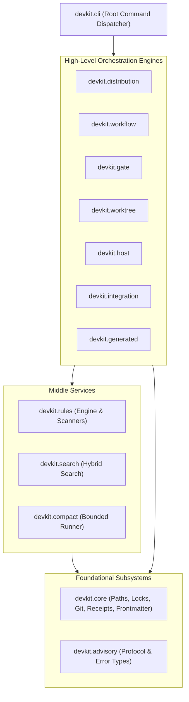

# [ARCH-05-2-components] Building Block View: Components

- **arc42**: §5 Building Block View - Level 2 (Components)
- Containers: `ARCH-05-1-containers`. Runtime: `ARCH-06-runtime-view`.

---

## 1. Subsystem Decomposition & Layering

The internal modules of `packages/devkit` adhere to strict layering rules enforced by unit tests (`test_layering.py`):

### 1.1 Layering Rules

1. `advisory` imports no other module.
2. `core` imports only `advisory`.
3. `rules` imports `core`, `advisory`, and `compact` (`devkit rules test` runs rule tests through `compact`).
4. `workflow` imports `core`, `advisory`, and `rules`.
5. `gate` imports `core`, `advisory`, `rules`, and `compact`.
6. `search`, `compact`, `worktree`, and `host` import only `core` and `advisory`.
7. `distribution` imports `core`, `advisory`, `search`, and `host`.
8. `integration` imports `core`, `advisory`, `host`, and `worktree`.
9. `devkit.cli` maps subcommands to module references and lazy-loads them only when the command executes.

---

## 2. Core Modules Summary

| Module | Core Purpose | Exported Commands / APIs |
| :--- | :--- | :--- |
| **`devkit.core`** | Shared SDD-agnostic primitives (atomic writes, git runner, receipts, locks, frontmatter). | Internal library |
| **`devkit.advisory`** | Standard library advisory protocol and error base classes. | `AdvisoryError`, `ExitCode` |
| **`devkit.distribution`** | Bundle manifest validation, transaction engine, skill/subagent projection. | `sync`, `add`, `remove`, `list`, `status` |
| **`devkit.rules`** | Deterministic static invariant checking, autofix, and convergence recheck. | `rules check`, `rules fix`, `rules phases` |
| **`devkit.workflow`** | Multi-stage delivery procedures, stage evaluation, decision envelopes. | `workflow next`, `workflow envelope` |
| **`devkit.worktree`** | Activity branch management and task worktree lifecycle. | `worktree start`, `worktree finish` |
| **`devkit.gate`** | Git hook wrappers enforcing commit policies. | `gate install`, `gate run` |
| **`devkit.compact`** | Bounded command execution with persistent log capture. | `devkit run` |
| **`devkit.search`** | Lexical (BM25), dense (embeddings), and hybrid document retrieval. | Library API |
| **`devkit.host`** | Host environment discovery, lifecycle event hook dispatch. | `host status` |
| **`devkit.integration`** | MCP server endpoints exposing devkit services to coding agents. | `integration serve` |
| **`devkit.generated`** | Tracking and deterministic regeneration of machine-generated files. | `generated check`, `generated regen` |
