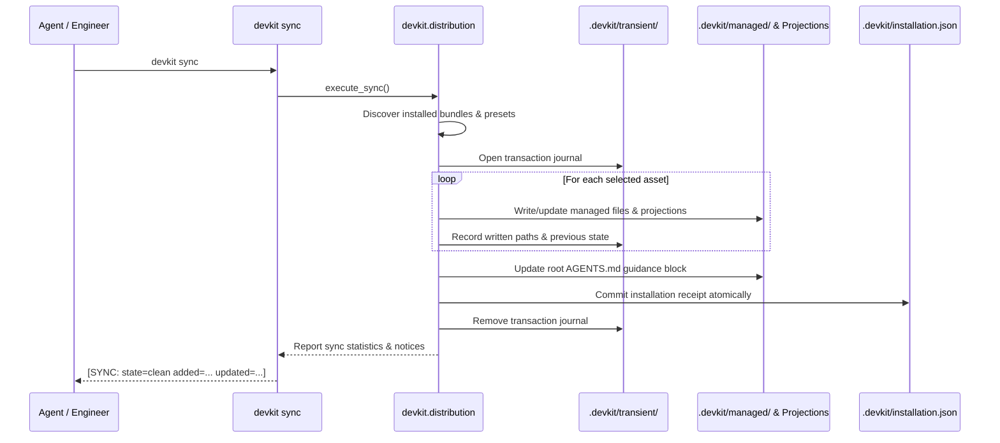
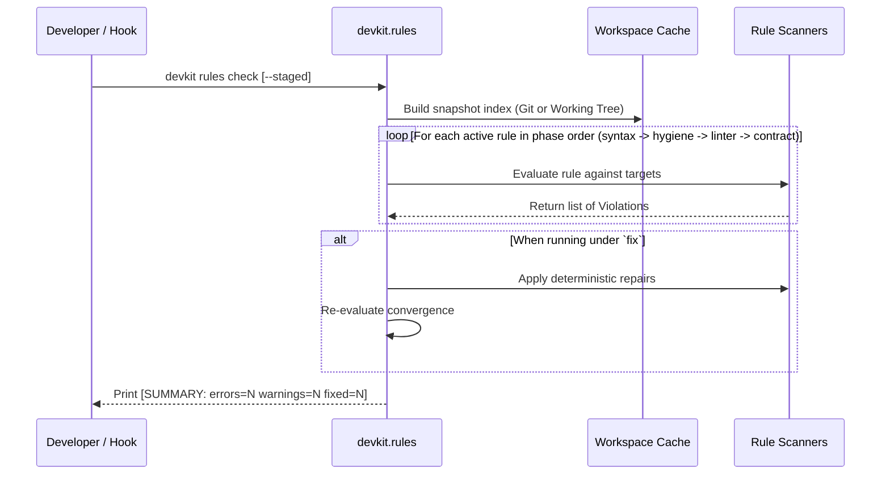

# [ARCH-06-runtime-view] Runtime View

- **arc42**: §6 Runtime View
- Components: `ARCH-05-2-components`. Cross-cutting: `ARCH-08-cross-cutting`.

---

## 1. Scenario 1: Transactional Bundle Synchronization (`devkit sync`)

`devkit sync` ensures atomic deployment of bundle assets and projections into consumer repositories:

If an error or process termination occurs midway, `devkit recover` reads `.devkit/transient/` to roll back modified files to their previous clean baseline.

---

## 2. Scenario 2: Governance Rule Evaluation & Autofix (`devkit rules check|fix`)

---

## 3. Scenario 3: Task Worktree Lifecycle (`devkit worktree start|finish`)

1. **Start**: `devkit worktree start <branch> [--unit <dir>]` checks that no uncommitted conflicts exist, checks that the branch does not already exist, and creates a linked Git worktree under `.devkit/worktrees/<slug>`.
2. **Execute**: The agent runs development tasks isolated within the allocated worktree.
3. **Finish**: `devkit worktree finish [--merge]` validates that envelopes hold no unresolved questions or problems, commits final artifacts, integrates into the base branch, and safely removes the worktree.
