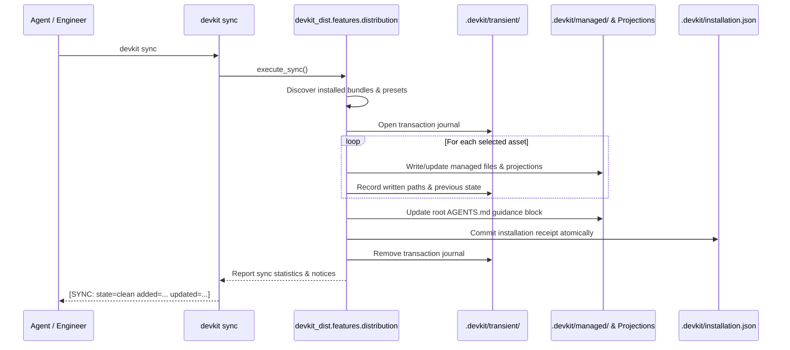
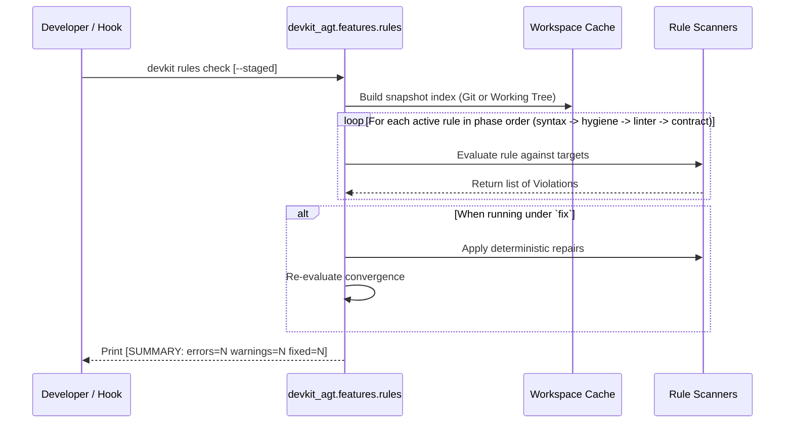

# [ARCH-06-runtime-view] Runtime View

- **arc42**: §6 Runtime View
- Components: `ARCH-05-2-components`. Cross-cutting: `ARCH-08-cross-cutting`.

---

## 1. Scenario 1: Transactional Bundle Synchronization (`devkit sync`)

`devkit sync` ensures atomic deployment of bundle assets and projections into consumer repositories:

If an error or process termination occurs midway, `devkit recover` reads `.devkit/transient/` to roll back modified files to their previous clean baseline.

---

## 2. Scenario 2: Governance Rule Evaluation & Autofix (`devkit rules check|fix`)

---

## 3. Scenario 3: Task Worktree Lifecycle (`devkit worktree start|finish`)

1. **Start**: `devkit worktree start <branch> [--unit <dir>]` checks that no uncommitted conflicts exist, checks that the branch does not already exist, and creates a linked Git worktree under `.devkit/worktrees/<slug>`.
2. **Execute**: The agent runs development tasks isolated within the allocated worktree.
3. **Integrate**: after the Host's `devkit workflow envelope check` reports no unresolved question or problem, `devkit integration prepare <branch> --route local` and `devkit integration integrate <branch> --route local` land the branch on the base branch and clean up its worktree and branch.
4. **Finish**: `devkit worktree finish <branch>` cleans up a branch the base already contains (a merged pull request, or a landing whose cleanup stopped); `--merge` refuses with `WORKTREE_MERGE_RETIRED`.

## Post-merge verification runtime

The Host verifies the branch through its runtime, executes approved integration/cleanup, synchronizes dependencies
from landed declarations, and starts fresh commands for bundle sync, generated-artifact regeneration and final
project checks. Regeneration and repair commits precede checks of the resulting target HEAD. The integration
process interprets no new rule imports, receipt schema or workflow content after landing. Proposal acceptance
yields before handoff; the Host invokes handoff only after final verification in a fresh process.
`ADR-post-merge-verification`, `CAP-INT-mcp-services` and `CAP-DLV-delivery-workflows` own these contracts.
