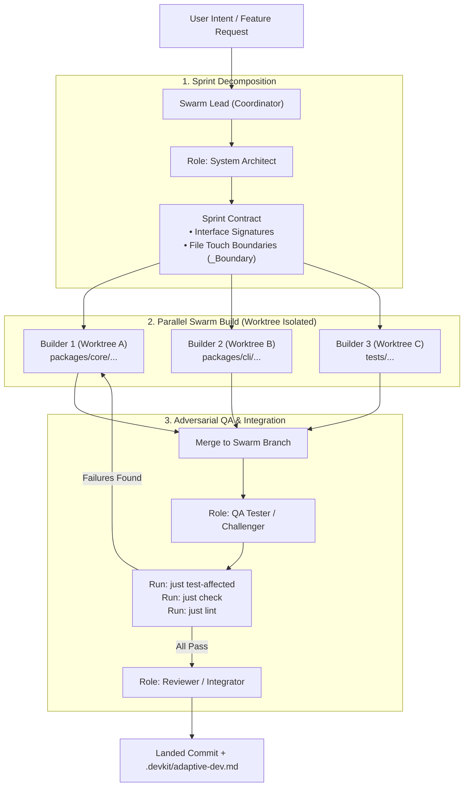

# [MAT-adaptive-swarm-references] Multi-Agent Swarm Architectures and Role Catalogs for Adaptive Development

## 1. Overview and Intent

This reference material investigates multi-agent architectures, role-catalog frameworks, and subagent orchestration patterns
to inform the design of an autonomous agent-swarm rapid development mode under `adaptive-dev`. While devkit's primary
delivery model—Spec-Driven Development (SDD)—provides high governance, traceability, and zero phantom completion through
strict sequential stages (`spec` → `plan` → `tasks` → `develop` → `review` → `sync`), developers frequently require a rapid,
high-throughput development mode ("agent swarm") for prototypes, exploratory features, and rapid spikes without heavy ceremony.

This survey compares six upstream open-source references, identifies key structural patterns, evaluates the architectural
choice between globally registered subagents versus skill-local role documents, and defines how devkit's native primitives
(git worktrees, `just test-affected`, and execution isolation) solve the primary failure modes of existing agent swarms.

---

## 2. Upstream Reference Survey

The following repositories were examined on 2026-11-06 as architectural and operational references.

### 2.1 FoundationAgents/MetaGPT: SOP-Driven Multi-Agent Framework
- **Repository**: [FoundationAgents/MetaGPT](https://github.com/FoundationAgents/MetaGPT)
- **Core Philosophy**: "Code = SOP(Team)". Encodes Standard Operating Procedures into LLM-based agent roles.
- **Key Mechanics**:
  - Roles: Product Manager (generates PRD), Architect (generates system design and API interfaces), Project Manager (decomposes tasks into a dependency graph), Engineer (writes source code and unit tests), and QA Engineer (designs test cases and runs execution).
  - Environment & Message Pool: Agents share an environment where messages carry typed payloads. Roles observe (`_watch`), evaluate relevance (`_observe`), and trigger actions (`_react`).
- **Strengths**:
  - Clear sequential-to-parallel progression: Waterfall analysis flows cleanly into concurrent module implementation.
  - Interface-first design: Architect specifies API signatures and data structures before Engineers write implementation code, minimizing interface mismatches.
- **Limitations & Friction Points for devkit**:
  - Monolithic Python runtime dependency: MetaGPT requires a heavy Python daemon, API servers, and complex orchestration libraries that conflict with devkit's lightweight CLI-driven packaging.
  - High token cost and pipeline latency: Running every role end-to-end for small-to-medium changes introduces substantial token overhead.
  - Weak filesystem-level collision control: Relies primarily on prompt instructions to avoid file overwrite conflicts rather than filesystem/git isolation.

### 2.2 code-yeongyu/oh-my-openagent & Yeachan-Heo/oh-my-codex: Coding Agent Harnesses
- **Repositories**: [code-yeongyu/oh-my-openagent](https://github.com/code-yeongyu/oh-my-openagent), [Yeachan-Heo/oh-my-codex](https://github.com/Yeachan-Heo/oh-my-codex)
- **Core Philosophy**: Practical developer harnesses and command wrappers for LLM coding environments (OpenAgent, OpenAI Codex, Antigravity, Claude Code).
- **Key Mechanics**:
  - Modular persona prompts and system instructions categorized by task kind (planner, implementer, reviewer, refactorer).
  - Shortcut slash commands and streamlined prompt injection.
  - Lead agent / orchestrator pattern: A primary agent interacts with the user, decomposes requirements, and invokes targeted sub-prompts.
- **Strengths**:
  - Low friction: Operates directly within existing coding agent interfaces without external daemons.
  - High developer ergonomics: Pragmatic commands focused on shipping code fast.
- **Takeaways for devkit**:
  - Keep the invocation interface as a natural slash command/skill (`/adaptive-dev` or `/adaptive-swarm`).
  - Maintain an orchestrator that stays in continuous dialogue with the user while dispatching background workers.

### 2.3 msitarzewski/agency-agents: Domain Persona Catalog
- **Repository**: [msitarzewski/agency-agents](https://github.com/msitarzewski/agency-agents)
- **Core Philosophy**: A comprehensive, modular library of specialized agent personas (50+ markdown files) spanning Engineering, Design, Testing, Marketing, and Operations.
- **Key Mechanics**:
  - Each persona is a standalone Markdown document specifying identity, core strengths, thinking style, boundaries, and concrete output deliverables.
  - Roles can be mixed and matched to form dynamic virtual agencies (e.g., UX Architect + Frontend Dev + Reality Checker).
- **Strengths**:
  - Prompt modularity: Adding or updating a role requires editing only a single Markdown file.
  - Strong behavioral boundaries: Prompts explicitly instruct roles on what *not* to do (e.g., reality checker does not write production code).
- **Takeaways for devkit**:
  - Persona modularity maps directly to devkit's bundle `roles/*.md` pattern.
  - Roles should be behavioral contracts loaded dynamically rather than monolithic hardcoded agent classes.

### 2.4 VoltAgent/awesome-codex-subagents & wshobson/agents: Developer Subagent Libraries
- **Repositories**: [VoltAgent/awesome-codex-subagents](https://github.com/VoltAgent/awesome-codex-subagents), [wshobson/agents](https://github.com/wshobson/agents)
- **Core Philosophy**: Curated subagent prompt templates specifically optimized for AI coding assistants.
- **Key Mechanics**:
  - Task-specific subagents: `refactoring-specialist`, `test-automator`, `security-auditor`, `api-designer`, `bug-hunter`.
  - Precise boundary definitions: Each subagent template defines strict input parameters, expected file touch boundaries, and exact output formats (e.g., unified diffs, test logs).
- **Strengths**:
  - Clear separation of concerns: Testing agents focus exclusively on breaking code; refactoring agents focus on structural cleanliness without changing behavior.
  - Ready-to-use prompt patterns for coding tasks.

---

## 3. Structural Comparison: Registered Subagents vs. Skill-Local Roles

When implementing a multi-agent swarm in devkit, two structural approaches present themselves:

| Criterion | Option A: Globally Registered Subagents (`.agents/subagents/`) | Option B: Skill-Local Role Documents (`roles/*.md` + Coordinator) |
| :--- | :--- | :--- |
| **Global Context Load** | **High failure**: System prompt must list all 5~15 subagents with descriptions on every single session, bloating token consumption and diluting attention. | **Optimal**: Zero global tokens. Role definitions exist on disk and are read only when the swarm coordinator explicitly delegates. |
| **Tool / Permission Enforcement** | Platform-level isolation possible (if host supports per-subagent tool restrictions). | Behavioral instructions via prompt; physical isolation enforced via devkit CLI/worktree rather than host permissions. |
| **Host Portability** | Host-specific: Antigravity, Claude Code, OpenAI Codex, and OpenAgent all have incompatible subagent configuration syntaxes. | Highly portable: Standard Markdown files usable across any agent harness capable of reading files and spawning children. |
| **Extensibility & Catalog Packaging** | Adding new specialized roles requires modifying global agent projections and registry configurations. | Adding roles is as simple as dropping a Markdown file into `roles/` inside the bundle. Fully compatible with `devkit-catalog`. |
| **Orchestration Flexibility** | Harder to dynamically chain into custom SOPs without host-level workflow engine support. | Coordinator dynamically selects, parameterizes, and sequences roles in a task-specific DAG. |

**Conclusion**: In accordance with the precedent established in `ADR-skill-local-research-roles`, Option B (`skill-local role markdown documents`) is strongly superior for devkit.

---

## 4. The Core Failure Mode of Multi-Agent Swarms & devkit's Solution

### 4.1 Why Pure Prompt-Based Swarms Fail in Real Projects
1. **Concurrent File Write Collisions (Race Conditions)**: When 3+ agents write code simultaneously in the same working directory, they overwrite each other's edits, produce syntax errors, and create git merge chaos.
2. **Interface Drift**: Agent A assumes an API returns JSON; Agent B implements it returning a string or different field names because no binding interface contract was established before implementation.
3. **Phantom Completion & Test Rot**: Workers report "all tasks completed" without running local compilers, type checkers, or test suites, leaving broken builds on the main branch.

### 4.2 devkit's Architectural Countermeasures
devkit possesses unique primitives that turn theoretical swarms into reliable development engines:

1. **Explicit File Boundaries (`_Boundary`)**:
   - The Architect role partitions the work such that parallel builders operate on strictly disjoint file sets (e.g., Builder A owns `packages/pkg-a/src/`, Builder B owns `packages/pkg-b/src/`).
2. **Git Worktree Isolation (`devkit worktree`)**:
   - Where file overlap is unavoidable, builders run in dedicated git worktrees created via `devkit worktree create`. Changes are integrated systematically rather than written concurrently to a single working tree.
3. **Deterministic Local Verification (`just test-affected`)**:
   - Instead of trusting LLM assertions of correctness, the QA Tester executes devkit's native verification pipeline (`just test-affected`, `just check`, `just lint-check`). If tests fail, the failure logs are routed back to the specific Builder responsible.
4. **Lightweight Context Retention**:
   - Rather than creating heavy SDD artifacts (`spec.md`, `plan.md`, `tasks.md`, `reconcile.md`, `envelopes/*.yaml`), the swarm records its state in `.devkit/adaptive-dev.md` with active facts, completed changes, and open questions.

---

## 5. Synthesis and Recommendations

1. **Adopt MetaGPT's SOP Flow without its Heavy Runtime**:
   Use a 4-stage pipeline: (1) Architecture & Boundary Contract, (2) Parallel Builder Implementation, (3) QA & Affected Test Execution, (4) Integration & Context Record.
2. **Package as a Skill-Local Catalog Bundle**:
   Ship `adaptive-dev` (or companion `adaptive-swarm`) with self-contained `roles/` and `references/orchestration.md` within `devkit-catalog`.
3. **Core Role Set**:
   - `swarm-coordinator` (Skill entrypoint)
   - `roles/architect.md` (Interface & Boundary Designer)
   - `roles/builder.md` (Implementation Worker)
   - `roles/qa-tester.md` (Test Execution & Edge Case Attacker)
   - `roles/reviewer.md` (Code Quality & Diff Sanity Reviewer)
4. **Retain Clear Separation from SDD**:
   Adaptive swarm development is an accelerator for iteration and exploratory builds; SDD remains canonical for durable, highly governed systems. A swarm-built prototype can graduate into SDD at any point via the standard adoption procedure.

