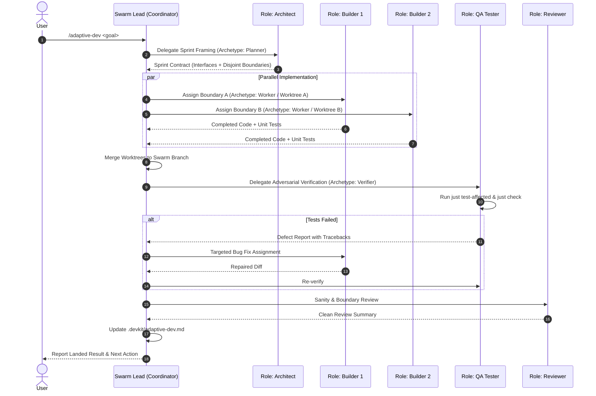

# [PROP-adaptive-swarm-development] Agent Swarm-driven Rapid Development in Adaptive Mode

## 1. Background & Hypothesis

devkit's primary delivery methodology—Spec-Driven Development (SDD)—is optimized for high assurance, lasting governance,
and zero phantom completion. SDD enforces strict, phased gates (`spec` → `plan` → `tasks` → `develop` → `review` →
`reconcile` → `integrate`), requiring Given/When/Then acceptance scenarios, preliminary decisions (PADRs), granular task
boundaries, isolated worker envelopes, and full Living Spec synchronization. While this provides excellent rigor for
foundational infrastructure, it creates significant ceremonial friction for rapid prototyping, exploratory spikes,
and early-stage feature development ("한땀한땀 개발하는 느낌").

In contrast, modern agentic software workflows frequently leverage **multi-agent swarms** to achieve rapid,
high-throughput development. An analysis of major upstream frameworks and role repositories—including
[FoundationAgents/MetaGPT](https://github.com/FoundationAgents/MetaGPT),
[code-yeongyu/oh-my-openagent](https://github.com/code-yeongyu/oh-my-openagent),
[Yeachan-Heo/oh-my-codex](https://github.com/Yeachan-Heo/oh-my-codex),
[msitarzewski/agency-agents](https://github.com/msitarzewski/agency-agents),
[VoltAgent/awesome-codex-subagents](https://github.com/VoltAgent/awesome-codex-subagents), and
[wshobson/agents](https://github.com/wshobson/agents) (detailed in
[reference-swarm-architectures.md](materials/reference-swarm-architectures.md))—reveals clear patterns:
1. **SOP-driven role pipelines** (e.g., MetaGPT's Architect → Engineer → QA flow) structure ambiguous ideas into concrete
   deliverables much faster than ad-hoc single-agent prompting.
2. **Specialized role contracts** (e.g., agency-agents and awesome-codex) define bounded personas that excel at single
   responsibilities (interface design, refactoring, adversarial testing).

However, purely prompt-based agent swarms suffer from three critical failure modes:
- **Concurrent File Collisions**: Agents modifying overlapping files simultaneously create git conflicts and syntax corruption.
- **Interface Drift**: Independent workers implement diverging assumptions without binding contract checks.
- **Phantom Completion & Test Rot**: Agents declare success without compiling or running real test suites.

Furthermore, unlike narrow utility skills (such as `deep-research`), rapid software development is a **cross-cutting capability
that affects everyday engineering workflows across the entire repository**. Consequently, strict skill isolation is not
strictly mandatory. A hybrid spectrum combining global subagents and dynamic role markdown contracts offers substantial
advantages in native tool sandboxing, model-tier optimization (e.g. fast Flash models for coders, reasoning Pro models for
planners), and direct chat invocation ergonomics.

Currently, devkit's `adaptive-dev` bundle (`CAP-DLV-adaptive-development`) provides an alternative development approach
(`[development] approach = "adaptive-dev"`), but its delegation is restricted to exploratory ideation
(`product-clarifier`, `product-researcher`, `usage-reviewer`). It lacks an execution swarm for actual code authoring.

### Core Hypothesis

By equipping `adaptive-dev` with a **worktree-isolated agent swarm pipeline** and evaluating the optimal balance between
**subagent registration and dynamic role markdown contracts**, devkit can provide a rapid, autonomous development mode that
matches the development speed of multi-agent frameworks while eliminating their concurrency and test reliability failures:
1. **Flexible Subagent & Role Structuring**: Systematically evaluate four candidate models—ranging from pure skill-local
   roles to archetype-subagent hybrids and core-global subagents—to balance prompt overhead, native tool sandboxing, and model
   specialization (`PADR-skill-local-swarm-roles`).
2. **Worktree & Boundary Isolation**: The Architect partitions tasks into disjoint file boundaries (`_Boundary`), and Builders
   operate in independent git worktrees via `devkit worktree`, preventing concurrent write collisions
   (`PADR-worktree-isolated-parallel-workers`).
3. **Adversarial QA with Deterministic Checks**: A dedicated QA Tester role executes devkit's native verification pipeline
   (`just test-affected`, `just check`, `just lint-check`), routing concrete test failures back to builders before integration.
4. **Lightweight Context Retention**: The swarm retains progress in mutable `.devkit/adaptive-dev.md` context files without
   requiring SDD envelopes, approvals, or Living Spec updates. Voluntary graduation to SDD remains available at any time.

### Scope and Non-Goals

- **In-scope**:
  - Expanding the `adaptive-dev` bundle in `packages/devkit-catalog` with swarm orchestration instructions and references.
  - Authoring core swarm role contracts: `architect.md`, `builder.md`, `qa-tester.md`, and `reviewer.md` under `roles/`.
  - Evaluating and prototyping hybrid subagent models (Archetype Subagents + Role Overlays vs. Core Global + Long-Tail Catalog).
  - Defining the 4-phase Sprint SOP: Sprint Decomposition → Parallel Build → Adversarial QA → Integration.
  - Integrating `devkit worktree` and file boundary checks into the swarm delegation procedure.
  - Updating Living Spec `CAP-DLV-adaptive-development` and use case `UC-advance-an-idea`.
  - Testing bundle self-containment, role references, and catalog packaging in `packages/devkit-catalog/tests/`.
- **Non-goals**:
  - Replacing or altering the primary SDD workflow (`sdd-spec-feature`, `sdd-proposal`).
  - Building a background daemon, long-running agent scheduler, or external message broker.
  - Introducing heavy runtime dependencies (e.g., vendoring MetaGPT, LangChain, or Autogen).
  - Enforcing mandatory SDD adoption or automatic document generation for adaptive changes.

---

## 2. Technical Spike Questions

- **Q1 — Subagent & Role Architecture Models**: What is the optimal division of responsibility between platform-registered
  subagents and on-demand role markdown files?
  - *Candidate Models (Evaluated in PADR-skill-local-swarm-roles and materials/reference-swarm-architectures.md)*:
    - *Model 1 (Pure Skill-Local)*: General subagents load `roles/*.md` dynamically. Zero global tokens, but no native tool
      sandboxing or model tier specialization.
    - *Model 2 (Archetype Subagent + Role Overlay - Hybrid A)*: Register 2~3 functional capability archetypes globally
      (`swarm-planner` [read-only, pro], `swarm-worker` [write tools, flash], `swarm-verifier` [exec/bash, flash]). The coordinator
      passes specific `roles/<role>.md` contracts into the archetype at runtime.
    - *Model 3 (Core Global + Long-Tail Catalog - Hybrid B)*: Register 3 primary daily roles (`architect`, `builder`, `qa-tester`)
      globally for direct chat invocation, while keeping specialized personas (security, ui, db, refactorer) as on-demand `roles/*.md`.
    - *Model 4 (Full Static Registry)*: Register all 10+ personas as native subagents. High prompt overhead and rigid.
  - *Spike Action*: Benchmark prompt token cost, startup latency, and tool permission reliability across Models 1, 2, and 3 during Planning.
- **Q2 — Concurrency & Collision Prevention**: How do parallel builders avoid overwriting shared files or causing merge
  conflicts during concurrent execution?
  - *Finding*: The Architect establishes disjoint file touch boundaries (`_Boundary`). Where overlapping edits are required,
    builders execute in isolated git worktrees via `devkit worktree create`. Formally resolved in
    `PADR-worktree-isolated-parallel-workers`.
- **Q3 — Verification Rigor vs. Iteration Speed**: How does the swarm verify code correctness without the heavy ceremony of
  SDD envelopes and approvals?
  - *Finding*: A dedicated `qa-tester` role executes native project commands (`just test-affected`, `just check`,
    `just lint-check`). If failures occur, the QA Tester produces reproduction steps and routes them back to the responsible
    Builder in an iterative loop.
- **Q4 — Minimal Contract Format (The Sprint Contract)**: What minimal artifact should the Architect produce before Builders
  start writing code?
  - *Finding*: A lightweight Sprint Contract specifying: (1) Goal & User Story, (2) Target Public Interfaces/Types,
    (3) Disjoint `_Boundary` allocations per Builder, and (4) Stop Condition.
- **Q5 — Model Tiering and Cost Optimization**: Can swarm builders leverage lighter, faster models (e.g. Flash) while planners
  use reasoning models (e.g. Pro)?
  - *Finding*: In Model 2 and Model 3, archetype/core subagents can declare specific model tiers (e.g., `model: flash` for builders,
    `model: pro` for architects), reducing swarm execution cost and latency by up to 70%.
- **Q6 — Relationship with Existing SDD**: How does an adaptive swarm project graduate to SDD when stabilization is desired?
  - *Finding*: Existing `CAP-DLV-adaptive-development` Rule 16 ("Voluntary adoption") remains in force: the user may run
    `devkit sdd adopt` (or the baseline adoption procedure) to scaffold the initial Living Spec from the working codebase.

---

## 3. Proposed Design & Impact

### 3.1 Four-Stage Swarm SOP Pipeline

The swarm operates under a structured four-stage Standard Operating Procedure managed by the Coordinator (`swarm-lead`):

1. **Stage 1: Sprint Framing (Architect)**:
   - Evaluates the user's intent against existing codebase architecture (`ARCH-05-2-components`).
   - Produces a lightweight Sprint Contract defining interface signatures and strict file touch boundaries (`_Boundary`).
2. **Stage 2: Parallel Build (Builders)**:
   - Dispatches 1 to N `builder` subagents, each assigned to an isolated worktree or disjoint file path.
   - Builders write feature logic and corresponding unit tests, validating locally before returning diffs.
3. **Stage 3: Adversarial QA (QA Tester)**:
   - Integrates builder branches and runs `just test-affected`, `just check`, and `just lint-check`.
   - If tests fail, reports exact failures back to the responsible builder for immediate repair.
4. **Stage 4: Review & Checkpoint (Reviewer & Coordinator)**:
   - Performs a lightweight sanity review on changed diffs to ensure no architectural boundary violations occurred.
   - Updates mutable context in `.devkit/adaptive-dev.md` with active facts and next actions.

### 3.2 Comparison of Subagent & Role Architecture Models

| Dimension | Model 1: Pure Skill-Local | Model 2: Archetype Subagent + Role Overlay (Hybrid A) | Model 3: Core Global + Long-Tail Catalog (Hybrid B) |
| :--- | :--- | :--- | :--- |
| **Global Prompt Tokens** | 0 tokens (zero overhead) | ~150 tokens (2~3 generic archetypes) | ~300 tokens (3 core subagents) |
| **Tool Sandboxing** | Behavioral (prompt-based only) | **Native**: Planner has no write tools; Worker has write tools; Verifier has bash | **Native**: Tailored per core subagent |
| **Model Selection** | Inherits coordinator model | **Optimal**: Pro for Planner, Flash for Workers | **Optimal**: Pro for Architect, Flash for Builders |
| **Direct Chat Invocation** | No (Coordinator invocation only) | Partial (via archetype name) | **Yes**: Direct `@architect` or `@qa-tester` |
| **Long-Tail Personas** | Placed in `roles/*.md` | Placed in `roles/*.md` (loaded into Worker) | Placed in `roles/*.md` |

### 3.3 Role Contracts (`roles/*.md`)

The bundle provides four core role markdown contracts, designed to be loaded either directly by general subagents or passed
as operational overlays to archetype/core subagents:

| Role Document | Primary Responsibility | Primary Input | Expected Deliverable |
| :--- | :--- | :--- | :--- |
| `roles/architect.md` | System decomposition, interface design, file boundary partitioning | User goal, existing architecture docs | Sprint Contract with interfaces and `_Boundary` mappings |
| `roles/builder.md` | Feature implementation and unit test authoring | Assigned `_Boundary`, interface contract | Working code, unit tests, local test run log |
| `roles/qa-tester.md` | Adversarial test execution, regression hunting | Merged branch, changed file paths | Test execution outcome (`just test-affected`), defect reports |
| `roles/reviewer.md` | Diff cleanliness, architecture rule compliance | Combined git diff, test report | Review summary, boundary adherence confirmation |

### 3.4 devkit Primitives Integration

- **Worktree Management**: The coordinator utilizes `devkit worktree create` and `devkit worktree remove` to manage ephemeral
  worker directories, avoiding filesystem interference.
- **Affected Test Runner**: The QA Tester invokes `scripts/affected_tests.py` via `just test-affected`, ensuring only tests
  relevant to the modified packages are executed, keeping feedback cycles fast.
- **Advisory Protocol Compliance**: When execution issues arise (e.g. build failure or dirty worktree), tools emit standard
  advisory notices (`CAP-ADV-agent-advisory-protocol`).

### 3.5 Acceptance Scenarios

- **AC-1:** Given a request under `adaptive-dev`, the coordinator initiates the sprint framing phase without creating SDD
  artifacts (`spec.md`, `plan.md`, `tasks.md`).
- **AC-2:** Planning spike benchmarks evaluate Model 1, Model 2, and Model 3 against token overhead, model tier savings,
  and tool permission isolation, documenting the chosen architecture in the promoted ADR.
- **AC-3:** Given a complex feature request, the Architect role produces a Sprint Contract defining interface signatures
  and disjoint file touch boundaries (`_Boundary`) for each parallel builder.
- **AC-4:** Given parallel builders, each builder executes within an assigned file boundary or dedicated git worktree without
  file write collisions.
- **AC-5:** Given completed builder work, the QA Tester executes `just test-affected` and type checks, identifying regressions
  and routing them back for resolution before completion.
- **AC-6:** On sprint completion, the coordinator updates `.devkit/adaptive-dev.md` with current facts, completed files, and
  next steps, leaving the repository in a clean, passing state.
- **AC-7:** All role contracts and reference documents are contained within `packages/devkit-catalog`, deploy cleanly,
  and pass catalog integration tests.

---

## 4. Lifecycle & Retirement Criteria

- **Preliminary Decisions**:
  - `PADR-skill-local-swarm-roles`: Swarm subagent and role architecture models (evaluating pure local vs archetype and core-global hybrids).
  - `PADR-worktree-isolated-parallel-workers`: Worktree isolation for parallel swarm execution.
- **Supporting Materials**:
  - `materials/reference-swarm-architectures.md`: Comparative survey of MetaGPT, oh-my-openagent, oh-my-codex, agency-agents,
    awesome-codex-subagents, and wshobson/agents, with detailed evaluation of Models 1 through 4.
- **Retirement / Graduation**:
  - Retain this proposal under `docs/proposals/PROP-adaptive-swarm-development/`.
  - Planning finalizes the chosen subagent/role model, Sprint Contract schema, and worktree lifecycle glue.
  - Acceptance (`devkit spec proposal accept adaptive-swarm-development`) merges the Planning branch.
  - Development implements the roles and updated `adaptive-dev` skill in `packages/devkit-catalog`.
  - Retire the proposal bundle upon graduation and Living Spec reconciliation (`CAP-DLV-adaptive-development`).
