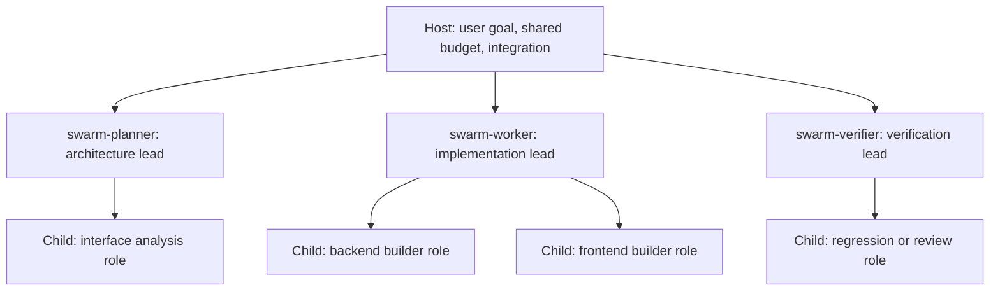

# [PROP-adaptive-swarm-development] Reusable Subagents and Optional Teams for Adaptive Development

## 1. Background & Hypothesis

`CAP-DLV-adaptive-development` already supports clarification, research, implementation and usage verification
without per-change SDD records. Its bundle registers three optional support subagents: `product-clarifier`,
`product-researcher` and `usage-reviewer`. The missing capability is a reusable delegation procedure for code-writing
teams, including ownership, nested delegation and verification of their combined result.

SDD already supports isolated workers and nested review delegation (`ARCH-04-delivery-strategy`). This proposal
adapts useful delegation patterns to adaptive development without introducing SDD Units or a mandatory role pipeline.
It does not claim that SDD execution is necessarily serial or that adaptive development is limited to ideation.

### Core hypothesis

A small set of reusable, prefixed subagents can supply execution capabilities, while on-demand `roles/*.md`
contracts supply task-specific responsibilities. A subagent can execute a bounded task itself or, where the host
supports nesting and the task warrants it, lead a small team of its own subagents. Registration and team topology
are separate choices: either flat or nested execution can use the same registered agents and role documents.

Planning has exercised source-level projection, an agent-only preset and one read-only nested role assignment.
These observations establish bounded feasibility, not completed implementation. Prompt cost, latency, model savings
and native host enforcement remain unmeasured.
The local reference comparison is in [reference-swarm-architectures.md](materials/reference-swarm-architectures.md).
Upstream examples motivate patterns; they are not evidence of performance or correctness in devkit.

### Scope and non-goals

In scope:

- Ship a small default set of general execution subagents with a common prefix in `adaptive-dev`.
- Allow installed prefixed subagents to be reused by compatible callers, and allow projects to add their own agents.
- Keep task and domain specializations in role Markdown files loaded only for the assigned task.
- Support direct work, flat delegation and optional two-level delegation with bounded ownership and concurrency.
- Define worker isolation, combined verification, interruption recovery and current-context ownership.
- Update the capability, use case and catalog ownership description after implementation.
- Verify bundle installation, projection, extension and representative invocation behavior.

Scope excluded:

- A runtime scheduler, daemon, agent bus, automatic agent importer or new package.
- Changes to distribution schemas, host settings, SDD orchestration or shared model-level resolution.
- A mandatory team hierarchy or role sequence for every adaptive action.
- Automatic approach switching, SDD adoption, publication or new approval authority.
- Guaranteed speedup, conflict-free merges, native file-boundary enforcement or model quality equivalence.
- Making other bundles depend on these agents or moving existing SDD roles into a shared registry.

## 2. Design Decisions and Alternatives

### 2.1 Shared prefixed agents and task-specific roles

The recommended default is the archetype model in `PADR-skill-local-swarm-roles`:

| Proposed agent ID | Stable responsibility | Example role overlay |
| :--- | :--- | :--- |
| `swarm-planner` | Analyze and partition one assigned goal | `roles/architect.md` |
| `swarm-worker` | Implement within an assigned write boundary | `roles/builder.md` |
| `swarm-verifier` | Verify an identified source or artifact and return evidence | `roles/qa-tester.md`, `roles/reviewer.md` |

The `swarm-` prefix identifies this shipped family and avoids bare names such as `builder` or `architect`.
The names are selected public asset IDs for this proposed implementation, not a new namespace mechanism. Each agent has one owning bundle
and uses existing native projections. Common contracts retain the existing host support declarations and subagent model levels
from `CAP-DIST-agent-projections`; this bundle adds no model router. Omit a source `level` and native model/effort
defaults so existing project policy and host inheritance apply. A project may opt into a shared level with the owning bundle-qualified key, for example:

```toml
[subagents.roles."adaptive-dev:swarm-worker"]
level = "lean"
```

Add `adaptive-dev:agents` containing only the three archetype assets. Keep `adaptive-dev:core` as the existing six
assets plus those archetypes. A caller that only needs reusable execution selects `uv run devkit add adaptive-dev:agents`.
This does not deploy the adaptive skill or its pointer, seed current context, or change the development approach.
Distribution still writes its ordinary managed guidance block. The reusable contracts have no `skill: adaptive-dev`
field and do not load an adaptive entry or context as a prerequisite.

Scope the bundle constitution's approach guard to `/adaptive-dev` product iteration. Distinguish existing product
support roles, which never commit, from bounded execution workers, which may commit only on explicit assignment.
Agent-only callers follow their own governing workflow and authority; the preset does not bypass SDD obligations.

Other callers may reuse an installed agent when its contract matches their task. Such reuse is optional and does
not permit importing another bundle's private role files. A caller supplies its own role contract and verifies agent
availability. The adaptive bundle itself remains independently installable with docs/catalog and does not require
`devkit-spec` or another role catalog.

Projects can add a specialized native subagent through an existing in-repository bundle, for example
`acme-security-reviewer`, or supply a local role file to a default agent. Prefer a role file when only task instructions
change. Add a registered agent when recurring execution settings or a stable reusable contract justify it. Project
extensions use their own prefix and do not overwrite shipped IDs. The three defaults are a starting set, not a limit
on the number of user-defined agents.

A role overlay specifies the assigned goal and deliverable. It cannot widen the agent's host permissions, Git
operations or delegated authority. Resolve an incompatible overlay by choosing a compatible agent or returning the
capability gap; do not silently combine conflicting contracts.

### 2.2 Optional role leads and two-level delegation

The user-facing Host remains the overall coordinator. A first-level subagent may act as a role lead (the master
for that assigned responsibility) and spawn second-level agents with specialized role files.



This diagram shows available relationships, not a requirement to run all agents concurrently. The defaults are:

1. Keep small or inseparable work in the invoking agent.
2. Use flat delegation when one bounded assignment fits one agent.
3. Use a role lead only when its assignment contains independently useful subtasks and nesting is available.

The delegation limit is two child levels below the Host: Host → role lead → child. Second-level agents do not
spawn further agents. The Host allocates a session-wide child-agent budget before dispatch, including waiting leads
and their children. A lead receives an explicit child allowance; it does not independently allocate a full team.
When capacity is insufficient, execute inline or sequentially rather than wait while occupying all slots.
Count the Host too when the runtime's reported limit includes it. Reserve capacity before dispatching a lead;
unknown capacity grants no nested allowance. Treat completion as slot release only when the runtime's accounting
supports that interpretation. Budgeting and the depth-two limit are procedural checks, not newly enforced settings.

Each lead owns the aggregate result for its assignment. Child boundaries stay within the lead's boundary, and the
lead checks actual changed paths and evidence before returning. A planner delegates only read-only work.
A verifier keeps product sources and Git read-only, but may use an explicit scratch/probe directory and project-approved test outputs. Its children inherit those same restrictions.
The Host owns cross-lead coordination, final integration and `.devkit/adaptive-dev.md`; leads return evidence or drafts.

One general-agent read-only depth-two call with an absolute role-file overlay succeeded in the Planning session.
Registered archetype invocation and other native runtimes remain to be exercised; nesting is checked at dispatch.
If it is unavailable, the Host flattens the assignments and retains the same ownership and verification requirements. If subagents are unavailable, the Host works directly
and reports the unverified delegation behavior. No host setting is changed to enable nesting.

### 2.3 Alternatives

| Option | Benefit | Cost or limitation | Proposed use |
| :--- | :--- | :--- | :--- |
| Existing direct adaptive work | No team startup or registration cost | No parallel execution procedure | Keep for small work and fallback |
| General agents plus role files | Small bundle surface; portable role content | Available settings depend on the host invocation API | Supported fallback |
| Prefixed archetypes plus role files | Stable reusable execution contracts; extensible specialization | Persistent metadata and host-specific projections | Recommended default |
| Registered domain personas | Convenient recurring specialist invocation | More public contracts and metadata | Project extension when justified |
| Mandatory nested role teams | Delegates local coordination | Extra context transfer, latency and occupied slots | Rejected as the default |

Role-file placement alone determines neither model selection nor native enforcement. A general-agent invocation
may expose those settings, and a registered agent may still be emulated. Measure the actual host behavior rather
than assigning universal guarantees to either model.

## 3. Execution and Ownership

### 3.1 Lightweight assignment contract

Before delegated code authoring, record the goal, relevant source/base SHA, public interfaces when needed, absolute
read/write boundaries, permitted Git operations, verification commands, stop condition and expected return.
A role lead also receives its depth and child allowance. Treat the following as a task-message example, not a
new parser or persisted schema:

```yaml
goal: Implement the assigned interface
source: {base_sha: "<sha>", worktree: "<absolute worker checkout>"}
role_contract: "<absolute role file resolved from the invoked skill>"
read_boundaries: ["<absolute allowed inputs>"]
write_boundaries: ["<absolute owned source paths>"]
probe_path: "<absolute assigned ignored scratch path>"
git_actions: [read, commit]
checks: ["<project command>"]
depth_remaining: 1
child_allowance: 1
stop_condition: "Return after the assigned checks, or report the first authority gap"
expected_output: "status, source/base/final identity, changed paths, checks, defects, unverified areas"
```

Resolve a local role path from the invoked skill directory, verify it exists and is readable in the child's scope,
and pass that absolute path. A caller can instead provide bounded inline role instructions. Do not assume that
relative paths resolve from a reference directory, default cwd or a sibling checkout. External callers supply their
own overlays; the public agent does not discover another skill's roles automatically. Keep this in the assignment
or mutable current context; no separate Sprint Contract file or SDD artifact is required.

Architectural decomposition is conditional on interface or ownership uncertainty. The Host can provide an already
clear assignment directly instead of starting an architect solely to repeat it.

### 3.2 Parallel implementation

`PADR-worktree-isolated-parallel-workers` proposes one worktree per concurrent writing worker, including nested
workers. Disjoint file ownership still matters for integration; separate worktrees do not prevent incompatible
interfaces, shared external resource conflicts or merge conflicts.

When the harness is available, use its existing worktree lifecycle. Otherwise use the consuming project's documented
Git procedure. Catalog itself has no runtime dependencies. The documented docs/catalog installation currently includes
`devkit-agt` through `devkit-docs`; still check actual command availability and worktree permissions at dispatch.
If isolated writable worktrees cannot be created within current authority, serialize writers. A lead does not write into a worktree while
its child owns it; shared glue changes occur after children finish.

### 3.3 Verification, integration and recovery

Workers check their bounded changes before returning. A return identifies status, source/base and final SHA where
committed, actual changed paths, commands, outcomes, unresolved defects and unverified areas. The lead verifies its
aggregate assignment; the Host verifies the combined result and controls integration into the final target.

Use the consuming project's lint, type, test and representative usage commands. In this repository, use
`just test-affected` with its full fallback, required lint/type/rule checks, and the applicable E2E and final-target
verification procedure. Record the baseline before integration and identify each checked SHA. A worker's passing
checks do not establish that the combined or landed HEAD passes.

A dedicated verifier is useful for separable checks; it is not mandatory for every action. Independent verification
requirements of the consuming project still apply. Failures route to the responsible writer with reproducing evidence.
Bound repair attempts in the assignment and report an unresolved result when the stop condition is reached.

Update `.devkit/adaptive-dev.md` when resume facts change, including on failure or interruption. A passing QA gate is
not a prerequisite for preserving failure evidence. On cancellation, stop or collect active children before releasing
ownership. Preserve unmerged commits and dirty worktrees; remove only worktrees whose results are retained or whose
removal has separate authority.

## 4. Acceptance Scenarios

- **AC-1:** Given an adaptive task that needs no delegation, when the Host acts, then it can implement and verify
  directly without creating SDD artifacts or running a fixed team sequence.
- **AC-2:** Given an independent docs/catalog installation, when `adaptive-dev` is selected and synchronized, then
  the three prefixed archetype contracts and their supported projections deploy without `devkit-spec`.
- **AC-3:** Given a compatible caller and an installed archetype, when the caller supplies its own bounded role
  assignment, then the agent can return the requested evidence without loading adaptive orchestration or sibling
  bundles' private assets.
- **AC-4:** Given a project-owned specialized agent or role overlay, when it is selected for a task, then shipped
  defaults remain unchanged and incompatible permissions or unavailable capabilities are reported explicitly.
- **AC-5:** Given a nested assignment, when the lead dispatches children, then depth stays within two child levels,
  all children fit the Host's shared allowance, and each child stays within its parent's authority and ownership.
- **AC-6:** Given no nested-agent support or insufficient capacity, when the assignment is executed, then the Host
  flattens or serializes it and preserves the same result and verification contracts without changing host settings.
- **AC-7:** Given concurrent writing children, when they implement, then each owns a separate worktree; a parent
  performs no concurrent writes there, and actual changed paths are checked before integration.
- **AC-8:** Given completed worker results, when the Host reports delivery, then combined and applicable landed-target
  checks identify their actual SHAs, commands and outcomes; failed or unavailable checks remain explicit.
- **AC-9:** Given a failed or interrupted assignment, when work pauses, then current context records retained results,
  active ownership and the next action, and cleanup preserves unmerged or dirty work.
- **AC-10:** Given an SDD consumer selecting only `adaptive-dev:agents`, when assets synchronize and a compatible
  caller assigns bounded work, then only the three execution agents deploy, no adaptive entry/pointer or current
  context deploys, and neither the approach nor the caller's lifecycle authority changes.

Installation and projection tests establish packaging behavior only. Invocation exercises and review establish the
semantic delegation behavior; keyword assertions do not prove concurrency, sandboxing or successful nested execution.

## 5. Planning Outcome and Development Sequence

### 5.1 Observed feasibility and retained gaps

[feasibility-spike.md](materials/feasibility-spike.md) records the source review, reproducible projection probe,
official host references and the bounded nested-call result at Planning baseline
`86eb5bd1b706ec586ebbdbd76ad4840ae22c00b2`.

- The existing schema deployed three prototype archetypes plus a distinct project agent into twelve native files
  across three projection targets. Bundle-qualified model policy applied without a schema change.
- The prototype agent-only preset deployed only the execution agents; the adaptive entry and pointer were absent.
- A duplicate `swarm-worker` from a second bundle returned `BUNDLE_CONFLICT` and left existing projections unchanged.
- A fresh-context role lead spawned one child, passed an absolute role file and validated the returned evidence.
  The same child refused a read-only assignment's write request with `WRITE_DENIED`; no mutation was attempted.
- Source/index/HEAD snapshots were unchanged by the read-only agents. This does not prove native sandbox enforcement
  or exclude transient writes beyond the observed/reported evidence.

Registration, reuse and optional role-lead topology are selected for this plan. Runtime implementation still needs
representative coding, combined-failure, interruption and fresh-installed-consumer exercises. Claude Code and
Antigravity were not run. Token cost, performance, model quality and native confinement remain unverified.

### 5.2 Execution settings to author

All three common contracts declare every supported host, omit `skill` and model/effort defaults, and carry explicit
assignment/return instructions. Start with `emulated` status for Claude Code and Codex and `unverified` for Antigravity;
projection validation alone does not justify upgrading status. Preserve the three existing product-support contracts.

| Agent | Claude Code tools | Codex declared sandbox | Antigravity tools and command policy | Product/Git authority |
| :--- | :--- | :--- | :--- | :--- |
| swarm-planner | Read, Grep, Glob, Agent | read-only; not relied on as an override | view_file, grep_search; off | Read only; descendants read only |
| swarm-worker | Read, Grep, Glob, Write, Edit, Bash, Agent | workspace-write; inherited effective policy still governs | view_file, grep_search, replace_file_content, run_command; sandbox | Assigned writes; commit only when explicitly granted |
| swarm-verifier | Read, Grep, Glob, Bash, Agent | workspace-write; product read-only by contract | view_file, grep_search, run_command; sandbox | Read-only product and Git; assigned test/probe writes only |

`Agent` permits Claude Code delegation where effective host policy supports it. Antigravity's nested invocation
capability is not asserted by a file-tool allowlist. None of these declarations grants host-setting changes,
publication or native path confinement. On hosts that cannot provide the required operations under current authority,
return the gap and use the defined direct/flat/sequential path.

### 5.3 Ordered implementation packages

These are a Development handoff outline, not a parallel delivery pipeline or checked-off implementation tasks.
Keep one source writer until the shared contracts and entry changes agree; use read-only helpers when useful.

| Order | Owned files under the declared boundaries | Result and validation | Requirements |
| :--- | :--- | :--- | :--- |
| 1 | adaptive_dev/bundle/subagents/swarm-*.md, bundle.toml, AGENTS.md | Three self-contained agents; core and agents presets; scoped approach/Git clauses; bundle validate/plan and preset isolation checks | AC-2, AC-3, AC-4, AC-10 |
| 2 | adaptive_dev/bundle/skills/adaptive-dev/SKILL.md, references/delegation.md, references/orchestration.md, roles/*.md | Conditional entry routing, bounded assignments, role path resolution, lead allowance, isolation, fallback, verification and recovery; direct/flat/nested walkthroughs | AC-1, AC-3, AC-5, AC-6, AC-7, AC-8, AC-9 |
| 3 | adaptive_dev/bundle/skills/adaptive-dev/references/current-context.md; catalog integration test and adaptive-dev installed-consumer E2E directory | Failure checkpoints, unchanged product-support contracts, project extension/collision, no-SDD wheel install, agents-only under SDD, retained context and honest missing coverage | AC-1 through AC-10 |
| 4 | CAP-DLV-adaptive-development, UC-advance-an-idea, ARCH-05-2-components and retained ADR partial-supersession pointer | Current behavior and entrypoints reflect verified assets; capability/use-case cross-references and promoted ADR clauses agree | AC-1 through AC-10 |

Paths beginning `adaptive_dev/` in this table are under
`packages/devkit-catalog/src/devkit_catalog/`. The test owners are
`packages/devkit-catalog/tests/integration/bundles/test_adaptive_dev.py` and
`packages/devkit-catalog/tests/e2e/bundles/adaptive_dev/`. No source outside those boundaries or new feature edge is planned.

### 5.4 Verification and readiness

During Development, validate and plan the edited bundle; run affected unit/integration checks with full fallback,
required lint/type/rule checks for actual changed files, and the installed-consumer E2E selected by the changes.
Preserve the integration baseline and exact checked SHAs under the repository's existing final-target procedure.
Do not use another host's success or static keyword checks to mark a native-runtime exercise passed.

Representative behavior covers direct work, a flat external caller, a nested assignment when available, exhausted or
unknown allowance, incompatible roles, two isolated writing checkouts, failed combined checks and interruption with
dirty/unmerged work. Missing host capability takes the fallback case and stays unverified for nested execution.
No task promises to validate every runtime or to benchmark performance before delivery.

`PADR-skill-local-swarm-roles` and `PADR-worktree-isolated-parallel-workers` record the selected draft decisions.
The role PADR declares partial supersession of `ADR-adaptive-development-and-research`; the existing handoff procedure
adds its pointer without superseding the retained approach, current-context or research-material decisions.
No product or architecture contract is changed before the approved implementation is retained. Development effort
remains `medium`; there is no runtime/schema change, new package or unresolved design choice requiring user input.

## 6. Lifecycle and Target Documents

`PROP-adaptive-swarm-development-target` lists prospective Living Spec changes. Current capability and architecture
contracts remain unchanged during this proposal review. Acceptance and Development handoff remain separate authorized
operations; this refinement does not accept the proposal, merge its Planning branch or start implementation.
