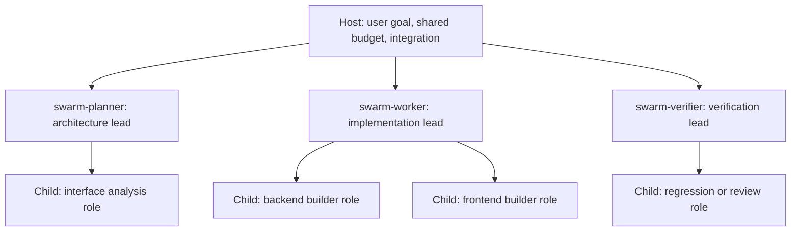

# [PROP-adaptive-swarm-development] Reusable Subagents and Optional Teams for Adaptive Development

## 1. Background & Hypothesis

`CAP-DLV-adaptive-development` already supports clarification, research, implementation and usage verification
without per-change SDD records. Its bundle registers three optional support subagents: `product-clarifier`,
`product-researcher` and `usage-reviewer`. The missing capability is a reusable delegation procedure for code-writing
teams, including ownership, nested delegation and verification of their combined result.

SDD already supports isolated workers and nested review delegation (`ARCH-04-delivery-strategy`). This proposal
adapts useful delegation patterns to adaptive development without introducing SDD Units or a mandatory role pipeline.
It does not claim that SDD execution is necessarily serial or that adaptive development is limited to ideation.

### Core hypothesis

A small set of reusable, prefixed subagents can supply execution capabilities, while on-demand `roles/*.md`
contracts supply task-specific responsibilities. A subagent can execute a bounded task itself or, where the host
supports nesting and the task warrants it, lead a small team of its own subagents. Registration and team topology
are separate choices: either flat or nested execution can use the same registered agents and role documents.

This is a design hypothesis. Prompt cost, latency, model savings and host enforcement remain unmeasured.
The local reference comparison is in [reference-swarm-architectures.md](materials/reference-swarm-architectures.md).
Upstream examples motivate patterns; they are not evidence of performance or correctness in devkit.

### Scope and non-goals

In scope:

- Ship a small default set of general execution subagents with a common prefix in `adaptive-dev`.
- Allow installed prefixed subagents to be reused by compatible callers, and allow projects to add their own agents.
- Keep task and domain specializations in role Markdown files loaded only for the assigned task.
- Support direct work, flat delegation and optional two-level delegation with bounded ownership and concurrency.
- Define worker isolation, combined verification, interruption recovery and current-context ownership.
- Update the capability, use case and catalog ownership description after implementation.
- Verify bundle installation, projection, extension and representative invocation behavior.

Scope excluded:

- A runtime scheduler, daemon, agent bus, automatic agent importer or new package.
- Changes to distribution schemas, host settings, SDD orchestration or shared model-level resolution.
- A mandatory team hierarchy or role sequence for every adaptive action.
- Automatic approach switching, SDD adoption, publication or new approval authority.
- Guaranteed speedup, conflict-free merges, native file-boundary enforcement or model quality equivalence.
- Making other bundles depend on these agents or moving existing SDD roles into a shared registry.

## 2. Design Decisions and Alternatives

### 2.1 Shared prefixed agents and task-specific roles

The recommended default is the archetype model in `PADR-skill-local-swarm-roles`:

| Proposed agent ID | Stable responsibility | Example role overlay |
| :--- | :--- | :--- |
| `swarm-planner` | Analyze and partition one assigned goal | `roles/architect.md` |
| `swarm-worker` | Implement within an assigned write boundary | `roles/builder.md` |
| `swarm-verifier` | Verify an identified source or artifact and return evidence | `roles/qa-tester.md`, `roles/reviewer.md` |

The `swarm-` prefix identifies this shipped family and avoids bare names such as `builder` or `architect`.
The names are proposed public asset IDs, not a new namespace mechanism. Each agent has one owning bundle and uses
existing native projections. Common contracts retain the existing host support declarations and subagent model levels
from `CAP-DIST-agent-projections`; this bundle adds no model router.

Other callers may reuse an installed agent when its contract matches their task. Such reuse is optional and does
not permit importing another bundle's private role files. A caller supplies its own role contract and verifies agent
availability. The adaptive bundle itself remains independently installable with docs/catalog and does not require
`devkit-spec` or another role catalog.

Projects can add a specialized native subagent through an existing in-repository bundle, for example
`acme-security-reviewer`, or supply a local role file to a default agent. Prefer a role file when only task instructions
change. Add a registered agent when recurring execution settings or a stable reusable contract justify it. Project
extensions use their own prefix and do not overwrite shipped IDs. The three defaults are a starting set, not a limit
on the number of user-defined agents.

A role overlay specifies the assigned goal and deliverable. It cannot widen the agent's host permissions, Git
operations or delegated authority. Resolve an incompatible overlay by choosing a compatible agent or returning the
capability gap; do not silently combine conflicting contracts.

### 2.2 Optional role leads and two-level delegation

The user-facing Host remains the overall coordinator. A first-level subagent may act as a role lead (the master
for that assigned responsibility) and spawn second-level agents with specialized role files.

This diagram shows available relationships, not a requirement to run all agents concurrently. The defaults are:

1. Keep small or inseparable work in the invoking agent.
2. Use flat delegation when one bounded assignment fits one agent.
3. Use a role lead only when its assignment contains independently useful subtasks and nesting is available.

The delegation limit is two child levels below the Host: Host → role lead → child. Second-level agents do not
spawn further agents. The Host allocates a session-wide child-agent budget before dispatch, including waiting leads
and their children. A lead receives an explicit child allowance; it does not independently allocate a full team.
When capacity is insufficient, execute inline or sequentially rather than wait while occupying all slots.

Each lead owns the aggregate result for its assignment. Child boundaries stay within the lead's boundary, and the
lead checks actual changed paths and evidence before returning. A read-only lead delegates only read-only work.
The Host owns cross-lead coordination, final integration and `.devkit/adaptive-dev.md`; leads return evidence or drafts.

Nesting support is host-dependent and remains to be exercised. If it is unavailable, the Host flattens the assignments
and retains the same ownership and verification requirements. If subagents are unavailable, the Host works directly
and reports the unverified delegation behavior. No host setting is changed to enable nesting.

### 2.3 Alternatives

| Option | Benefit | Cost or limitation | Proposed use |
| :--- | :--- | :--- | :--- |
| Existing direct adaptive work | No team startup or registration cost | No parallel execution procedure | Keep for small work and fallback |
| General agents plus role files | Small bundle surface; portable role content | Available settings depend on the host invocation API | Supported fallback |
| Prefixed archetypes plus role files | Stable reusable execution contracts; extensible specialization | Persistent metadata and host-specific projections | Recommended default |
| Registered domain personas | Convenient recurring specialist invocation | More public contracts and metadata | Project extension when justified |
| Mandatory nested role teams | Delegates local coordination | Extra context transfer, latency and occupied slots | Rejected as the default |

Role-file placement alone determines neither model selection nor native enforcement. A general-agent invocation
may expose those settings, and a registered agent may still be emulated. Measure the actual host behavior rather
than assigning universal guarantees to either model.

## 3. Execution and Ownership

### 3.1 Lightweight assignment contract

Before delegated code authoring, record the goal, relevant source/base SHA, public interfaces when needed, absolute
read/write boundaries, permitted Git operations, verification commands, stop condition and expected return.
A role lead also receives its depth and child allowance. Keep this in the assignment or mutable current context;
no separate Sprint Contract file or SDD artifact is required.

Architectural decomposition is conditional on interface or ownership uncertainty. The Host can provide an already
clear assignment directly instead of starting an architect solely to repeat it.

### 3.2 Parallel implementation

`PADR-worktree-isolated-parallel-workers` proposes one worktree per concurrent writing worker, including nested
workers. Disjoint file ownership still matters for integration; separate worktrees do not prevent incompatible
interfaces, shared external resource conflicts or merge conflicts.

When the harness is available, use its existing worktree lifecycle. Otherwise use the consuming project's documented
Git procedure. A minimal catalog installation does not imply that `devkit worktree` is installed. If isolated writable
worktrees cannot be created within current authority, serialize writers. A lead does not write into a worktree while
its child owns it; shared glue changes occur after children finish.

### 3.3 Verification, integration and recovery

Workers check their bounded changes before returning. A return identifies status, source/base and final SHA where
committed, actual changed paths, commands, outcomes, unresolved defects and unverified areas. The lead verifies its
aggregate assignment; the Host verifies the combined result and controls integration into the final target.

Use the consuming project's lint, type, test and representative usage commands. In this repository, use
`just test-affected` with its full fallback, required lint/type/rule checks, and the applicable E2E and final-target
verification procedure. Record the baseline before integration and identify each checked SHA. A worker's passing
checks do not establish that the combined or landed HEAD passes.

A dedicated verifier is useful for separable checks; it is not mandatory for every action. Independent verification
requirements of the consuming project still apply. Failures route to the responsible writer with reproducing evidence.
Bound repair attempts in the assignment and report an unresolved result when the stop condition is reached.

Update `.devkit/adaptive-dev.md` when resume facts change, including on failure or interruption. A passing QA gate is
not a prerequisite for preserving failure evidence. On cancellation, stop or collect active children before releasing
ownership. Preserve unmerged commits and dirty worktrees; remove only worktrees whose results are retained or whose
removal has separate authority.

## 4. Acceptance Scenarios

- **AC-1:** Given an adaptive task that needs no delegation, when the Host acts, then it can implement and verify
  directly without creating SDD artifacts or running a fixed team sequence.
- **AC-2:** Given an independent docs/catalog installation, when `adaptive-dev` is selected and synchronized, then
  the three prefixed archetype contracts and their supported projections deploy without `devkit-spec`.
- **AC-3:** Given a compatible caller and an installed archetype, when the caller supplies its own bounded role
  assignment, then the agent can return the requested evidence without loading adaptive orchestration or sibling
  bundles' private assets.
- **AC-4:** Given a project-owned specialized agent or role overlay, when it is selected for a task, then shipped
  defaults remain unchanged and incompatible permissions or unavailable capabilities are reported explicitly.
- **AC-5:** Given a nested assignment, when the lead dispatches children, then depth stays within two child levels,
  all children fit the Host's shared allowance, and each child stays within its parent's authority and ownership.
- **AC-6:** Given no nested-agent support or insufficient capacity, when the assignment is executed, then the Host
  flattens or serializes it and preserves the same result and verification contracts without changing host settings.
- **AC-7:** Given concurrent writing children, when they implement, then each owns a separate worktree; a parent
  performs no concurrent writes there, and actual changed paths are checked before integration.
- **AC-8:** Given completed worker results, when the Host reports delivery, then combined and applicable landed-target
  checks identify their actual SHAs, commands and outcomes; failed or unavailable checks remain explicit.
- **AC-9:** Given a failed or interrupted assignment, when work pauses, then current context records retained results,
  active ownership and the next action, and cleanup preserves unmerged or dirty work.

Installation and projection tests establish packaging behavior only. Invocation exercises and review establish the
semantic delegation behavior; keyword assertions do not prove concurrency, sandboxing or successful nested execution.

## 5. Planning Findings and Remaining Evidence

The Planning review selects prefixed archetypes plus on-demand role files as the recommended direction and keeps
nested role leads optional. `PADR-skill-local-swarm-roles` records registration and team-topology alternatives;
`PADR-worktree-isolated-parallel-workers` records write ownership and integration consequences.

Existing `CAP-DLV-adaptive-development` exclusions for fixed hierarchy and model routing remain in force: the team
shape is optional and model settings reuse distribution policy. The existing no-Git-mutation contract for product
support roles remains unchanged; code-writing archetypes receive separately defined Git authority. The promoted
role decision will amend the relevant role-set clauses of `ADR-adaptive-development-and-research` without replacing
its approach, current-context or research-material decisions.

Before implementation is declared verified, exercise direct, flat and nested assignments on supported hosts and
record unavailable cases. Start with one representative coding task and one failed/interrupted task. Record actual
host/version, source identity, depth/capacity behavior and permission enforcement or emulation. Compare latency or
token usage only when the runtime exposes measurements and the task, model settings and completion checks match;
otherwise retain those metrics as unmeasured. No performance threshold or savings percentage is an acceptance claim.

## 6. Lifecycle and Target Documents

`PROP-adaptive-swarm-development-target` lists prospective Living Spec changes. Current capability and architecture
contracts remain unchanged during this proposal review. Acceptance and Development handoff remain separate authorized
operations; this refinement does not accept the proposal, merge its Planning branch or start implementation.
