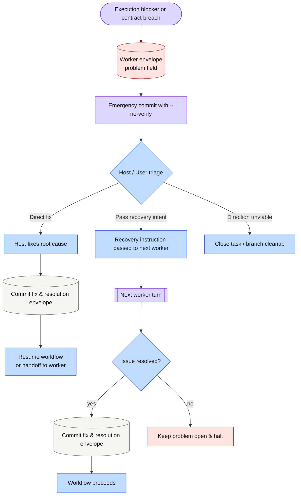

# [US-handle-delivery-problems-and-exceptions] Handle Delivery Problems and Exceptions

## 1. User Story Narrative

- **As a**: AI coding agent working across delivery workflows
- **I want to**: distinguish between minor non-blocking feedback and blocking contract breaches, record unresolvable issues as structured problems, and escalate or close tasks cleanly
- **So that**: execution never halts for benign ambiguities, but halts strictly when agreed boundaries cannot be met, preserving evidence for human recovery.

---

## 2. Background & Context

Autonomous progression requires agents to resolve choices using recommended options when within agreed scope. Non-blocking suggestions are recorded as feedback rather than pausing the workflow. When an implementation discovers that agreed goals, contracts, or boundaries cannot be honored, the worker logs a `problem` envelope and halts. The host or user can then remediate the root cause and author a `resolution` envelope explicitly citing the problem. If a task requires unexpected documentation or contract updates, depth escalates (`session → spec`). When a direction is unviable, the task closes as abandoned or superseded without leaving dangling worktrees or corrupting the base branch.

---

## 3. Acceptance Criteria (Given / When / Then)

### Scenario 1: An agreement breach or execution blocker halts the worker via a problem envelope
- **Given**: a worker executing a task discovering an insurmountable technical blocker or an unavoidable breach of agreed constraints
- **When**: the worker completes its turn
- **Then**: it writes a `worker` envelope containing the `problem` field specifying cause, attempted steps, and recovery recommendations, commits the record, and exits without attempting integration.

### Scenario 2: A resolution envelope resolves an open problem before integration
- **Given**: an active unit branch containing an unresolved problem envelope
- **When**: the agent or developer resolves the underlying issue and records a `resolution` envelope referencing the target worker envelope filename via `resolves:`
- **Then**: `devkit workflow envelope check --unit <dir>` reports zero active blockers, and the integration guard allows gated progression.

### Scenario 3: Scope expansion escalates session depth to spec in-flight
- **Given**: a `session` task discovering that a persistent Living Spec contract or architectural document must be modified
- **When**: the agent triggers depth escalation under `[tool.spec] depth_escalation = "auto"`
- **Then**: it initializes a bound spec Unit with `devkit spec new <slug>`, copies in-flight changes, and transitions execution into the spec workflow without losing uncommitted progress.

### Scenario 4: An unviable direction closes a task without corrupting history
- **Given**: a task whose agreed direction is rejected or determined unviable during review or development
- **When**: the host or user decides to abandon an unviable development branch or reject a proposal
- **Then**: an abandoned task branch is dropped cleanly using `devkit worktree finish <branch> --discard`, whereas a rejected proposal records `status: rejected` with the decision rationale in its commit message and merges per policy, leaving rejection ADR authoring and cleanup to subsequent hygiene sweeps (`devkit rules check -p hygiene`).

### Scenario 5: Stale activity branches trigger hygiene warnings without automated deletion
- **Given**: an activity branch `dev-<slug>` whose latest commit and linked PR activity exceed `[worktree] stale_after`
- **When**: the developer runs `devkit rules check -p hygiene`
- **Then**: the rule engine emits a warning detailing the branch name, unit path, inactivity duration, and suggested discard command, without silently deleting the branch.

