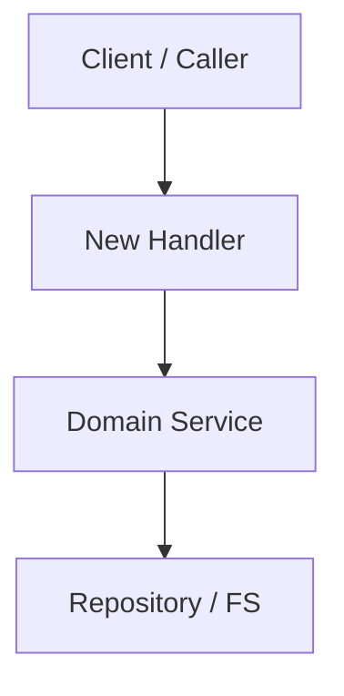

# spec-plan: Technical Planning Workflow

Use this skill once `spec.md` is drafted and agreed: the `specify` stage of workflow `sdd-spec-feature`, or the `plan-tasks` stage (fix design) of workflow `sdd-spec-bugfix`. It designs the solution, maps changes onto the architecture and sets the contracts and boundaries the tasks build on.

---

## 1. Prerequisites & Inputs

- `specs/<YYYY-MM>/<YYYYMMDD>-<slug>/spec.md`; `plan.md` beside it is the skeleton `devkit spec new` or `devkit spec proposal handoff` wrote. A bugfix bundle from `devkit spec new` has none: write `plan.md` at the `plan-tasks` stage with the frontmatter `id: PLAN-<slug>` and `spec: SPEC-<slug>`, then the sections below.
- `docs/architecture/`, capabilities (`devkit spec list capability`) and ADRs (`devkit spec list decision`).

---

## 2. Planning Workflow

### Step 0: Constitution & Invariant Pre-Flight
- Check the plan against:
  - accepted ADRs (`devkit spec search "<topic>" --kind decision`);
  - module boundaries, import hierarchies and runtime, packaging or dependency constraints in `docs/architecture/`;
  - existing capabilities it duplicates or breaks (`devkit spec refs <CAP-ID> --direction in` shows what depends on one).
- An architectural rule that MUST change needs a new ADR, proposed with its reason (`docs/decisions/<YYYY-MM>/<YYYYMMDD>-<slug>.md`, ID `ADR-<slug>`, template `.devkit/managed/spec/templates/decision.md`).
- Decide design choices inside the agreed intent with the recommended option and record the reason here; one outside it is a problem for the Host. A bugfix whose fix needs a different defect scope within the agreed expected behavior returns to `characterize`.

### Step 1: Component Breakdown & Interface Contracts
- The packages, modules or services touched or introduced, and their internal contracts (data structures, interfaces, signatures, schemas); for external APIs or CLIs, flags, return codes and payload formats.

### Step 2: Cross-Artifact Consistency Check
- Every user story in `spec.md` has an implementation path, every `[AC-NN]` scenario a handling component, and no non-goal is in the plan.

### Step 3: Failure Modes & Rollback
- The failure modes the change introduces, and a backwards-compatible rollout for any required migration.

### Step 4: Verification Strategy
- The tests and static checks that prove each scenario; for a bugfix, the reproduction test that becomes the regression test and the checks that cover the preserved behavior.

---

## 3. Plan Output Standard

Read the skeleton `specs/<YYYY-MM>/<YYYYMMDD>-<slug>/plan.md`, then rewrite it, keeping its `id` and `spec` frontmatter. The invariant review, impacted components and verification sections are always present; the others (diagram, data contracts, storage, failure modes) are written only when the change has that content. Drop a section that does not apply instead of writing "N/A"; a small change can have a short plan. Cite documents by full ID in backticks (`` `ADR-<slug>` ``, `` `CAP-<AREA>-<slug>` ``), never by Markdown path.

````markdown
---
id: PLAN-<feature-slug>
spec: SPEC-<feature-slug>
---

# Technical Plan: `SPEC-<feature-slug>` <Feature Title>

## 1. Constitution & Invariant Review
<List only conflicts with ADRs, architecture constraints or existing capabilities, and the ADR each one needs. Write "None" when the plan conforms.>

## 2. Architecture Overview & Impact
- **Impacted Components**:
  - `path/to/component-a`: <What changes>
  - `path/to/component-b`: <What changes>
- **New Dependencies**: <None or specific libraries with rationale>

## 3. Component & Interface Design


### Data Contracts & Types
```python
# or a snippet in the project's language specifying the normative interface
@dataclass(frozen=True)
class FeatureConfig:
    enabled: bool
    timeout_ms: int
```

## 4. Storage & State Management
<Schema changes, persistence layer, or file formats.>

## 5. Error Handling & Edge Cases
- **Failure Scenario 1**: <Mitigation>
- **Failure Scenario 2**: <Mitigation>

## 6. Verification & Test Plan
- Unit test coverage targets.
- Integration test scenarios.
- Commands to run for validation: the targeted tests during development (the touched modules or areas), the full suite once before integration (`just test`), and the other checks (`just lint`, `devkit rules check`, etc.).
````

---

## 4. Definition of Done (DoD) for Planning
- [ ] Every user story and scenario has an implementation path; non-goals stay out; sections that do not apply are omitted.
- [ ] The skeleton marker line `<!-- devkit:skeleton -->` is removed from `plan.md` (`not-skeleton(plan.md)` keeps the stage open until then); next is `spec-tasks`.
