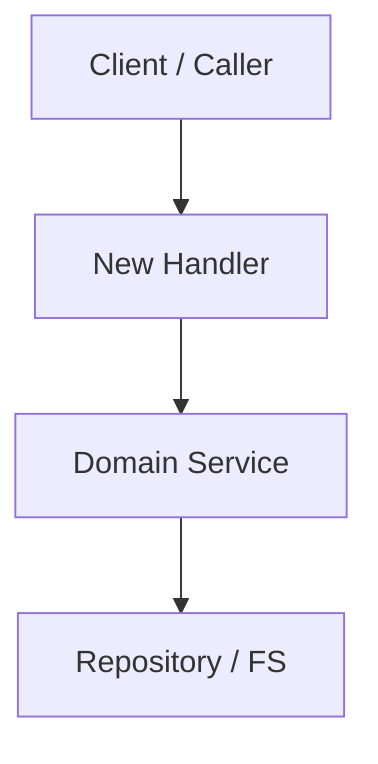

# spec-plan: Technical Planning Workflow

Design the solution for an agreed `spec.md`: map it onto the architecture and set the contracts and boundaries the
tasks build on.

Use this skill at:

- the `specify` stage of workflow `sdd-spec-feature`, once `spec.md` is drafted and agreed;
- the `plan-tasks` stage (fix design) of workflow `sdd-spec-bugfix`.

## 1. Inputs

- `specs/<YYYY-MM>/<YYYYMMDD>-<slug>/spec.md`.
- `plan.md` beside it: the skeleton `devkit spec new` or `devkit spec proposal handoff` wrote.
- If the bundle is a bugfix from `devkit spec new` (no `plan.md`): create `plan.md` at `plan-tasks` with the
  frontmatter `id: PLAN-<slug>` and `spec: SPEC-<slug>`.
- `docs/architecture/`, capabilities (`devkit spec list capability`), ADRs (`devkit spec list decision`).

## 2. Procedure

1. **Invariant pre-flight.** Check the design against:
   - accepted ADRs: `devkit spec search "<topic>" --kind decision`;
   - module boundaries, import hierarchies, and runtime, packaging or dependency constraints in `docs/architecture/`;
   - capabilities it duplicates or breaks: `devkit spec refs <CAP-ID> --direction in` lists what depends on one.
2. **Changed invariant.** If an architectural rule that must hold has to change, propose a new ADR with its reason:
   path `docs/decisions/<YYYY-MM>/<YYYYMMDD>-<slug>.md`, ID `ADR-<slug>`, template
   `.devkit/managed/spec/templates/decision.md`.
3. **Design choices.** Inside the agreed intent, choose the recommended option and record its reason in the plan.
   - If a choice falls outside the intent, raise it as a problem for the Host.
   - If a bugfix needs a different defect scope within the agreed expected behavior, return to `characterize`.
4. **Components and contracts.** List the packages, modules or services touched or added, and their internal
   contracts: data structures, interfaces, signatures, schemas. For an external API or CLI, give flags, return
   codes and payload formats.
5. **Consistency.** Give every user story an implementation path and every `[AC-NN]` scenario a handling
   component. Keep every non-goal out of the plan.
6. **Failure modes.** List the failure modes the change introduces. Give a required migration a
   backwards-compatible rollout.
7. **Verification.** Name the tests and static checks that prove each scenario. For a bugfix, keep the reproduction
   test as the regression test and name the checks that cover the preserved behavior.

## 3. Plan Output

1. Read the skeleton `plan.md`, then rewrite it. Keep its `id` and `spec` frontmatter.
2. Always write the invariant review, impacted components and verification sections.
3. Write the diagram, data contracts, storage and failure-mode sections only when the change has that content. Drop
   an inapplicable section instead of writing "N/A"; a small change gets a short plan.
4. Cite documents by full ID in backticks (`` `SPEC-<slug>` ``, `` `ADR-<slug>` ``, `` `CAP-<AREA>-<slug>` ``),
   the unit's own spec included, not by Markdown path or file name.

````markdown
---
id: PLAN-<feature-slug>
spec: SPEC-<feature-slug>
---

# Technical Plan: `SPEC-<feature-slug>` <Feature Title>

## 1. Constitution & Invariant Review
<Only conflicts with ADRs, architecture constraints or existing capabilities, each with the ADR it needs; "None" when the plan conforms.>

## 2. Architecture Overview & Impact
- **Impacted Components**:
  - `path/to/component-a`: <What changes>
  - `path/to/component-b`: <What changes>
- **New Dependencies**: <None, or each library with its reason>

## 3. Component & Interface Design


### Data Contracts & Types
```python
# or a snippet in the project's language specifying the normative interface
@dataclass(frozen=True)
class FeatureConfig:
    enabled: bool
    timeout_ms: int
```

## 4. Storage & State Management
<Schema changes, persistence layer, or file formats.>

## 5. Error Handling & Edge Cases
- **Failure Scenario 1**: <Mitigation>
- **Failure Scenario 2**: <Mitigation>

## 6. Verification & Test Plan
- Unit test coverage targets.
- Integration test scenarios.
- Validation commands under the repository's policy: affected tests (e.g., `just test-affected`), any required
  full-suite checks, and lint, type and governance checks. State when existing results can be reused.
````

## 4. Completion

- [ ] Every user story and scenario has an implementation path; no non-goal is planned; no inapplicable section
  remains.
- [ ] The skeleton marker line `<!-- devkit:skeleton -->` is removed from `plan.md`.
- [ ] `devkit workflow next --unit <dir>` no longer reports `not-skeleton(plan.md)`; the next skill is `spec-tasks`.
