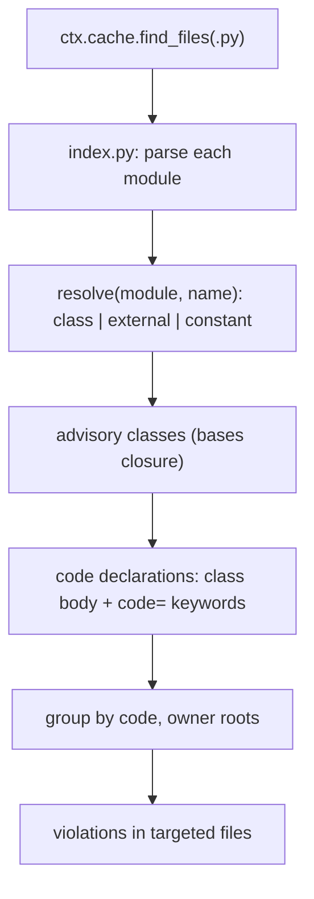

# Technical Plan: `SPEC-advisory-unique-code` Advisory code uniqueness rule

## 1. Constitution & Invariant Review

None. `devkit.advisory_guide` stays a data-only module (its `__init__.py` imports nothing); like
`devkit.authoring_guide`, its `bundle/rules/` code uses the public rule API and is loaded only from the synchronized
copy. The layering allowance for `advisory_guide` grows from nothing to `rules`, which is below no other area that
imports it. `devkit-advisory` is not touched, so its standard-library-only runtime contract holds. The rule follows
`CAP-GOV-rule-authoring` (one plugin package directory with `rule.py`, `guide.md`, `tests/`).

## 2. Architecture Overview & Impact

- **Impacted Components**:
  - `packages/devkit/src/devkit/advisory_guide/bundle/rules/unique_code/`: new plugin package. `rule.py` (the
    `BaseRule`), `index.py` (static module index: imports, classes, string constants, code declarations), `guide.md`,
    `tests/test_rule.py`.
  - `packages/devkit/src/devkit/advisory_guide/bundle/bundle.toml`: `unique-code` rule asset, in the `python` preset.
  - `packages/devkit/src/devkit/advisory_guide/__init__.py`: docstring names the shipped rule.
  - `packages/devkit/tests/test_layering.py`: `advisory_guide` allowed `{"rules"}`; comment covers both guide areas.
  - `.devkit/config.toml`: `advisory = "python"` under `[presets]`; `devkit sync` updates `.devkit/installation.json`.
  - `AGENTS.md`, `packages/devkit/README.md`: layering and data-only wording.
  - `docs/development/reference/advisory.md`, `docs/development/reference/rules.md`,
    `docs/development/reference/distribution.md`: preset table and bundle rule catalog.
  - `CAP-ADV-agent-advisory-protocol` §10 and the `agent-advisory-python` instruction: name the rule by ID.
- **New Dependencies**: None (`ast` from the standard library).

## 3. Component & Interface Design



### Data Contracts & Types

```python
@dataclass(frozen=True)
class UniqueCodeSettings:
    bases: list[str] = field(default_factory=lambda: ["devkit.advisory.AdvisoryError", "devkit.advisory.error.AdvisoryError"])
    exclude: list[str] = field(default_factory=lambda: ["**/tests/**", "**/test_*.py", "**/*_test.py", "**/conftest.py"])

# index.py
@dataclass(frozen=True)
class ClassInfo:
    qualname: str            # "<module>.<Name>"
    file: str                # workspace-relative path
    line: int
    bases: tuple[Ref, ...]   # unresolved references as written

@dataclass(frozen=True)
class Declaration:
    code: str
    owner: str               # qualified name of a ClassInfo or an external "<module>.<name>"
    file: str
    line: int
```

- **Module names**: path parts after the last `src` segment, else from the workspace root; `pkg/__init__.py` is `pkg`.
- **Symbols per module**: top-level `class`, top-level `NAME = "literal"`, `import a.b [as c]`, `from [.]m import x [as
  y]`. A reference `(module, name)` resolves to a class or constant defined there, follows a `from` import of the same
  name through re-exports (cycle-guarded), and otherwise stays external as `"<module>.<name>"`. A dotted base `m.X`
  resolves `m` through `import` aliases first. Relative imports resolve against the module's package.
- **Advisory closure**: a class is advisory when a base resolves to a configured base name (each configured name is
  itself resolved, so `devkit.advisory.AdvisoryError` maps to the class in `devkit.advisory.error` inside this
  repository and stays external in a consumer) or to an advisory class.
- **Declarations**: class-body `code` assignments of advisory classes; `code=` keywords of calls whose callee is an
  advisory class or `<advisory class>.<attribute>` (a classmethod factory). Values are string literals or names
  resolving to module constants; anything else is skipped (non-goal 2).
- **Collision**: per code, owners are reduced to roots (owners that do not derive from another owner). One root is
  accepted; more than one reports every declaration whose owner is a root, in a targeted file, naming the other roots.
  The base class's own `code` (`GENERAL_ERROR`) participates like any other.
- **Message**: `Code "<CODE>" is also declared by <qualname> (<file>:<line>)[, ...]; a code names one condition`.
  Remediation: give the condition its own code, or derive the class from the one that owns the code.

## 5. Error Handling & Edge Cases

- **Syntax error or undecodable file**: skipped (`ast.parse` failure); other files are still analyzed (AC-09).
- **Excluded or untargeted files**: `exclude` removes a file from analysis; `ctx.is_file_targeted` limits reporting
  only, so a commit touching one side of a collision is still refused (AC-08).
- **Import cycles and star imports**: resolution keeps a visited set; `from m import *` is ignored.
- **Duplicate module names** (two `src` trees with the same module): the first path in sorted order wins, as the
  analysis needs one definition per name; the guide documents it.

## 6. Verification & Test Plan

- Rule tests (`tests/test_rule.py` via `devkit.rules.testing.check`): one test per AC-01 to AC-09.
- AC-10: `uv run devkit sync`, `uv run devkit rules check` (no violation), `uv run devkit rules test
  RULE-advisory-unique-code`, `just test devkit` (layering and documented-codes tests).
- `just lint-check devkit`, `just check devkit`, `just rules-check`, `git diff --check`.
- Mutation check: a temporary collision in a scratch workspace is reported by `devkit rules check`.
