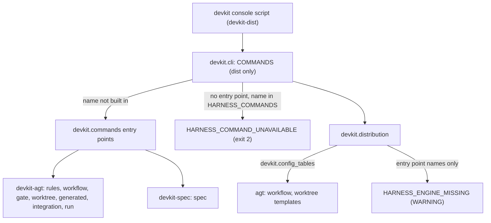

# Technical Plan: `SPEC-devkit-dist-package-separation` Separate asset distribution into independent devkit-dist package

## 1. Constitution & Invariant Review

- The split itself is decided in `ADR-dist-foundation-ownership`, `ADR-dist-module-split`,
  `ADR-dist-command-composition`, `ADR-dist-config-receipt-ownership` and `ADR-dist-bundles-compatibility`; the plan
  implements them and needs no new ADR.
- The AGENTS.md layering rule for `packages/devkit` becomes a per-wheel rule (`ADR-dist-module-split`): the
  `devkit-dist` areas keep their current edges (`core` < `search`/`host` < `distribution`, all on `advisory`), the
  `devkit-agt` areas keep theirs and may use the `devkit-dist` areas below them. The AGENTS.md text is reconciled.
- `ARCH-05-3-command-plugins` loses the built-in reservation for the harness command names (`ADR-dist-command-composition`
  M1, accepted cost); its precedence gains the name-only list as the last step.
- The AGENTS.md compatibility section forbids shims and migrations; none is added. The `devkit-advisory` semver
  contract is untouched (its version moves only with the lockstep release).

## 2. Architecture Overview & Impact

- **Impacted Components**:
  - `packages/devkit-dist/` (new): `pyproject.toml` (wheel `devkit-dist`, the `devkit` console script, `devkit.bundles`
    `devkit`/`advisory`/`git-commits`, `devkit.host.handlers` `observe`, extras `search` and `mcp`, the `devkit-embed`
    URL source), `README.md`, `src/devkit/{cli.py,__main__.py,core,search,host,distribution,advisory_guide,commits_guide}`
    moved with `git mv`, a `py.typed` in each area, and `tests/` moved from `packages/devkit/tests` for those areas.
  - `packages/devkit/`: keeps `rules`, `workflow`, `gate`, `worktree`, `generated`, `integration`, `compact`,
    `authoring_guide`; gains `harness_guide`; drops the root `py.typed` for one per area; `pyproject.toml` depends on
    `devkit-dist==0.1.1`, declares the seven `devkit.commands` entry points, the `devkit.bundles` `authoring` and
    `harness` entries, the `devkit.config_tables` `workflow` and `worktree` entries, keeps its other entry points, no
    console script, and extras `search = ["devkit-dist[search]"]`, `mcp = ["devkit-dist[mcp]"]`.
  - `devkit.cli` (dist): `COMMANDS` holds only `devkit-dist` commands (`host` included); `HARNESS_COMMANDS` is the
    name-only list; `--version` reads `devkit-dist`.
  - `devkit.core.errors` (dist): `HarnessCommandUnavailableError` (`HARNESS_COMMAND_UNAVAILABLE`, exit `2`) and the
    shared `HARNESS_INSTALL_FIX`; extra-fix texts in `devkit.search.errors`, `devkit.host.errors`, `devkit.host.cli`,
    `devkit.distribution.cli`.
  - `devkit.distribution.installation`: `discovery.BUILTIN_DISTRIBUTIONS = {"devkit-dist", "devkit-agt"}`;
    `sync.TOOL_PACKAGE = "devkit-dist"` and the two-sided tool notice; `config.TEMPLATE_TABLES` removed in favour of
    `config_template.load_reserved_templates()` over `devkit.config_tables` with `config.RESERVED_TABLES`; a new
    `engines.py` computing `HARNESS_ENGINE_MISSING` from deployed asset kinds and `devkit.commands` entry point names,
    called from `sync.commit_locked` and `status.get_project_status`; `devkit.distribution.errors` gains
    `HarnessEngineMissingNotice`.
  - `devkit.distribution.guide` (the `devkit` bundle): constitution contracts 1 to 4 plus the receipt-commit half of
    contract 6 (contract 3 generic), `consumption`, `resource-kinds` and `in-repo-bundle` without harness directives,
    preset `core` only; `devkit-run` and `run-pointer` move out.
  - `devkit.harness_guide` (agt, new data area): `bundle/bundle.toml` (`harness`, `auto_select = true`, presets `core` =
    `harness-consumption`, `harness-assets`, `devkit-run`; `run` = `devkit-run`, `run-pointer`), `AGENTS.md` (harness intro,
    contract 5, snapshot-gate half of contract 6), the moved `devkit-run.md` and `run-pointer.md`, and the two new
    instructions holding the moved sections.
  - `devkit.workflow.project.config` and `devkit.worktree.config` (agt): `config_tables()` callables returning the
    templates that left `config.TEMPLATE_TABLES`, unchanged text.
  - Tests: per-wheel `test_layering.py`; `distsupport` replaces `testsupport.distribution` and `testsupport.search` for
    the dist tests; harness-dependent dist tests (`distribution/test_config_template.py` harness tables, the root-command
    assertion of `core/test_cli.py`, the gate hook assertion of `distribution/test_sync.py`) move to or split into agt
    tests; new tests for the name-only list, the engine notice, the harness bundle, the reserved templates and the
    receipt tool record.
  - `devkit-catalog`, `devkit-starter`: dev dependency `devkit-dist`. `devkit-spec`, `devkit-viewer`: unchanged
    `devkit-agt` dependency; the `spec-rule` skill text also points to the `harness` bundle for rule tests and snapshot
    gates.
  - Root `pyproject.toml` (ruff `namespace-packages`, Pyright `extraPaths`, pytest `testpaths`/`pythonpath`, dev group,
    sources), `uv.lock`, `justfile` (`test-dist`), `scripts/_lib.sh` (`dist` alias, model URL read from
    `packages/devkit-dist/pyproject.toml`), `scripts/dist_only.sh` (new), `scripts/smoke.sh`, `scripts/release.sh`,
    `.github/workflows/ci.yml`.
  - Living Spec and guides (reconcile): the `CAP-DIST-*` capabilities, `CAP-HOST-lifecycle-observation`,
    `CAP-SRCH-document-search`, `CAP-CMP-bounded-execution`, `CAP-INT-mcp-services`, `ARCH-01-introduction-and-goals`,
    `ARCH-03-context`, `ARCH-05-1-containers`, `ARCH-05-2-components`, `ARCH-05-3-command-plugins`,
    `ARCH-05-4-distribution-components`, `ARCH-07-deployment`, the architecture README, `docs/development/*`,
    `guides/*`, the package READMEs, the root README and AGENTS.md; the five ADRs get no edit unless a consequence
    needs a status note.
- **New Dependencies**: none. `devkit-dist` takes the runtime dependencies `devkit-agt` has today.

## 3. Component & Interface Design



### Data Contracts & Types

```python
# devkit/cli.py (devkit-dist)
HARNESS_COMMANDS: tuple[str, ...] = ("rules", "workflow", "gate", "worktree", "generated", "integration", "run")
# lookup: built-in COMMANDS -> devkit.commands entry point -> HARNESS_COMMANDS stand-in reporting
# HarnessCommandUnavailableError (text or {"error": ...} under --format json) -> None (click usage error)

# devkit/core/errors.py
HARNESS_INSTALL_FIX: str  # the install directive of SPEC AC section 4, shared by both signals
class HarnessCommandUnavailableError(DevkitCoreError):
    code = "HARNESS_COMMAND_UNAVAILABLE"   # exit_code ERROR (2), actor USER, fix HARNESS_INSTALL_FIX

# devkit/distribution/installation/config.py
RESERVED_TABLES = ("rules", "workflow", "gates", "worktree", "integration")  # passed through unread

# devkit/distribution/installation/config_template.py
RESERVED_GROUP = "devkit.config_tables"   # entry name: a reserved table; value: () -> Sequence[TemplateTable]
def load_reserved_templates() -> tuple[list[ToolTemplate], list[AdvisoryError]]: ...

# devkit/distribution/installation/engines.py
ENGINE_COMMANDS = {"rule": "rules", "gate": "gate", "workflow": "workflow"}
def engine_notices(assets: Iterable[AssetRecord]) -> list[AdvisoryError]: ...  # HarnessEngineMissingNotice or []
```

- `HarnessEngineMissingNotice(SyncNotice)`: `code = "HARNESS_ENGINE_MISSING"`, `level = WARNING`, message
  `deployed assets no installed engine runs: <bundle> (<kind>, ...), ...`, one detail line per bundle, `fix =
  HARNESS_INSTALL_FIX`. Engine presence is `{entry.name for entry in entry_points(group="devkit.commands")}`; the
  module holds the group name in a constant not ending in `GROUP`, so the layering test keeps `devkit.commands` loaded
  by `cli`.
- `ToolVersionChangedNotice` message: `"<old package> <old version> -> <new package> <new version>: ..."` when the
  package differs, unchanged `"<package> <old> -> <new>: ..."` otherwise.
- Missing-extra fix form: `Add the <extra> extra to the devkit requirement the project declares: uv add
  'devkit-agt[<extra>] @ git+https://github.com/mjkimR/devkit.git#subdirectory=packages/devkit' when it depends on
  devkit-agt, else uv add 'devkit-dist[<extra>] @ git+https://github.com/mjkimR/devkit.git#subdirectory=packages/devkit-dist'`.

## 4. Storage & State Management

- `.devkit/config.toml` schema unchanged (`SCHEMA = 1`, same closed field list).
- Receipt schema unchanged (`schema = 1`); the next writing sync records `tool.package = "devkit-dist"`, the shipping
  wheel per bundle and, with `devkit-agt`, the `harness` entry. This repository's own `.devkit/installation.json` and
  root `AGENTS.md` block are rewritten by `devkit sync` after the split and committed with it.

## 5. Error Handling & Edge Cases

- **A third-party plugin named like a harness command next to `devkit-agt`**: two declarations of one name, so
  `COMMAND_PLUGIN_INVALID` for that command only (accepted cost of M1).
- **`devkit <harness-name> --help` standalone**: the stand-in has no help option, so the coded error is reported for
  `--help` too, like an unusable plugin.
- **A `devkit.config_tables` entry that fails, returns invalid tables or is not reserved**: left out with
  `CONFIG_TEMPLATE_EXTENSION_FAILED`, the command succeeds.
- **Old receipt written by `devkit-agt`**: read as is; a no-op sync keeps its bytes (the writing tool alone is not a
  change); the first writing sync records the new names.
- **Override of a moved asset (`devkit:devkit-run`)**: the asset no longer exists in `devkit`, so the override file is
  not applied; its record is carried while `.devkit/overrides/devkit/` exists; the sync deploys `harness:devkit-run`
  upstream (AC-17).
- **Rollback**: reverting the merge restores the single wheel; no data migration exists to undo.

## 6. Verification & Test Plan

- Unit and CLI tests per AC in the owning wheel's tests; dist tests pass in the workspace and in the dist-only
  environment (tests that need standalone entry points are skipped unless `devkit.rules` is absent).
- `just lint-check`, `just check`, `just test` (workspace, both wheels), `just test-dist` (dist-only environment,
  AC-14), `just rules-check`, `just smoke` (AC-01, AC-02, AC-04 to AC-06, AC-16), wheel RECORD overlap check and
  `scripts/release.sh` dry build (AC-15).
- Manual evidence for the final report: before/after `--format json` comparison of `devkit list`, `devkit status`,
  `devkit sync --dry-run`, `devkit config template --print` and `devkit get-context` on a fixture project with wheels
  built from the base commit and this branch; a `git+file://` installation of `devkit-agt` from this branch to check
  that its `devkit-dist` workspace dependency and the `devkit-embed` source resolve.
