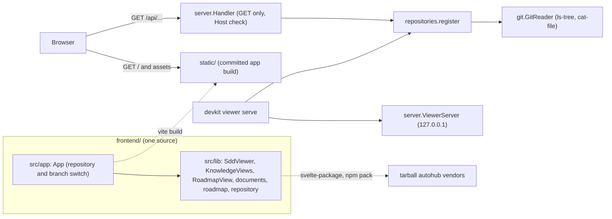

# Technical Plan: `SPEC-repository-viewer` Local multi-repository SDD viewer owned by devkit

## 1. Constitution & Invariant Review

None. The plan follows `ADR-viewer-distribution-and-frontend-build` and `ADR-read-only-local-server-over-git-refs`:

- **Agent-first output** (`ARCH-08-1-agent-output`): `devkit viewer serve` prints one sentinel on stdout, refusals are
  `AdvisoryError`s rendered by `devkit.core.cli.boundary`, and access logs are `logging` records visible under `-v`.
  The HTTP API is for the page, not for agents; it answers JSON errors with stable `VIEWER_` codes.
- **No daemon** (`ARCH-01-introduction-and-goals` §3.4): a foreground process a person starts and stops.
- **Layering**: `devkit_viewer` is its own top-level package (like `devkit_spec`) and imports only `devkit.core` and
  `devkit.advisory`; a test in the package enforces it. `packages/devkit/tests/test_layering.py` scans `devkit` only
  and needs no change.
- **One `devkit` executable** (`ADR-mount-under-the-devkit-command-line`): mounted through `devkit.commands` `viewer`.
- **Compatibility**: no schema or command is changed; the new API is additive.

## 2. Architecture Overview & Impact

- **Impacted Components**:
  - `packages/devkit-viewer/` (new): distribution `devkit-viewer` 0.1.0, import package `devkit_viewer`, its tests,
    README, and the frontend project under `frontend/`.
  - `pyproject.toml` (root): workspace source, dev dependency, pyright `extraPaths`, pytest `testpaths`.
  - `scripts/_lib.sh`: module alias `viewer`; `scripts/viewer.sh` (new) and a `viewer` recipe in `justfile` for the
    frontend; `scripts/smoke.sh` installs the wheel and serves a page; `scripts/release.sh` lists the wheel.
  - `.devkit/generated.toml` (new): the `viewer-assets` artifact.
  - `.gitignore`: `node_modules/`, the library's `dist/` and Vite caches under the frontend.
  - `.github/workflows/ci.yml`: a `viewer` job (Node, frontend checks, `devkit generated check viewer-assets`).
  - Docs: a new capability document in the new area `viewer`, `docs/development/reference/viewer.md`, `AGENTS.md` and
    `README.md` package lists.
- **New Dependencies**:
  - Python: none beyond `click` and `devkit-agt` (standard library `http.server`).
  - Frontend runtime: `marked`, `dompurify`, `yaml`, `mermaid` (as in autohub); peer `svelte` 5.
  - Frontend development: `vite`, `@sveltejs/vite-plugin-svelte`, `@sveltejs/package`, `svelte-check`, `typescript`,
    `vitest`, `jsdom`, `@testing-library/svelte`, `prettier`, `prettier-plugin-svelte`.

## 3. Component & Interface Design



### Python (`devkit_viewer`)

- `errors.py`: `ViewerError(AdvisoryError)` and its CLI refusals, all input errors (exit `2`):
  `RepoDuplicateError` `VIEWER_REPO_DUPLICATE`, `RepoInvalidError` `VIEWER_REPO_INVALID`, `NoRepositoryError`
  `VIEWER_NO_REPOSITORY`, `PortInUseError` `VIEWER_PORT_IN_USE`. `ReadError(Exception)` carries `status`, `code` and
  `message` for HTTP answers: `VIEWER_REPO_UNKNOWN` 404, `VIEWER_REF_UNKNOWN` 404, `VIEWER_PATH_NOT_FOUND` 404,
  `VIEWER_PATH_INVALID` 400, `VIEWER_HOST_REFUSED` 403, `VIEWER_METHOD_NOT_ALLOWED` 405, `VIEWER_NOT_FOUND` 404,
  `VIEWER_GIT_FAILED` 500.
- `git.py`: `GitReader(root: Path)` over `devkit.core.git.run_git`:
  - `default_branch() -> str`: `symbolic-ref --short HEAD`, `HEAD` when detached;
  - `branches() -> list[str]`: `for-each-ref --format=%(refname:short) refs/heads`, sorted;
  - `commit(ref) -> str`: refuses an empty ref or one starting with `-`, then
    `rev-parse --verify --quiet --end-of-options <ref>^{commit}`;
  - `tree(ref, path) -> list[TreeItem]` (`ls-tree -l -z`), `blob(ref, path) -> bytes` (`cat-file blob`), with the
    object type checked by `cat-file -t <commit>:<path>`; `TreeItem(name, path, type, size)`;
  - `check_path(path)`: empty means the root; a leading `/`, a backslash, an empty, `.` or `..` segment is
    `VIEWER_PATH_INVALID`.
- `repositories.py`: `Repository(id, root, reader)`; `register(repos, scans, cwd) -> tuple[Repository, ...]`: each
  `--repo` must be the top level of a Git work tree (`git_toplevel(path) == path`); `--scan` adds each direct child
  that is such a top level and holds `.devkit/config.toml`; with neither, the Git top level of `cwd` when it holds
  `.devkit/config.toml`. IDs are directory names; duplicates and an empty result are refused.
- `server.py`: `ViewerServer(ThreadingHTTPServer)` bound to `("127.0.0.1", port)` (`EADDRINUSE` →
  `PortInUseError`), `daemon_threads = True`; `Handler(BaseHTTPRequestHandler)`:
  - every method other than `GET` → 405; a `Host` other than `127.0.0.1:<port>` or `localhost:<port>` → 403;
  - `/api/repos` and `/api/repos/<id>/info|refs|tree|blob` (query `path`, `ref`; the default branch when `ref` is
    absent) → JSON with `Cache-Control: no-store`;
  - other paths → a file of `importlib.resources.files("devkit_viewer") / "static"` (`/` → `index.html`), else 404;
  - `log_message` → `logging` debug.
- `cli.py`: group `viewer` (`--version` → `[VERSION: devkit-viewer <version>]`) and `serve` (`--repo` and `--scan`
  repeatable, `--port` default `8765`, `0` for any free port), under `boundary`. Prints
  `[VIEWER: url=http://127.0.0.1:<port>/ repos=<n>]`, flushes, serves until `SIGINT` or `SIGTERM`, exits `0`.

### API payloads

```text
GET /api/repos                 {"repos": [{"id": str, "default_branch": str}]}
GET /api/repos/<id>/info       {"repo_id": str, "default_branch": str}
GET /api/repos/<id>/refs       {"default_branch": str, "branches": [str]}
GET /api/repos/<id>/tree       {"items": [{"name": str, "path": str, "type": "tree"|"blob", "size"?: int}]}
GET /api/repos/<id>/blob       {"path": str, "encoding": "base64", "content": str, "size": int}
error                          {"error": {"code": str, "message": str}}
```

### Frontend (`frontend/`)

- `src/lib/repository.ts`: the moved `RepositoryDataSource`, plus optional
  `refs?(signal): Promise<{default_branch: string; branches: string[]}>`; `httpDataSource(base)` implements it.
- `src/lib/documents.ts`, `KnowledgeViews.svelte`: moved, unchanged in behavior.
- `src/lib/SddViewer.svelte`: moved; a `roadmap` tab ("로드맵") renders `RoadmapView`. The dead Custom Element `:host`
  rules and the "Shadow DOM" hint pills are dropped.
- `src/lib/roadmap.ts` (pure, tested):
  ```ts
  interface Milestone { id: string; title: string; status: string; dependsOn: string[]; ready: boolean;
    waitingFor: string[]; unknown: string[]; members: Member[] }
  interface Member { id: string; title: string; kind: 'proposal' | 'spec'; status: string; settled: boolean;
    branch: string | null; path: string }
  function buildRoadmap(base: RepositoryDocument[], branches: { name: string; documents: RepositoryDocument[] }[],
    options: { history: boolean }): Milestone[]
  async function loadRoadmapDocuments(source, ref, signal): Promise<{ documents; errors }>
  ```
  Order: `active`, `planned`, then (history) `done`, `dropped`; by ID within a status. Ready: every `depends_on` is a
  known milestone in `done` or `dropped`. Members: proposals (`docs/proposals/PROP-*/proposal.md`) and specs
  (`specs/<YYYY-MM>/<bundle>/spec.md`) whose `milestone` is the ID; rejected proposals are left out; a completed spec
  is settled. One member per slug: a spec beats a proposal, a `plan-`/`dev-` branch beats the default branch.
- `src/lib/RoadmapView.svelte`: loads the default branch and, when `refs` exists, each local `plan-*`/`dev-*` branch;
  a failing `refs` falls back to the default branch only, with a note.
- `src/lib/index.ts`: exports `SddViewer`, `KnowledgeViews`, `RoadmapView`, `httpDataSource`, `normalizeTree`,
  `buildRoadmap` and the types.
- `src/app/App.svelte`, `src/app/api.ts`, `src/app/main.ts`, `index.html`: list `/api/repos`, pick a repository and a
  branch (`/api/repos/<id>/refs`), render `SddViewer` with `httpDataSource("/api/repos/<id>")`, keyed by repository
  and branch.
- `package.json`: name `devkit-viewer`, `files: ["dist"]`, `exports["."]` with `types`/`svelte`/`default` from
  `dist/index.*`, `peerDependencies.svelte`; scripts `build:app` (Vite → `../src/devkit_viewer/static`, emptied
  first), `package` (`svelte-package -i src/lib -o dist`), `check` (`svelte-check`), `lint` (`prettier --check`),
  `test` (`vitest run`).

## 4. Storage & State Management

- `.devkit/generated.toml`:
  ```toml
  [artifacts.viewer-assets]
  paths = ["packages/devkit-viewer/src/devkit_viewer/static/**"]
  inputs = ["packages/devkit-viewer/frontend/**"]
  command = "npm ci --prefix packages/devkit-viewer/frontend && npm run --prefix packages/devkit-viewer/frontend build:app"
  ```
- No server state: every request reads Git anew.

## 5. Error Handling & Edge Cases

- **Branch moved during a session**: each request resolves the ref again; the page reloads documents on branch change.
- **Detached `HEAD`**: `default_branch` is `HEAD`, which `rev-parse` resolves.
- **Large or binary files**: always base64; the viewer decodes text and the file explorer shows what it can.
- **A repository removed while serving**: Git fails and the request answers `VIEWER_REF_UNKNOWN` or
  `VIEWER_GIT_FAILED`; the server keeps running.
- **Git timeouts**: `run_git`'s default timeout; a timeout answers 500 `VIEWER_GIT_FAILED`.
- **Non-reproducible build**: verified by building twice before relying on `devkit generated check`.

## 6. Verification & Test Plan

- **Python unit and integration** (`packages/devkit-viewer/tests/`, real disposable Git fixtures):
  - `test_git.py`: tree, blob, refs, ref and path refusals (AC-04, AC-05, AC-06, AC-07).
  - `test_repositories.py`: `--repo`, `--scan`, default, refusals (AC-02, AC-03).
  - `test_server.py`: a server on port 0 in a thread, `http.client` requests: API answers, Host refusal, 405, no CORS
    header, static files and 404 (AC-01 `/api/repos`, AC-04 to AC-09).
  - `test_cli.py`: `devkit viewer serve` in a subprocess: the first stdout line, no other stdout, exit 0 on SIGINT
    (AC-01); refusals with their codes and exit 2, including a bound port (AC-03); `--version` and the mount (AC-16).
  - `test_imports.py`: `devkit_viewer` imports only `devkit.core`, `devkit.advisory`, the standard library and `click`.
- **Frontend** (`just viewer test`): `roadmap.test.ts` (AC-11, AC-12), `documents.test.ts` (AC-13), `api.test.ts`
  and `App.test.ts` (AC-10).
- **Packaging**: `npm pack --dry-run` file list and `package.json` exports (AC-14, checked by `scripts/viewer.sh pack`);
  `uv run devkit generated check viewer-assets` twice and after a source edit (AC-15); `just smoke` installs the wheel,
  checks `devkit viewer --version` and serves `/` and an asset (AC-09, AC-16).
- **Commands**: `just lint viewer`, `just check viewer`, `just test viewer`, `just test`, `just viewer lint`,
  `just viewer check`, `just viewer test`, `just viewer pack`, `just smoke`, `just rules-check`,
  `uv run devkit generated check`.
