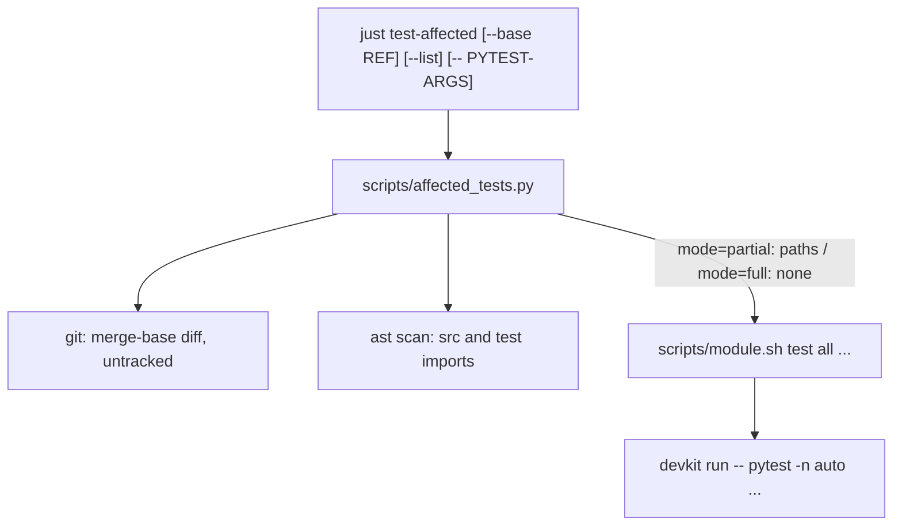

# Technical Plan: `SPEC-targeted-tests` Targeted and affected test runs

## 1. Constitution & Invariant Review

None. The change is repository tooling (`justfile`, `scripts/`), tests and guidance; no package module, schema or CLI
command of `devkit` changes. The new script follows the agent output contract of `CAP-ADV-agent-advisory-protocol`
the way `scripts/check_test_environment.py` already does: a stdout sentinel result, failures as an `AdvisoryError`
through `devkit.core.cli.boundary`. The `justfile` recipe stays thin and the logic lives in `scripts/` (AGENTS.md).

## 2. Architecture Overview & Impact

- **Impacted Components**:
  - `scripts/module.sh`: selector parsing for `test` and `test-cov` on a single module (AC-01 to AC-05).
  - `scripts/affected_tests.py` (new): change collection, static dependency scan, selection, output, and the hand-off
    to `scripts/module.sh test all` (AC-06 to AC-14).
  - `justfile`: `test`/`test-cov` comments name the selectors; new `test-affected *args` recipe.
  - `packages/devkit/tests/test_module_script.py`: selector cases; `packages/devkit/tests/test_affected_tests.py`
    (new): selection, change collection and command cases.
  - Guidance (AC-15): `AGENTS.md` verification table; devkit-spec bundle `skills/spec-review/SKILL.md` Step 3 and
    `skills/spec-plan/SKILL.md` §6 template line; the projected copies under `.claude/` and `.agents/` regenerated
    with `devkit sync`.
  - Living Spec and quick references: `docs/development/ci-cd.md` §2, `docs/development/setup.md`,
    `docs/development/workflow.md` §3, `README.md` development commands.
- **New Dependencies**: None (standard library `ast`, `subprocess`; `click` and `devkit.advisory` as the existing
  script uses them).

## 3. Component & Interface Design



### `just test <module> [selector...] [pytest-args...]`

For a single module (not `all`), leading arguments that do not start with `-` are selectors; the first argument that
starts with `-` and everything after it are pytest arguments. Each selector resolves in order:

1. A path: the selector with any `::` suffix removed exists as a file or directory; it is passed unchanged.
2. An area: the existing ones of `<module>/tests/<name>` and `<module>/src/*/<name>` (a directory).
3. Otherwise: `Unknown area for <module>: <name>` and `Available areas: <list>` on stderr, exit `2`, before the
   environment preflight runs any tool. The list is the directory names under `<module>/tests` except `__pycache__`.

With at least one selector the resolved paths replace the module's default `tests/` and `src/` paths. `all` keeps its
current behavior: pytest's own positional arguments already override the configured `testpaths`.

### `scripts/affected_tests.py`

```python
@dataclass(frozen=True)
class Selection:
    mode: Literal["full", "partial", "none"]
    paths: tuple[str, ...]  # repository-relative, sorted; empty unless partial
    reason: str             # full: the triggering path; partial: the changed nodes and data prefixes; none: "untested"

def changed_paths(root: Path, base: str) -> list[str]   # AC-11, AC-14
def select(root: Path, changed: Iterable[str]) -> Selection  # AC-06 to AC-10
```

**Change collection** (`changed_paths`): `git rev-parse --verify --quiet <base>^{commit}` (else `TEST_BASE_UNKNOWN`,
exit `2`), `git merge-base HEAD <base>`, then `git diff --name-only --no-renames <merge-base>` (committed, staged and
unstaged changes, both sides of a rename, deletions) and `git ls-files --others --exclude-standard`.

**Nodes**: each package directory `A` under `packages/devkit/src/devkit/` is node `devkit.A`; `devkit-spec`,
`devkit-starter` and `devkit-catalog` are nodes named after their import package. Production files (outside `tests`
directories) are scanned with `ast` for `import`/`from` statements; `devkit.A...` maps to `devkit.A`,
`devkit.cli`/`devkit.__main__` to `devkit.core`, `devkit_spec...` to `devkit_spec`, and so on. The affected nodes are
the changed nodes plus everything that imports them, transitively.

**Test groups** and their dependencies:

| Group | Paths | Depends on |
| --- | --- | --- |
| `devkit-agt` area `A` | those of `packages/devkit/tests/A`, `packages/devkit/src/devkit/A` that hold tests | `devkit.A` and the nodes its test files import |
| A top-level `packages/devkit/tests/test_*.py` | the file | the nodes it imports |
| Another package `P` | those of `packages/P/tests`, `packages/P/src` that hold tests | its own node and the nodes its test files import |

A group is selected when one of its dependencies is affected.

**Path mapping** (per changed path; a full trigger anywhere wins, and the data table adds to the other rules):

1. Full suite: `packages/devkit/src/devkit/core/`, `packages/devkit-advisory/`, `packages/devkit/src/devkit/cli.py`,
   `packages/devkit/src/devkit/__main__.py`, `uv.lock`, any `pyproject.toml` or `conftest.py`,
   `packages/devkit/tests/testsupport/` (AC-08).
2. Data table: path prefixes selecting fixed test paths, for dependencies imports do not show:

   | Prefix | Test paths |
   | --- | --- |
   | `docs/` | `packages/devkit/tests/test_documented_codes.py`, `packages/devkit-spec/tests/test_documented_codes.py`, `packages/devkit/tests/rules/test_docs.py`, `packages/devkit/tests/workflow/test_library.py` |
   | `examples/` | `packages/devkit-starter/tests`, `packages/devkit/tests/workflow/test_library.py` |
   | `models/` | `packages/devkit/tests/search` |
   | `scripts/module.sh`, `scripts/_lib.sh`, `justfile` | `packages/devkit/tests/test_module_script.py` |
   | `scripts/check_test_environment.py` | `packages/devkit/tests/test_test_environment.py` |
   | `scripts/fetch_model.py` | `packages/devkit/tests/search/test_packaging.py` |
   | `scripts/affected_tests.py` | `packages/devkit/tests/test_affected_tests.py` |

3. Source: `packages/devkit/src/devkit/<A>/...` changes node `devkit.A`; `packages/<P>/src/...` changes the node of
   `P`. Any change under `packages/devkit/src/` also selects the tests over the whole source tree
   (`SOURCE_TREE_TESTS`: `test_layering.py`, `test_documented_codes.py`, `test_cli_imports.py`, `test_cli_plugins.py`).
4. Tests: a changed `test_*.py` under a `tests` directory selects itself; any other file there (a support module, a
   fixture) selects its directory.
5. Untested: `specs/`, `guides/`, `.claude/`, `.agents/`, `.codex/`, `.devkit/`, `.github/`, `scripts/smoke.sh`,
   `scripts/smoke_integration.py`, `scripts/release.sh`, Markdown files at the repository root or a package root,
   `.gitignore`, `.python-version`.
6. Anything else matched by no rule above: full suite, with that path as the reason, so a new directory is never silently untested.

Selected paths that no longer exist (a deleted test file) are dropped; a path inside another selected directory is
dropped as covered. No selected path with no full trigger is `mode=none`.

**Output and execution** (AC-12, AC-13): the first stdout line is
`[TEST_SELECTION: mode=<mode> base=<ref> changed=<n> paths=<n> reason=<reason>]`. `--list` adds one
`[TEST_PATH: <path>]` per path and exits `0`. Otherwise `mode=none` exits `0`; `full` and `partial` flush stdout and
replace the process with `bash scripts/module.sh test all [paths...] [pytest-args...]`, so the environment preflight,
xdist options, `DEVKIT_RUN_MODE` and the exit code are those of `just test all`.

## 4. Error Handling & Edge Cases

- **Unknown base ref or no merge base**: `TEST_BASE_UNKNOWN` (`Actor.TOOL`, `Retry.AFTER_FIX`), `[FIX]` naming
  `just test-affected --base <existing-ref>`; nothing runs. A failing `git diff` or `git ls-files` is
  `TEST_CHANGES_UNREADABLE` (`Actor.USER`).
- **A source file that does not parse**: skipped by the scan (an `INFO` log record); the changed file still maps to its
  node, and the full suite before integration covers what the scan cannot see.
- **Detached HEAD or a base equal to HEAD**: the merge base is HEAD and only uncommitted and untracked changes count.

## 5. Verification & Test Plan

- **Unit** (`test_affected_tests.py`, loading the script with `importlib`): `select` against the real repository tree
  for AC-06, AC-07, AC-08 (each trigger), AC-09, AC-10 and the unknown-path fallback; `changed_paths` against a
  temporary Git repository for AC-11 and AC-14; the command through `CliRunner` with `changed_paths` and the process
  replacement patched for AC-12 and AC-13.
- **Scripts** (`test_module_script.py`, with the fake `uv`): AC-01 to AC-05 for `test`, one selector case for
  `test-cov`.
- **Manual**: `just test-affected --list` on this branch, and with `--base` against scratch changes in a gate, a
  worktree, a docs-only and a core file; `just test devkit gate`.
- **Checks during development**: targeted runs (`just test devkit <area>`, `just test-affected`), `just lint-check`,
  `just check`, `just rules-check`; the full `just test` once on the reviewed head.
