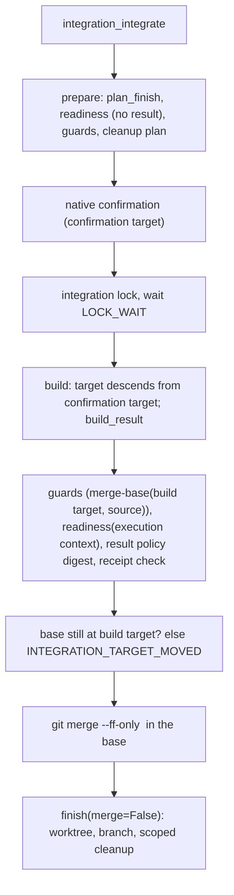

# Technical Plan: `SPEC-integration-follow-ups` Integration base advances: merge commits, effective policy digest and readiness on the result

## 1. Constitution & Invariant Review

None. The change follows the accepted `ADR-merge-commit-outside-checkout`, `ADR-effective-policy-digest` and
`ADR-target-advance-readiness`; `ADR-integration-approval-asserted` is unchanged (no new authority, native
confirmation only). Layering holds: `devkit.worktree` keeps importing only `devkit.core` and `devkit.advisory`;
`devkit.integration` reads the receipt through `devkit.core.parse_receipt`, never `devkit.distribution`; no change to
`devkit.host` (packages/devkit-dist).

## 2. Architecture Overview & Impact

- **Impacted Components**:
  - `packages/devkit/src/devkit/worktree/config.py`: the `[worktree] merge = "no-ff" | "ff-only"` key (default
    `"no-ff"`) and its template line.
  - `packages/devkit/src/devkit/worktree/merging.py` (new): the result-commit build shared by the CLI and the
    service (`build_result`, `check_identity`, `merge_method`, `fast_forward`, `integration_lock`).
  - `packages/devkit/src/devkit/worktree/errors.py`: `WORKTREE_MERGE_CONFLICT`, `WORKTREE_GIT_UNSUPPORTED`,
    `WORKTREE_COMMIT_FAILED`; SHA-preserving `WORKTREE_MERGE_NOT_FF` and `WORKTREE_PUSH_REJECTED` fixes.
  - `packages/devkit/src/devkit/worktree/lifecycle.py` `finish`: `merge_method`; an already merged branch builds
    nothing; otherwise it fast-forwards onto the built result (never `git merge` of the tip under `no-ff`).
  - `packages/devkit/src/devkit/worktree/planning.py`: `FinishPlan.merge_method` and `already_merged`;
    `validate_finish(..., result=, target=)` accepts a base containing the result after the merge.
  - `packages/devkit/src/devkit/worktree/cli.py`: `finish --merge` takes the integration lock (`timeout=0`) and reads
    the merge key; help and module docstring.
  - `packages/devkit/src/devkit/integration/`: execution context (`IntegrationContext.result_sha`), provider
    declarations on `Readiness` (`result_sha`, `target_bound`, `disclosure`), effective policy digest, the receipt
    consistency check (`receipts.py`), the build in `service.py`, new codes `INTEGRATION_TARGET_MOVED` and
    `INTEGRATION_RECEIPT_CONFLICT`, confirmation text, result fields, the approving call's lock wait.
  - `packages/devkit-spec/src/devkit_spec/integration.py`: target-bound codes, disclosure, `SPEC_POLICY`, CI rules on
    the result tree, the unit-directory advance reason.
  - `packages/devkit-spec/src/devkit_spec/cleanup.py`: `_is_post_git` tests "HEAD contains the result".
  - Bundle guidance of devkit-spec (`spec-integrate`, `spec/references/completion.md`, `spec/references/worktree.md`).
  - Living Spec: `CAP-INT-mcp-services`, `CAP-WT-task-worktrees`, `CAP-DLV-delivery-workflows`,
    `CAP-DLV-project-policy`, the integration and worktree references, the then-existing multi-host native integration milestone, the install
    guide's Git requirement.
- **New Dependencies**: None. Git 2.38 or later only for a build whose target advanced (`git merge-tree --write-tree`).

## 3. Component & Interface Design



### Data Contracts & Types

```python
# devkit.worktree
MERGE_METHODS = ("no-ff", "ff-only")
COMMIT_TIMEOUT = 30.0
def merge_method(base: Path, configured: str, source: str) -> str: ...      # ff-only in either policy wins
def check_identity(base: Path) -> None: ...                                 # WORKTREE_COMMIT_FAILED
def build_result(base, branch, target_branch, target, source, method, *, advance: bool) -> str: ...
def fast_forward(base: Path, result: str) -> None: ...                      # git merge --ff-only --quiet <result>
@dataclass(frozen=True)
class FinishPlan:  # adds
    merge_method: str = "no-ff"
    already_merged: bool = False
def validate_finish(plan, *, merged=False, removed=False, finalized=False,
                    result: str | None = None, target: str | None = None) -> None: ...

# devkit.integration
@dataclass(frozen=True)
class IntegrationContext:
    finish: FinishPlan; task: Task; network: str = "forbid"; result_sha: str | None = None
@dataclass(frozen=True)
class Readiness:
    source_sha: str; target_sha: str; evidence: tuple[Evidence, ...]; reasons: tuple[str, ...] = ()
    result_sha: str | None = None; target_bound: tuple[str, ...] = (); disclosure: str = ""
class IntegrationResult:  # adds build_target, result_sha (process-local, outside the digest)
LOCK_WAIT = 20.0  # approving call; integration_resume keeps timeout=0
```

- **Build** (`build_result`): `ff-only` returns the source when the target is its ancestor, else
  `WORKTREE_MERGE_NOT_FF`. `no-ff` uses `<source>^{tree}` when the target is an ancestor of the source; otherwise,
  only with `advance=True` (the service), probes Git 2.38 (`WORKTREE_GIT_UNSUPPORTED`) and runs
  `git merge-tree --write-tree <target> <source>` (exit 1 `WORKTREE_MERGE_CONFLICT`, other failures
  `WORKTREE_MERGE_FAILED`); then `git commit-tree <tree> -p <target> -p <source> -m "chore(merge): integrate <branch>
  into <target_branch>"` with a 30-second bound (`WORKTREE_COMMIT_FAILED`). `run_git` already sets
  `GIT_TERMINAL_PROMPT=0`; `commit-tree` honours `commit.gpgSign` and the identity configuration.
- **Effective policy**: `providers.effective(config)` normalizes `dev-integration`, `pull_request`, `delete_branch`,
  `merge` and `provider` with their defaults; the base digest is computed from the base checkout's file, the
  prospective and result digests from the commit's `.devkit/config.toml` blob.
- **Receipt check** (`receipts.check_merge(root, result, parents)`): parses the result's and both parents' receipts
  with `devkit.core.parse_receipt`; for each result record whose path is tracked in the result and whose
  `(recorded hash, blob id)` pair equals neither parent's, the blob must match the record; an unparsable merged
  receipt or a mismatch is `INTEGRATION_RECEIPT_CONFLICT`.
- **Readiness equality**: the build's readiness must equal the approved readiness on source SHA, evidence outside
  `target_bound`, `target_bound` and `disclosure`, and carry no reasons.
- **Cleanup-only request**: `plan_finish` returns `already_merged=True` when the source is an ancestor of the target;
  guards and readiness run with the source as merge base, the merge step is `skipped`, and the expected post-merge
  policy is the target's at `prepare`.

## 4. Storage & State Management

No persistent state. The latest build target and result commit live in the process-local `IntegrationResult`
(reported by `integration_status`), outside the request digest. The integration lock stays
`<common dir>/devkit-integration.lock`; the CLI `finish --merge` now takes it too.

## 5. Error Handling & Edge Cases

- **Conflict or failed build**: nothing changes on the target; the unreferenced objects are left to `git gc`.
- **Target moved between build and fast-forward**: `INTEGRATION_TARGET_MOVED`, merge step `not_run`, no retry.
- **Target reset or rewritten**: `INTEGRATION_REQUEST_STALE`.
- **Unknown merge outcome**: recovery by ancestry of the latest result; equality with the last build target means not
  merged; anything else is stale.
- **Lock held**: the approving call waits `LOCK_WAIT`, then reports `LOCK_HELD` with a `[FIX]` naming
  `integration_resume` (target still at the confirmation target) or a new `integration_integrate`.
- **Host timeout**: the request stays retained; `integration_status` shows the actual progress.

## 6. Verification & Test Plan

- `packages/devkit/tests/worktree/`: the merge key, `build_result` (no advance, advance, conflict, unsupported Git,
  commit failure, identity), CLI `finish --merge` merge commit, ff-only, rerun after merge, lock held, push-rejected
  fix fixture with `git pull --rebase=merges` or the fetch-and-merge fallback.
- `packages/devkit/tests/integration/`: merge commit integration, ff-only, advance absorbed, conflict, reset target,
  target moved, receipt-only advance, policy advance, receipt conflict, readiness declarations and evidence changes,
  confirmation text, cleanup-only request, lock wait and resume rules, recovery by ancestry.
- `packages/devkit-spec/tests/`: provider declarations, `SPEC_POLICY`, CI rules on the result, unit-directory reason;
  cleanup after a merge commit.
- `just lint`, `just check`, `just test-affected`, `devkit rules check` through the commit gate, `just smoke` (CLI
  wiring of `finish --merge` changes).
