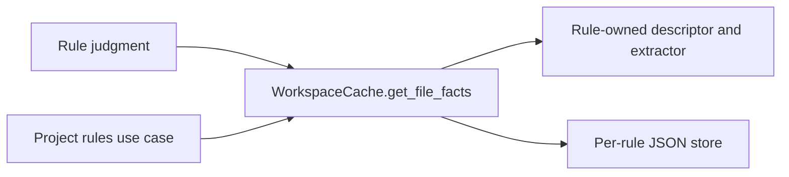

# Technical Plan: `SPEC-persistent-python-facts-cache`

## 1. Constitution & Invariant Review

The accepted `ADR-pull-per-file-python-facts` and `ADR-persist-python-facts-and-reuse-in-snapshots` define this change.
Shared ASTs stay unmodified; node ordering, snapshot policy and receipt verification retain their contracts.
Document memo behavior and public advisory/CLI APIs do not change. No additional ADR is required.

## 2. Architecture Overview & Impact

`WorkspaceCache` owns per-file facts identity and in-memory invalidation. A workspace facts repository owns validated
per-rule JSON loading and atomic flushing. A typed descriptor owns immutable extraction context, source provenance,
extractor and codec. Project rule orchestration enables writes only after successful working-tree evaluation.
The architecture, advisory unique-code and usecase-boundaries rules replace AST-consuming judgment with their own
immutable syntax records. Their existing discovery and cross-file resolution stay in place.

## 3. Component & Interface Design

The normative pull interface is `get_file_facts(path, descriptor, *, context_key=None) -> FactsT`.
A `FileFactsDescriptor[FactsT]` declares `rule_id`, `schema_version`, `source_dependencies`, `extract`, `encode`
and `decode`. Extraction receives a file-local reader exposing logical path, immutable context and shared AST/nodes.
`complete_file_facts(descriptor, paths)` marks a successful complete enumeration; a caught parse/read failure skips it.
`flush_file_facts()` writes only when explicitly enabled. Cache-disabled control stays a library/test keyword.

Each migrated rule declares only syntax needed by its judgment. Architecture records imports, aliases, attribute
chains, dynamic imports, entrypoint strings and facade assignments. Advisory records class/binding/code/call syntax
and nested import scopes. Usecase records retain expression kinds, declarations, argument annotations, ordered
assignments, decorators, scope boundaries and call arguments. Unknown syntax preserves unresolved behavior.
Codec validation reconstructs typed records and rejects malformed values without fabricating ASTs.

## 4. Storage & State Management

Stores live at `.devkit/transient/rules/facts/<rule-id>.json` beneath an existing safe transient directory.
Identity combines logical POSIX path, BLAKE2b of cached raw source bytes, canonical strict JSON context and a
source-derived fingerprint. Fingerprints cover declared extractor/helper/codec sources, cache/store framework and
Python implementation/full version, captured from actual executing modules. Missing provenance disables reuse.
One validated JSON object holds format version, fingerprint and path entries containing digest, context and payload.
Loading occurs once per descriptor; computed judgments are held separately. Invalidations drop in-memory facts and
pending writes for affected files. Partial runs preserve unseen entries. Only an enabled untargeted working-tree
flush with an explicit complete path set prunes. Equal serialized bytes cause no replacement. Concurrent writers use
atomic replacement without locks; lost updates only cause later misses.
Snapshots borrow their originating worktree's memo read-only, including in-place staged execution. Snapshot source
bytes and loaded rule provenance determine hits. No memo is written in either root during snapshot evaluation.

## 5. Error Handling & Edge Cases

Reject symlink/non-regular memo components, escaped paths, corrupt JSON and unsupported codecs. Log storage failures
without advisories. Invalid encodings and syntax retain existing rule behavior; extractor programming errors propagate.
BOM/coding cookies follow `WorkspaceCache.get_python_ast`. Settings and exclusions are evaluated anew. Source bytes
used for the digest are the same cached bytes extraction consumes. Dry-run fix bytes never reach disk memos.

## 6. Verification & Test Plan

Before production changes, collect at least five full fresh-process baseline samples on this branch.
Engine unit tests cover identity, corruption, safety, concurrency, invalidation, partial/full pruning and no-op writes
(AC-02, AC-04, AC-06). Co-located rule tests compare enabled/disabled full findings and assert no AST/node acquisition
on warm facts (AC-01, AC-03). Project/snapshot integration tests retain receipt and policy checks (AC-05).
A reproducible fresh-process benchmark compares disabled/cold/warm full, edited-file and snapshot checks with at least
five samples, medians, stage counters/timing and memo size (AC-07). A warm full-check saving below 20% requires design
revision before the hypothesis is claimed. Run `just lint-check`, `just check`, `just test-affected --base main` and
workspace governance checks. Independent code review and reconciliation review apply at medium effort.
