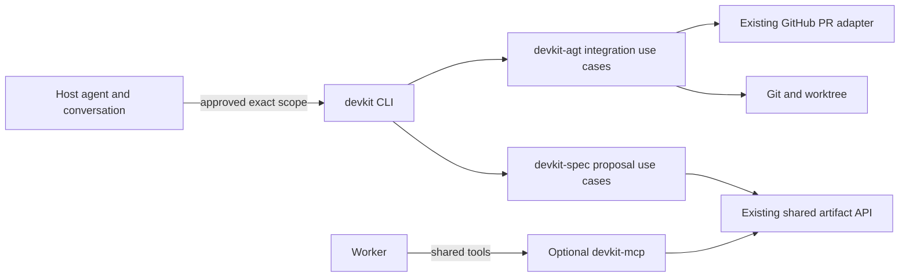

# Technical Plan: `SPEC-cli-host-lifecycle` CLI execution for Host lifecycle operations

## 1. Constitution & Invariant Review

- `ADR-host-cli-lifecycle-authority` selects conversational Host authorization under `ask`. The Host presents exact effects before execution. CLI code does not authenticate the user's answer or accept an approval credential.
- `ADR-delivery-decision-boundaries` remains authoritative for independent `plan-accept`, `proposal-handoff` and `dev-integration` gates and for policy-owned `auto` authority. Its native-only lifecycle execution clauses are superseded by `ADR-host-cli-lifecycle-authority`.
- `ADR-local-and-pull-request-integration` remains authoritative for merge construction, source and target validation, readiness, required PR policy and cleanup protections. Its retained request and native-confirmation execution path is replaced by the single-invocation CLI path.
- `CAP-MCP-runtime-registration` remains authoritative for runtime ownership and shared-resource registration. Lifecycle tools are removed from its registrations; the optional runtime and shared tools remain.
- `CAP-COLL-shared-artifacts` remains unchanged. Proposal report publication still uses its exact artifact URI and existing adapter.
- `devkit_core.base.mcp.Confirmation` remains because the retained shared and other MCP adapters use the transport contract. The feature removes lifecycle adapters, not the MCP runtime or generic contract.
- No package dependency or persisted-data schema changes are required. No migration is needed.

## 2. Architecture Overview & Impact

| Component | Change |
| --- | --- |
| `devkit-spec` proposal delivery | Refactor composed accept and handoff operations into typed use cases invoked by existing proposal CLI commands. Validate exact report, workflow, policy, base and worktree identity. |
| `devkit-agt` integration | Expose the integration CLI group. Run the existing integration engine without a `Confirmation` callback or cross-command request ID. Preserve local and PR checks. |
| `devkit-spec` and `devkit-agt` MCP adapters | Remove lifecycle registrations and the read-only report-template registration. Keep `spec_proposal_report` and shared artifact registration. |
| `devkit-mcp` | Keep the optional runtime. Verify that shared tools remain registered with their current access classes. |
| `devkit-spec` bundle and consumer guidance | Replace native-form lifecycle instructions with Host conversation plus CLI commands. Keep worker shared-resource MCP guidance. |
| Living Spec and ADRs | Update proposal, integration, runtime and worktree capabilities, both delivery use cases, affected architecture/reference/guide content and `ADR-host-cli-lifecycle-authority`. |

No component imports the MCP SDK into `devkit-agt` or `devkit-spec` use cases. `devkit-core` remains SDK-free and unchanged.

## 3. Component & Interface Design

### Proposal acceptance and handoff

Extend `devkit spec proposal accept <slug>` with `--report-uri`, `--mode accept_only|accept_and_handoff` and an explicit `--effort low|medium|high` for the combined mode. Keep `--by user` as the recorded conversational decision under `ask`; it is a record value, not an authenticated credential. For `auto`, derive authority from the retained base policy and reject caller claims that do not match it. Validate the report against the exact committed Planning source before recording acceptance or merging.

Extend `devkit spec proposal handoff <slug>` to accept the exact `--report-uri` and selected `--effort`, create or validate `dev-<slug>`, then run proposal handoff in that worktree. The command returns the spec bundle, worktree path, effort and actionable partial effects. Existing low-level handoff checks remain in the use case.

The acceptance operation preserves the independent `plan-accept` and `proposal-handoff` policy decisions. A `required` pull-request policy never uses local merge; use the existing supported PR path or refuse before mutation when the operation cannot satisfy it.

### Integration CLI

Expose `devkit integration prepare <branch>` for inspection. Add `devkit integration integrate <branch> --task-kind unit|session --task-id <id> [--unit <dir>] [--route local|pull-request] [--claims <json>]`. Give the domain use case an explicit typed `execute` method without `Confirmation`. The command invocation follows the Host's conversational decision under `ask`; the use case revalidates scope but does not authenticate that decision. Under `auto`, it reads and checks the retained base policy.

The local route performs no network operation. The pull-request route reports remote effects and validates required checks before landing. `auto` does not authorize the pull-request route. Both routes reuse the existing readiness provider, integration lock, pinned source and target checks, result validation, cleanup planning and stable `INTEGRATION_*`/`WORKTREE_*` advisories.

Do not expose `integration_status` or `integration_resume`. Their request IDs and approval records are meaningful only inside one MCP process. The operation reports completed effects and the failing step. After an unknown outcome, the Host uses `devkit worktree status`, Git or PR state. If local merge completed before cleanup failed, `devkit worktree finish <branch> --local-only` performs its existing already-merged checks and only the remaining guarded cleanup.

### MCP registrations and output

Remove `spec_plan_accept`, `spec_handoff`, `integration_prepare`, `integration_integrate`, `integration_status`, `integration_resume` and `spec_proposal_report_template` registrations after CLI coverage exists. Retain `spec_proposal_report`, `shared_put`, `shared_get`, `shared_list`, `shared_sweep` and `shared_sweep_apply` with current authorization and cloud restrictions.

All CLI output goes through `devkit_dist.adapters.cli`. Text mode emits result sentinel lines. JSON mode emits one object. Errors use stable codes and deterministic `[ACTION]` directives on stderr. Use cases and libraries do not print.

## 4. Storage & State Management

Add no approval, request or recovery storage. The operation may keep an in-memory record while one CLI invocation is running, but no identifier or authority survives that process. Shared proposal reports keep their existing immutable URI, source SHA and retention contract. Worktree and Git state remain the source for post-process recovery.

## 5. Error Handling & Edge Cases

- Reject a changed proposal source, report URI, base, policy, execution environment or worktree identity before mutation with existing or newly defined stable proposal error codes.
- Reject a changed integration source, target, effective policy, readiness result, receipt, provider, guard or cleanup identity with the corresponding stable integration code.
- Preserve `WORKTREE_PR_POLICY` for an attempted local merge under required PR policy. Preserve refusal of auto PR execution and undeclared remote effects.
- A partial result names completed effects and its failing operation. Never delete an unmerged source branch or infer completion from an unknown tool result.
- On a post-merge cleanup failure, verify that the base contains the merged source before calling the already-merged finish path. If the target or cleanup identity is ambiguous, stop mutation and direct the Host to inspect state.
- A PR waiting for required checks returns its actual PR state. Before a later attempt, the Host rechecks source, report, policy and displayed effects. Reuse conversational approval only while that scope remains identical; otherwise obtain a fresh decision.

## 6. Verification & Test Plan

- Proposal command and use-case checks: `just test devkit-spec tests/integration/features/proposals/ tests/integration/features/delivery/ tests/e2e/features/delivery/`.
- Integration checks: `just test devkit tests/integration/features/integration/ tests/e2e/features/integration/ tests/integration/features/worktree/test_cli.py`.
- Registration and retained shared transport checks: `just test devkit-mcp tests/integration/features/runtime/test_shared_transport.py` plus the affected `devkit` and `devkit-spec` MCP registration tests.
- Bundle guidance checks: affected `packages/devkit-spec/tests/integration/bundles/spec/` tests.
- Run `just lint-check devkit`, `just lint-check devkit-spec` and `just lint-check devkit-mcp`, then `just check devkit`, `just check devkit-spec` and `just check devkit-mcp` for changed Python packages.
- Run `just test-affected` from the final diff; preserve its `mode=full` fallback. Run `just smoke` for installed CLI and optional MCP wiring.
- Run `just rules-check`, then `uv run devkit rules check --ci --base <base-ref>` on the final committed head.
- No test result can be reused from Planning because implementation and registration change.
