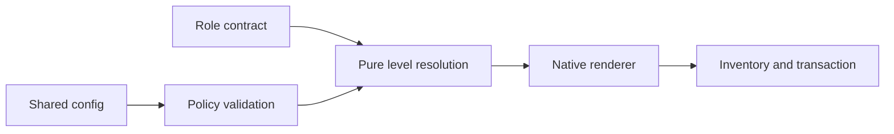

# Technical Plan: `SPEC-subagent-model-levels`

## 1. Constitution & Invariant Review

`ADR-subagent-level-projection` replaces only the fixed role effort/model-selection exclusion portions of
`ADR-orchestration-workers`. No layering, CLI output, ownership or receipt schema changes. Native variants stay
verbatim; neutral policy is distribution-owned and shared-only.

## 2. Architecture Overview & Impact

Add frozen distribution model values and a pure policy parser/resolver service. Extend ProjectConfig and
inventory inputs. Source validation accepts level and rejects mixed source mechanisms. Rendering receives an
optional resolved settings value, never reads project files. Sync supplies validated project policy and all
installed bundle identities; bundle plan remains project-independent. Configuration templates comment all fields.

## 3. Component & Interface Design

Use `SubagentPolicy(default_level, mappings, roles)` and `ModelSettings(model, effort)` frozen dataclasses.
`parse_subagents(value)` validates shape, levels, host values and merged known combinations.
`validate_role_overrides(policy, installed, selected)` validates discovered asset identities before writes.
`resolve_settings(policy, identity, source_level, host)` returns None for no neutral selection, or resolved
ModelSettings; empty settings represent explicit inherit. Project override selection intentionally replaces
native model/effort. Renderer rejects source-level conflicts during read_contract.

## 4. Storage & State Management

Only shared config stores policy. Existing receipt file hashes track final rendered projections. No new receipt
fields, schema bump or migration. Config.local.toml remains forbidden for this section.

## 5. Error Handling & Edge Cases

Reuse CONFIG_INVALID for strict project errors, BUNDLE_INVALID for source conflicts and
CONFIG_LOCAL_KEY_FORBIDDEN for local policy. Validate all mapping fields even when unused. Known exact Codex IDs
have deterministic effort constraints; arbitrary IDs and provider alias capabilities remain runtime-owned.

## 6. Verification & Test Plan

Resolver tests prove AC-02 through AC-05. Projection/sync integration tests prove AC-01 through AC-07, including
no-write preflight, dormant identities, templates, variant boundaries, resets and receipt hashes. Source role
checks prove inherited defaults. Run just lint-check dist/spec, just check dist/spec and just test-affected.
Record independent code review and reconcile verification at medium effort. Reuse passing results if content
is unchanged; no separate full suite beyond selector fallback.
