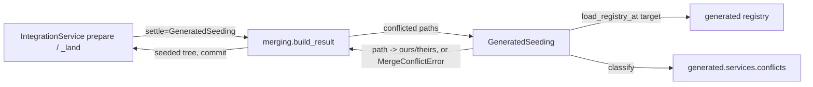

# Technical Plan: `SPEC-generated-conflicts-in-prepared-merge` Settle generated-file conflicts in prepared merges

## 1. Constitution & Invariant Review

- `ADR-moved-target-merge` decides "A conflict refuses at prepare with `WORKTREE_MERGE_CONFLICT` and nothing
  changed". A new ADR, `ADR-generated-conflicts-in-prepared-merge`, supersedes that clause only (`supersedes:
  [ADR-moved-target-merge]`, partial): a conflict confined to generated files whose artifacts read no other conflict
  is settled by the artifact's seed side and disclosed. The rest of `ADR-moved-target-merge` stays in force, and it
  gets a "Superseded in part by" line without a status change.
- `ARCH-05-2-components` layering: `devkit_agt.features.worktree` declares only `devkit_dist.features.project` as a
  feature dependency and must not read the generated registry. The worktree service therefore takes an injected
  conflict settler (a callable it defines in its models) and stays registry-agnostic. The integration feature
  composes the settler from the generated registry, which adds the feature dependency `integration -> generated`.
  `.devkit/architecture.toml` declares the feature graph (`feature_dependencies.integration`); the dependency has no
  cycle (`generated` depends on `compact` and `project` only), but the file is outside this unit's write scope, so the
  one-line declaration is raised to the Host (see section 5).
- `ARCH-08-1-agent-output`: the disclosure is a stable code (`INTEGRATION_GENERATED_SEEDED`, `WARNING`) with a
  deterministic `[FIX]`, a JSON field, and a sentinel field on the existing result lines; exit codes change only under
  `--strict`.
- `CAP-GEN-tracked-artifacts` §7 (whole files only) holds: only paths an artifact's `paths` own are seeded.

## 2. Architecture Overview & Impact

| Component | Change |
| --- | --- |
| `worktree/models/merging.py` (new) | `ConflictSettler` protocol: `(paths: tuple[str, ...]) -> Mapping[str, str]`, the side (`"ours"` = target, `"theirs"` = source) to keep per conflicted path; raises `MergeConflictError` when it cannot settle them. |
| `worktree/services/merging.py` | `_merge_tree` reads the conflicted entries from `git merge-tree --write-tree -z --no-messages`; with a settler it builds the seeded tree; `build_result(..., settle=None)` passes it through. Without a settler, behavior is unchanged. |
| `generated/repositories/registry.py` | `load_registry_at(root, commit)`: the built-in artifacts plus `.devkit/generated.toml` committed at `commit`. |
| `generated/services/conflicts.py` (new) | `classify(registry, paths) -> ConflictPlan`: the owned conflicts by artifact, the unowned ones and, per unowned conflict, the artifacts to regenerate that read or update it. `ResolveArtifacts` uses it instead of its inline loop (same behavior). |
| `integration/services/seeding.py` (new) | `GeneratedSeeding(root, target)`: the `ConflictSettler` of a local build; reads the registry at the build target, refuses through `MergeConflictError` with one detail per unsettleable conflict, records the seeded artifacts. |
| `integration/models/contracts.py` | `SeededArtifact` and `IntegrationResult.seeded`; `compact_dict()` and `to_dict()` add `generated` when something was seeded. |
| `integration/models/errors.py` | `GeneratedSeededWarning` (`INTEGRATION_GENERATED_SEEDED`). |
| `integration/usecases/service.py` | Local `prepare` (no acceptance lifecycle) and the integrate build pass a `GeneratedSeeding`; the result records `seeded` and the warning. Composed acceptance (`_prepare` with a lifecycle, `_compose_execute`) passes none. |
| `integration/cli.py` | `seeded=<ids>|-` on `[INTEGRATION_SCOPE: ...]` and `[INTEGRATION: ...]`; `prepare` text prints notices. |
| `spec-integrate`, `spec-orchestrate` skills | Present and act on the disclosure; the batch completion regenerates stale artifacts and commits before its test run. |

The pull-request route (`pull_request.py`) and `devkit worktree finish --merge` (`lifecycle.py`) pass no settler and
keep refusing every conflict: the platform builds the pull request's merge, and `finish --merge` never builds a merge
of a moved target.

## 3. Component & Interface Design



Normative interfaces:

```python
# devkit_agt.features.worktree.models.merging
class ConflictSettler(Protocol):
    def __call__(self, paths: tuple[str, ...], /) -> Mapping[str, str]: ...

# devkit_agt.features.worktree.services.merging
def build_result(base, *, branch, target_branch, target, source, method, advance=False, prospective=False,
                 settle: ConflictSettler | None = None) -> str: ...

# devkit_agt.features.generated
def load_registry_at(root: Path, commit: str) -> Registry: ...
def classify(registry: Registry, paths: Iterable[str]) -> ConflictPlan: ...

# devkit_agt.features.integration.models.contracts
@dataclass(frozen=True)
class SeededArtifact:
    id: str
    paths: tuple[str, ...]
    seed: str  # "ours" | "theirs"
    def kept(self) -> str: ...  # "target" | "source"
```

Reading the conflicted entries: with `-z`, `git merge-tree --write-tree --no-messages` writes the tree id and a NUL,
then one `<mode> <oid> <stage>\t<path>` record per NUL for every stage of every conflicted path; exit `1` means a
conflict. `devkit_core.core.git.run_git` drops standard output on a nonzero exit and `devkit-core` is outside this
change, so `merging` runs this one command through `subprocess` with `run_git`'s environment (`LC_ALL=C`,
`GIT_TERMINAL_PROMPT=0`, standard input closed) and its timeout.

Building the seeded tree: a temporary index (`run_git(..., index=<temp>)`) reads the merge-tree result tree
(`read-tree`), `update-index -z --index-info` sets each settled path to the seed stage's mode and blob or removes it
(mode `0`) when that stage is absent, and `write-tree` writes the tree. The temporary index lives in a temporary
directory removed afterwards; no ref, index or checkout of the repository changes. The tree depends only on the
target, the source, Git's merge configuration and the registry at the target, so prepare and integrate of one source
and target build one tree.

JSON disclosure (present only when a path was seeded):

```json
"generated": {
  "seeded": [{"id": "devkit-receipt", "paths": [".devkit/installation.json"], "seed": "ours", "kept": "target"}],
  "regenerate": "uv run devkit generated regen devkit-receipt"
}
```

`INTEGRATION_GENERATED_SEEDED` (`WARNING`, actor developer): message "kept <n> generated artifact(s) from one side of
the merge without regenerating them: <ids>"; one `[DETAIL]` per artifact `<id>: <paths> kept from the <target|source>
(seed = "<seed>")`; `[FIX]` "After the integration lands, run `uv run devkit generated regen <ids>` on the target
branch and commit the regenerated files".

## 4. Error Handling & Edge Cases

- A conflict no artifact owns: `WORKTREE_MERGE_CONFLICT`, message "the target's later commits conflict with the task
  branch in <n> file(s) no generated artifact settles; nothing was changed on the target", one `[DETAIL]` per path
  (`<path>: owned by no generated artifact` or `<path>: read by <ids>`), at most 20 listed. The fix (base merge,
  `devkit generated resolve` first) is unchanged.
- Two artifacts owning one path, or a malformed registry at the target: `GENERATED_CONFIG_INVALID` from the registry,
  nothing changed. A conflict-free merge never reads the registry.
- An owned path whose seed stage is absent (the seed side deleted it): removed from the result.
- `GeneratedSeeding` reads the registry once per build; the prospective build and the integrate build each get their
  own instance, so a failed build leaves no seeded disclosure behind (`_land` resets `seeded` before it builds).
- A repeated `integrate` invocation replaces the previous `INTEGRATION_GENERATED_SEEDED` notice with its own build's.

## 5. Problem raised to the Host

The integration feature must import `devkit_agt.features.generated`, and `RULE-architecture` refuses an undeclared
feature dependency. Declaring it is one line in `.devkit/architecture.toml`
(`feature_dependencies.integration = [..., "devkit_agt.features.generated", ...]`), outside this unit's write scope.
The implementation is complete and verified otherwise; the recovery is that one line.

## 6. Verification & Test Plan

- `packages/devkit/tests/integration/features/worktree/test_merging.py`: settler seeding `ours`/`theirs`, removal on
  a deleted seed side, a settler refusal and no settler keep `WORKTREE_MERGE_CONFLICT` with no ref change (AC-03,
  AC-08).
- `packages/devkit/tests/e2e/features/integration/test_base_advance.py`: a receipt-only conflict prepares, discloses
  and integrates with the prospective tree equal to the landed tree (AC-01, AC-02); a mixed owned and unowned
  conflict refuses with nothing changed (AC-04); a receipt conflict with a conflicted `AGENTS.md` refuses (AC-05); a
  seeded receipt that leaves a record inconsistent refuses with `INTEGRATION_RECEIPT_CONFLICT` (AC-06); a target
  that disables `devkit-receipt` refuses (AC-07).
- `packages/devkit/tests/unit/features/generated/`: `classify` and `load_registry_at`; the existing `resolve` tests
  cover the refactor.
- `packages/devkit/tests/.../integration` CLI tests: the `seeded=` field and printed notice (AC-01, AC-02).
- `packages/devkit-spec/tests/integration/bundles/spec/test_moved_target_guidance.py`: the batch completion and
  integration guidance (AC-09); `uv run devkit sync --check` after `devkit sync`.
- `just lint-check devkit`, `just check devkit`, `just test-affected` (with its `mode=full` fallback), `just
  rules-check`.
