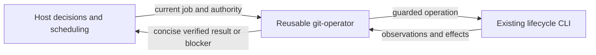

# Technical Plan: `SPEC-local-orch-resource-manager`

## 1. Constitution & Invariant Review

`ADR-reusable-lifecycle-resource-manager` supersedes only the Host-only execution and source-preset exceptions
it names in `ADR-host-cli-lifecycle-authority`, `ADR-orchestration-workers` and `ADR-five-subagent-levels`.
All business approval, readiness, publication, one-shot worker and sandbox constraints remain. `ARCH-05-2-components`
places bundle contracts and integration tests in devkit-spec; no lifecycle engine or distribution code changes.

## 2. Architecture Overview & Impact

Add a lean git-operator contract and operating reference to the spec bundle. Host orchestration/delegation and
integration references describe identity reuse, the per-job interface and decision ownership. Existing guarded CLI
operations remain the implementation boundary. No runtime dependency, scheduler, journal or model router is added.
Living Spec targets follow `PROP-local-orch-resource-manager-target`.

## 3. Component & Interface Design

Normative role message interface: job fields are operation, absolute repository/base/worktree paths, Unit/branch,
source/target refs, intended_effects, authority, prepared_digest when required, route/publication authority,
writers_quiesced, expected_checks and allowed_boundaries. Results carry status, identity, observed_refs,
completed_effects, remaining_effects, checks, blocker_codes and cli_result (status, exit_code, effects).
Memory grants neither Git truth nor authority. Conflicting jobs serialize within this conversation only.

## 4. Error Handling & Edge Cases

Refresh refs and resource state before mutation. Missing authority, drift, dirty resources and active writers
return needs_input with exact observed blockers. Execution failures return failed. Inspect partial or unknown
outcomes before a supported remainder; zero exit never implies all cleanup completed. Source preparation and
semantic conflicts return to the Host/implementer. A lost identity starts fresh without carrying effect authority.

## 6. Verification & Test Plan

- AC-01–AC-04: role/caller contract tests and selected-model sequential native continuation jobs; distinguish
  read-only execution and instructed replay from actual mutation fixtures.
- AC-05: bundle registration and all-host projection checks, preserving configured model overrides.
- Measure same-head matched job dispatch with role disabled versus enabled: Host instruction/output bytes and
  intervention counts are bounded proxies, not token/cost/latency or reliability claims.
- Run `just lint-check spec`, `just check spec`, `just test-affected --base main` with its full fallback,
  focused bundle tests, `uv run devkit sync --check` and `uv run devkit rules check --ci --base main`.
- Run `devkit sync` after source edits and commit every tracked output. Review and reconcile use separate nested
  read-only roles with before/after snapshots because Codex path enforcement is emulated.
