# Technical Plan: `SPEC-scope-activity-write-evidence`

## 1. Constitution & Invariant Review

None. `CAP-COLL-work-scope-registry` rules 1 (detection, never blocking) and 2 (unknown is not "no overlap") hold:
the horizon only labels evidence that is already listed and counted, and `inputs` only names reasons that already
count as gaps. `ADR-host-owned-scope-observation` keeps collection Host-owned and read-only; nothing here writes the
registry. `ARCH-05-2-components` holds: the change stays inside `devkit_spec.features.scope` (service and CLI
renderer), with no new package, layer or dependency. No accepted decision changes, so no ADR is needed.

## 2. Architecture Overview & Impact

| Component | Change |
| --- | --- |
| `features/scope/services/collection.py` (`Collector`) | Horizon per evidence side, pair `current`/`future`, summary `current_overlapping`; problem `inputs` and merged dedup; self-base guard replacing the tip-equality clear; detail text with inputs. |
| `features/scope/services/observation.py` | `planning(observation)` and `discard_base(...)` helpers beside `select_base`. |
| `features/scope/cli/collection_output.py` | `horizon=`, `current=`/`future=`, `current_overlapping=` in text. |
| `spec-orchestrate/SKILL.md.jinja` | Scheduling reads `current` overlap for parallel runs and `future` overlap for handoff and integration order. |
| `CAP-COLL-work-scope-registry` 4.5, 4.9 | Output, `inputs` and self-base contracts. |
| `CAP-HARN-agent-guidance` (Host scope observation), `UC-run-parallel-work-safely` | The same reading; a GOP-04 scenario. |

`compare`, `query` and `update` (`services/compare.py`, `usecases/query.py`, `usecases/flow.py`) are untouched
(Non-Goal 5).

## 3. Component & Interface Design

```mermaid
flowchart LR
  observe[Collector.observe] -->|provenance.unit, ref| planning[planning&#40;observation&#41;]
  observe -->|base ref| guard[discard_base]
  guard --> committed[committed&#40;&#41;]
  compare[Collector.compare] --> planning
  compare --> pair["pair: docs, code, unresolved, current, future"]
  pair --> summary["summary: overlapping, current_overlapping"]
  observe -->|scope.unresolved reasons| problem["problem(source, reason, inputs)"]
```



```python
# services/observation.py
def planning(observation: Observation) -> bool:
    """A Planning activity: a proposal unit on a plan-* ref or worktree (CAP-COLL-work-scope-registry 4.9)."""

def discard_base(root: Path, candidate: Candidate, base_ref: str, deadline: Deadline) -> bool:
    """Whether base_ref resolves (rev-parse --symbolic-full-name) to the candidate's own ref or a tracking peer."""

# services/collection.py
def horizon(observation: Observation, source: str) -> str:  # "current" | "future"
class Collector:
    def problem(self, source: str, reason: str, inputs: Iterable[str] = ()) -> None: ...
```

- Side horizon: `future` when `planning(observation)` and the side's `source` is not `observed`, else `current`.
  Entry horizon: `current` when both sides are `current`.
- Pair JSON: `{a, b, docs, code, unresolved, current, future}`; summary
  `{candidates, observations, pairs, overlapping, current_overlapping}`.
- Problem JSON: `{source_id, reason, inputs}`; `inputs` sorted distinct `Unresolved.reason` values of the source's
  scope. `problem()` deduplicates on `(source_id, reason)` and unions `inputs` into the retained entry.
- Detail: `f"{source_id}: {reason}"` plus `f" ({', '.join(inputs)})"` when `inputs` is non-empty.
- `observe()`: replace `if base_sha == candidate.sha or base_ref == candidate.ref: base_sha = ""` with
  `if base_ref and discard_base(...): base_sha = ""`. A base at the tip yields `merge-base` = tip, so `committed()`
  returns an empty range without `unknown-base`.

## 4. Error Handling & Edge Cases

- `rev-parse --symbolic-full-name` failing or printing nothing (a commit ID, an ambiguous name) keeps the base.
- `HEAD` resolves in `root` (the worktree for a worktree source, the collecting checkout for a ref source).
- A detached worktree has no branch: only an identical full ref could match, and there is none, so it is kept.
- Retention: pairs are charged by `retain()` after the new fields are added, so the report byte limit covers them.
- Observations without `provenance.unit` or `ref` (snapshots, identity-ambiguous dirty paths, synthetic test
  observations) are `current` through `dict.get`.

## 5. Verification & Test Plan

| Scenario | Test (`packages/devkit-spec/tests/integration/features/scope/test_collection_horizon.py`) |
| --- | --- |
| AC-01 | CLI text/JSON/`--strict` on two `plan-*` units with overlapping candidates and a planned target. |
| AC-02 | Pair counts, `horizon=future`, `current_overlapping` vs `overlapping`. |
| AC-03 | Planning/Development `future`, Development/Development `current`, Planning observed path `current`. |
| AC-04 | `dev-*` at base with only the proposal: `current` entry. |
| AC-05 | Detail text and `coverage.problems[].inputs` for `docs/` boundaries without `reconcile.md`. |
| AC-06 | `plan-*` at base: `committed` layer, no observed path, no `unknown-base`. |
| AC-07 | `--base <branch>`, `devkitBase=HEAD` and a tracking-peer base: `unknown-base`. |
| AC-08 | Review of the skill source and the three documents; `just rules-check`. |

Existing `test_collection.py` stays green (`test_ref_aliases_deduplicate_only_equivalent_base_ranges` exercises a
self-naming `devkitBase`). Checks: `just lint-check devkit-spec`, `just check devkit-spec`, `just test-affected`
(its `mode=full` fallback kept), `just rules-check`, `uv run devkit sync --check` after `devkit sync`.

Before/after: the synthetic probe in `.devkit/transient/probe/fixture.sh`, run with
`devkit spec scope collect -w <probe repo> --mode refs` on this head before and after the change (spec §6).
