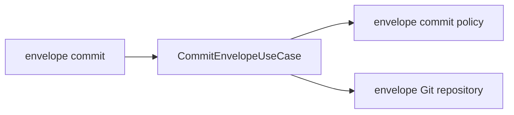

# Technical Plan: `SPEC-workflow-record-auto-commit`

## 1. Constitution & Invariant Review

`ARCH-05-2-components`, `CAP-GATE-commit-gates` and `CAP-DLV-workflow-envelopes` remain compatible. `ADR-explicit-envelope-commits` selects a separate opt-in command. No gate/worktree/integration engine or new dependency changes.

## 2. Architecture Overview & Impact

CLI delegates to typed CommitEnvelopeUseCase. Feature-owned repositories perform Git and filesystem I/O using foundation run_git. Services validate identity/eligibility and generate messages. Existing authoring stays unchanged. Spec source assets explain eligible call sites; sync deploys their tracked outputs.

## 3. Component & Interface Design

`execute(workspace: Workspace, unit: str, file: str) -> dict[str, Any]` returns unit, file, outcome, head, subject, notices. CLI accepts --unit and --file plus existing workspace/format options. The spec defines all four ENVELOPE_COMMIT error codes and text/JSON output. Repository validates identity, operations and dirty paths before staging the literal selected path. Normal commit uses an argument vector and hooks/signing.

## 4. Storage & State Management

Capture HEAD, selected bytes/blob and clean-except-selected state. Require tracked regular bound anchor and a new regular immediate envelope. Accept identical staged additions. Recheck preconditions before Git add; verify the index and HEAD again before commit. Postconditions require one parent equal to captured HEAD, exactly one added path/blob and clean worktree/index. Read final HEAD after hooks. Failures retain index/files/refs; unknown effects require inspection. Already committed exact content is a no-op. One active writer is required; no global locking service is introduced.

## 5. Error Handling & Edge Cases

Precondition errors wrap existing parsing failures with INVALID or STATE and exact targets. Git mutation failures report retained state and distinguish known no-commit failure from uncertain refs/content or process interruption. Never reset or auto-retry. Refuse alternate index, detached/unborn/in-progress/unmerged/locked Git, unsafe paths, skeletons, stale identity, ignored files, modified history and partial staging.

## 6. Verification & Test Plan

Real temporary Git integration tests cover AC-01 through AC-05: content/tree/parent/index, ordinary rejecting and metadata/content hooks, signing failure, retry/idempotence, unsupported states, authoring compatibility and readiness. Unit tests cover message identity and CLI rendering. Spec bundle integration checks cover both feature/bugfix guidance. Run just lint-check/check for devkit and devkit-spec, just test-affected (full fallback retained), rules checks and sync --check. Compare same-head authoring without explicit commit to explicit commit: record bytes/evidence remain equal; HEAD changes only on opt-in. No speed/cost claim or earlier checkout is needed.
