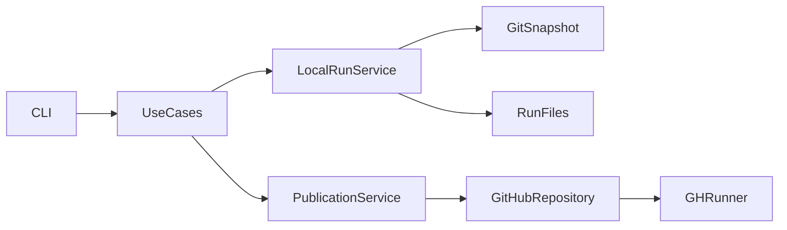

# Technical Plan: `SPEC-maintenance-history`

## 1. Constitution & Invariant Review

`ADR-history-branch-publication` and `ADR-inspected-state-identity` settle the accepted choices. No architecture invariant changes. `ARCH-05-2-components`, `ARCH-08-1-agent-output`, `CAP-CLI-agent-cli-toolkit` and `CAP-ADV-agent-advisory-protocol` govern layering and output. The history store does not use shared artifacts or integration policy.

## 2. Architecture Overview & Impact

A `maintenance_history` feature in devkit-agt has CLI, typed BaseUseCase operations, services, repositories and models. The CLI adapts arguments and renders returned results. Local capture uses an isolated Git index; GitHub access uses an injected gh runner. Feature edges to rules and project configuration support the secret check and defaults. Catalog changes remain content-only.

## 3. Component & Interface Design

The command table in `SPEC-maintenance-history` is normative. Requests are typed dataclasses; every exposed operation invokes a BaseUseCase execute method. Results carry dictionaries with stable fields and notices. The runner preserves response status/headers and distinguishes timeout before/at reference publication. No message-text branching.

## 4. Storage & State Management

Canonical JSON is sorted, compact UTF-8 with a final newline. A local run has record.json, an optional inspected.diff and retained report/file digests. Remote run records exclude local publication metadata. Updates fix their name and bytes before their first attempt. The immutable root uses fixed README, identity and timestamp; tests independently compute its Git SHA.

## 5. Error Handling & Edge Cases

Rate-limit mapping precedes status mapping on every request. Read and content-object uncertainty is pending/deferred; reference-update uncertainty alone is unknown. Before each retry, inspect immutable remote bytes and rebuild the index on the current head. Refuse unsafe relative publication paths, credential-bearing repository identities, invalid run IDs and malformed local records as input errors. Filesystem failure writes no finished record.

## 6. Verification & Test Plan

- Unit temporary-Git tests: AC-02, AC-03, AC-08 and canonical bytes/root constants.
- Injected Git Database integration model: AC-01, AC-04 through AC-08, including interleaved writers and unknown publication inspection.
- PATH-shim gh and Click boundary tests: AC-05, AC-09, bounded timeouts, output and command discovery.
- Catalog content tests and sync check: AC-09.
- A reproducible live exercise and sanitized evidence: AC-10; pending explicit Host destination/authority.
- `just lint-check devkit`, `just check devkit`, relevant catalog checks, `just test-affected --base c9f7c6d3a2674f95c345dc13bc89ab1874bcff23`, `uv run devkit rules check --ci --base main`, `uv run devkit sync --check`.

No performance/count comparison is claimed; this adds behavior rather than changing an existing measured outcome.
