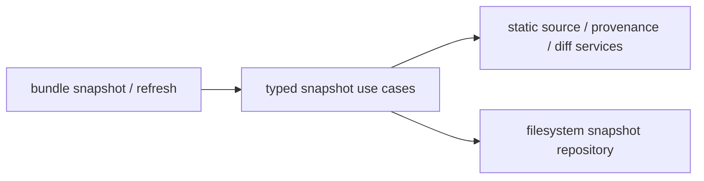

# Technical Plan: `SPEC-bundle-source-snapshots`

## 1. Constitution & Invariant Review

`ADR-bundle-source-snapshots` is accepted. No other invariant changes. Preserve the installed-package loader,
global duplicate detection, project overrides and dist independence. New feature edges are out of scope.

## 2. Architecture Overview & Impact

Keep all behavior under distribution: CLI adapters call typed BaseUseCase operations; snapshot services inspect
static metadata/resources, validate dependency support and construct package/provenance/diffs; a repository owns
filesystem reads, Git provenance inspection and staged replacement/rollback. No provider import/build runs.

## 3. Component & Interface Design

JSON-only commands add `--workspace-root` and stable status/code fields. Creation takes source/destination/package;
refresh takes destination/source/check/expect/candidate. Results include package, bundle versions, current/candidate
digests, deterministic file changes, metadata-change flag, removed selected bundles and actionable command strings.

Use `models/snapshots.py` for typed values/errors, `usecases/snapshots.py`, `services/snapshots/` for pure policy,
and `repositories/snapshots.py` for bounded reads, source Git identity and transaction writes. Existing bundle
manifest validation/source enumeration checks declarations and variants. Whole bundle resource trees preserve
support files; resource-module parent initializers must be inert. Wrapper uses distinct modules and Hatchling.

## 4. Storage & State Management

Schema-1 snapshot.json stores source distribution/version, bundle/module versions, wrapper name, optional verified
commit, source metadata and ordered payload path/hash/mode entries. Aggregate hashes canonical provenance without
its digest; payload excludes snapshot.json. No timestamps or paths/remote URLs. Compare byte/mode inventory and
refuse authored drift; derived bytecode is excluded. Stage next to destination, validate all staged bundles, then
replace via backup/rename with rollback on reported failure. An advisory consumer-directory lock serializes snapshot commands without creating a lock file or project state.

## 5. Error Handling & Edge Cases

Unsupported metadata/dependencies/imports or nonstandard mapping refuses before writes. Invalid provenance and
protected/overlapping/nonregular paths refuse. Both expected digests guard preview-to-apply changes. Staging or
write errors restore the previous directory; report a recovery path if rollback itself cannot complete. CLI/library
errors use AdvisoryError subclasses and deterministic fix instructions. No silent dependency install or sync.

## 6. Verification & Test Plan

Real filesystem integration tests cover complete source/mode copying, nonrecursive hashes, preview/apply guards,
bytecode idempotence, source and local drift, additions/removals, unsupported imports/declarative handlers and
rollback. CLI tests verify parsing/single JSON/advisory codes. Built wrapper consumers cover editable discovery,
entry-point metadata reinstall, duplicate rejection, private-origin-free bootstrap, overrides and a supported rule.
Run focused tests, `just test-dist`, dist lint/types, branch rules and `just test-affected --base
a3367f0d94a8ecb9762bbf35b5d0d3f89a621fe0` with full fallback. Independent medium code review and separate
reconcile review verify AC meaning and target agreement. No benchmark or live private source is needed.
