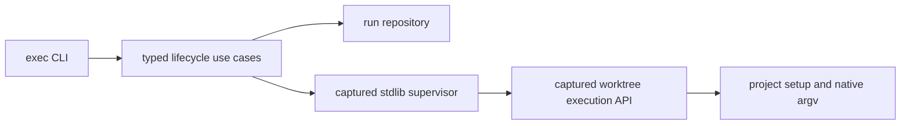

# Technical Plan: Isolated Command Execution

## 1. Constitution & Invariant Review

No invariant changes. Follow `ARCH-05-2-components`, `ARCH-08-1-agent-output`, `CAP-ADV-agent-advisory-protocol` and `ADR-post-merge-verification`. Promote the carried execution ADR without changing its decision. `SPEC-async-e2e-verification` retains all fifteen approved criteria.

## 2. Architecture Overview & Impact

`isolated_execution` owns the `exec` adapter, typed BaseUseCase operations, persistent run repository and detached supervisor. Its only new feature edges are worktree execution preparation/removal and project discovery. Worktree owns a detached checkout API with no Unit, branch, merge or post-finish hook. Compact remains unchanged.

## 3. Component & Interface Design

Normative CLI: `exec start --ref SHA [--setup SHELL] -- ARGV`; `exec list`; `exec status ID`; `exec logs ID [--tail N]`; `exec wait ID [--clean] [--timeout SECONDS]`; `exec cancel ID`; `exec clean ID`. Every operation supports `--format text|json`. JSON is one object containing run identity, fixed ref, phase/outcome, exit_code, checkout, evidence paths and process identities; wait additionally names observer and cleanup outcomes. Text uses EXECUTION_* sentinels. Start exit 0 is pending. Status pending/pass is 0, negative execution 1, unknown 2. Wait unknown/timeout/cleanup refusal is 2; negative execution is 1; success plus successful requested cleanup is 0. Native exit codes are payload fields.

Use standard-library files copied into the run directory before launch, executed with a stable interpreter outside the project environment. Scrub project interpreter overrides and Python import variables. Command PATH prefers the checkout environment. Reuse configured setup; run locked managed sync only when applicable, requiring a checkout-local interpreter. No setup failure may reach native execution.

## 4. Storage & State Management

Common Git directory `devkit/executions/<run-id>` owns atomically replaced manifest/result JSON, append-only logs, captured runtime and a private TMPDIR. Unique sibling detached checkout ownership binds run ID, repository, path and fixed SHA. A per-run flock serializes cleanup. Default retention keeps checkout and native artifacts. Cleanup removes only an inactive registered fixed checkout whose tracked and untracked nonignored content is clean; evidence remains. Unknown and interrupted ownership never authorizes removal.

## 5. Error Handling & Edge Cases

Supervisor starts a detached session with independent stdin/log descriptors. Record supervisor and managed process start identities; discover descendants and their process groups including compact wrappers. Cancel communicates through a durable request; supervisor terminates positively identified managed processes, escalates within bounded grace and confirms shutdown. Lost supervisor/identity mismatch is unknown and signals nobody. Wait interruption/timeout affects only the observer. Concurrent cleanup uses a lock and revalidates identity; failure never replaces command result. Deliberate escape from managed process ancestry requires project cooperation. macOS/Linux only; host kill/reboot survival is not promised.

## 6. Verification & Test Plan

Selector unit/CLI regressions cover all tiers and conservative full fallback (AC-01). Focused real subprocess lifecycle tests cover fixed SHA, latch ordering, setup failure, persisted evidence, unknown/reused identities, nested cancellation, surviving children, wait interruption/timeout and guarded concurrent cleanup (AC-03/04/07/08/09/11/12/13/14). Source-guidance tests and walkthroughs cover accumulated intervals, repair priority, final checked SHA and tool notification limits (AC-02/05/06/10/15). Compare synchronous and asynchronous blocking on the same revision/native fixture with warmup and three repetitions; record preparation, command, blocked time and resource limits, without suite speedup claims. Run `just init`, `just lint-check`, `just check`, `just test-affected --base ede62bde` and focused selector/lifecycle E2E. Required final landed verification stays with the Host. High effort uses fresh code-reviewer and reconcile-reviewer rounds.
