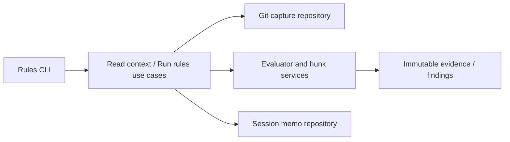

# Technical Plan: `SPEC-linter-change-notices`

## 1. Constitution & Invariant Review

`ADR-change-scoped-rule-notices` authorizes the additive contract. Existing package/layer ownership and exact-snapshot isolation remain. No feature dependency or architecture declaration changes. Models hold immutable values; repositories perform Git/memo IO; services calculate hunks/evaluation; use cases coordinate; CLI renders.

## 2. Architecture Overview & Impact

- Rules contracts add NOTICE and immutable ChangeEvidence/ChangeSpan values; RuleContext exposes change evidence and before text.
- A rules workspace repository captures exact HEAD/index/CI source bytes. A service derives old/new half-open ranges and validates reported construct overlap. Evidence is immutable per pass and recaptured after fixes against the original before source.
- Evaluator/policy exclude change-scoped rules from hygiene and reject invalid combinations; normal rules retain their behavior. Gate adapts NOTICE findings to GATE_RULES_NOTICES.
- ReadRuleContextUseCase returns FILE change/hunk evidence and only change-scoped NOTICE findings, then optionally applies bounded transient dedupe. It implements BaseUseCase.

## 3. Component & Interface Design

Normative public interface additions: Severity.NOTICE, BaseRule.change_scope=False, RuleContext.changes and before_text; Violation.change_span identifies before/after construct plus source identity. `rules context FILE [--session TOKEN] [--format text|json]` uses existing workspace/rules directory/output options. Existing finding fields remain stable with additive evidence fields only when provided.

## 4. Storage & State Management

Transient .devkit/transient/rules/read-notices stores hashed session keys and finding fingerprints only. The existing project lock serializes atomic read/update. Limits are 24h from session creation and 2048 delivered fingerprints; failure/expiry returns unsuppressed findings plus NOTICE advisory. No source or raw token is retained.

## 5. Error Handling & Edge Cases

Working evidence failures omit affected change-scoped evaluations with RULE_CHANGE_EVIDENCE_UNAVAILABLE; snapshots preserve RULES_SNAPSHOT_FAILED. Validate path and UTF-8/NUL content. Deletions retain before ranges; renames become delete/add; mode-only changes have no textual trigger. A read companion returns bounded excerpts even when no rule matches. Capture mismatch prevents matching fresh bytes to old ranges.

## 6. Verification & Test Plan

AC-01/02/05/09/10: immutable model unit tests plus real Git integration for working, staged, CI, deletion, partial/alternate staging, race and autofix refresh. AC-03/04/06/08: policy/evaluator/CLI/gate/workflow compatibility tests. AC-07: explicit context integration with excerpt boundaries, token expiry/cap/corruption/lock/concurrency and unchanged/no-match files.

Run focused new tests, just lint-check, just check, just test-affected --base fe54e1f8603e437869917792313ee899e138f1bb --tier all (full fallback retained), CI rules, sync and envelope checks. No performance or model-obedience claim; live host use is best effort.
