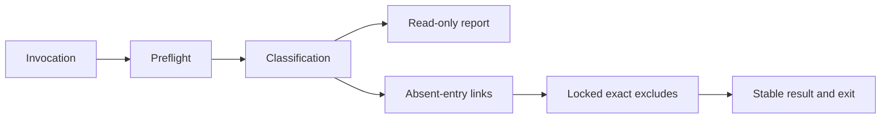

# Technical Plan: `SPEC-uiux-improve-impeccable-context-links`

## 1. Constitution & Invariant Review

`ADR-impeccable-context-links` extends only requested setup; `CAP-DLV-uiux-improvement` keeps consumer content,
task route and Git authority. `ARCH-05-2-components` permits content inside the existing skill. No Python feature,
asset kind, dependency edge or package is added. Root/source quiescence is the approved concurrency boundary.

## 2. Architecture Overview & Impact

The skill-local POSIX shell helper performs Git-root/source preflight, root entry classification and exact exclude
updates. Its subprocess integration tests exercise real filesystem/Git boundaries. Existing projection tests prove
byte preservation. Guide/reference and Living Spec reflect the same setup authority and manual recovery contract.

## 3. Component & Interface Design

Normative invocation: `sh <skill>/scripts/link-impeccable-context.sh [--check] [--] [<source-dir>]`.
Default source is `docs/materials/impeccable`; arguments resolve from the physical worktree root. Use POSIX test/ls
for literal link inspection, preserving output bytes through a sentinel. Only fixed root entry names appear in
stdout. Exit 0 is clean, 1 unresolved states, 2 invalid input/inspection/I/O. The spec owns the complete code table.

## 4. Storage & State Management

Only absent root links and missing exact Git exclude lines are written in link mode. Excludes use Git path
resolution and an adjacent exclusively-created lock, released only by its creator. Existing bytes and an unterminated
last line are preserved. Check mode writes no lock or temporary file. Failures retain reported partial effects.

## 5. Error Handling & Edge Cases

Preflight rejects metadata/out-of-root/control-character sources, symlinked source entries and wrong types.
Occupied-at-start root entries are preserved. Tracked root entries remain tracked. Newline target bytes remain
significant. Unsupported concurrent writers cannot be serialized by portable ln; setup requires quiescence.
Read-only comparisons disable external diff/textconv and distinguish diagnostics from unequal content.

## 6. Verification & Test Plan

AC-01 through AC-06: helper subprocess matrix under sh/dash, macOS utilities and GNU ls when available; report
BusyBox availability separately. AC-07: existing bundle projection tests, including exact script bytes.
AC-08: bounded authority/guide assertions and Living Spec agreement. Run shell syntax, focused tests, then
`just lint-check`, `just check`, `just test-affected --base 4131e8950bec81152a9d4eb62a200ef64d4995fa --tier all`,
`just rules-check --ci --base 4131e8950bec81152a9d4eb62a200ef64d4995fa`, and workflow/envelope checks.
Mandatory medium code review and independent reconciliation review use the committed source and read-only snapshots.
