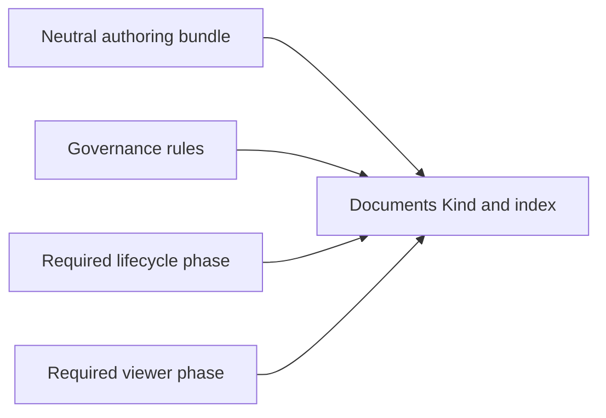

# Technical Plan: `SPEC-formal-document-kinds`

## 1. Constitution & Invariant Review

`ADR-formal-role-document-identities` settles the changed identity standing. Existing behavioral and recovery
owners stay authoritative; `ARCH-05-2-components` keeps documents below spec and governance dependent on documents.
No package, feature edge or test tier is introduced. Codex delegation is emulated: explicit absolute worktree paths,
scoped commits and Host range inspection substitute for native write isolation.

## 2. Architecture Overview & Impact

Documents owns appended Kind definitions, typed relations, parsing/index/query reuse and additive public values.
Governance owns flat identity grammar, narrow artifact classification, strict role format and DESIGN path anchors.
The docs bundle owns neutral templates/instructions; current Living Spec and five canonical role nodes migrate together.
The immutable core-contract F1–F6 and target blueprint supply the detailed handling matrix for AC-01–AC-07.

## 3. Component & Interface Design

Kind.DESIGN/design/DESIGN/designs; Kind.DOMAIN/domain/DOMAIN/domain; Kind.OPERATIONS/operations/OPS/operations.
All are unscoped Living Spec kinds checked in every root with summaries and retired terminal status. Only DESIGN
accepts optional entrypoints. Add related_designs, related_domains and related_operations as typed list relations
available on every indexed kind. Existing JSON shapes, codes, actions and commands remain unchanged.

## 4. Storage & State Management

Canonical nodes are flat PREFIX-slug.md files under each role directory in any docs root. Independent detail uses
its own ID. Parent-owned artifacts live only under PARENT-ID/artifacts; Markdown support names its parent and has
no identity. Rename/move/split/reclassification repair ownership paths and ordinary links. Same-kind aliases retain
identity; retired nodes remain resolvable and rule-checked. Existing memo/fingerprint machinery stores new kinds.

## 5. Error Handling & Edge Cases

Use existing rule IDs and deterministic remediation for malformed metadata, statuses, identity, typed references,
orphan/identified artifacts and invalid entrypoints. Unknown statuses are never guessed by fix. Existing parser
permissiveness remains; canonical governance is stricter. Preserve global identity across namespace selection and
history defaults. No universal CAP/UC reciprocity or source-entrypoint semantics is introduced.

## 6. Verification & Test Plan

Run focused documents/governance and bundle tests with real nodes for all new kinds, plus maintenance fixtures.
Run just init, just lint-check docs, just check docs, just test-affected --base 06eb94270608ee5a847ff988b48b6e75a521a2cf
--tier unit-integration preserving full fallback, and the docs installed-consumer E2E. Run sync --check, rules check
--ci --base main, generated checks as relevant and workflow envelope checks. HIGH independent code and reconcile
review rounds follow the repository review loop. Record F1–F6 evidence and baseline/head identity counts.
